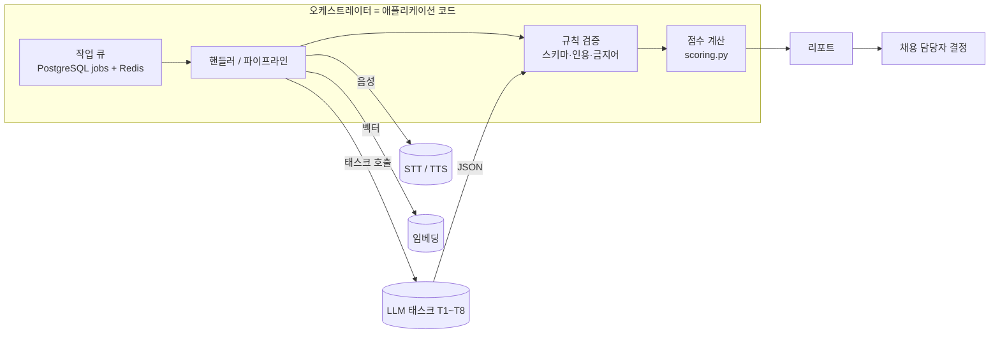
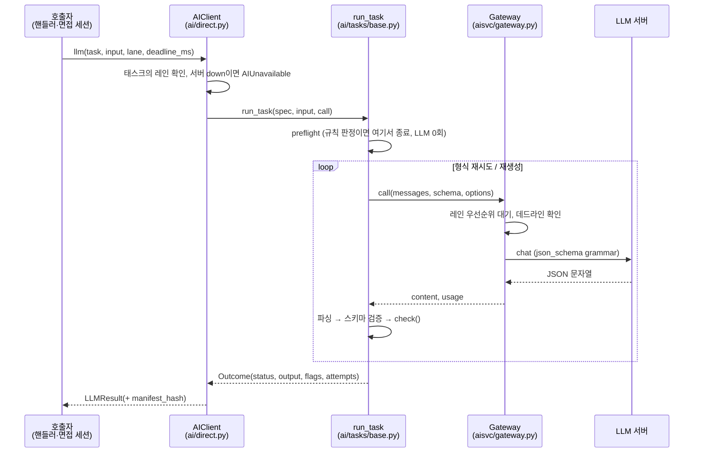
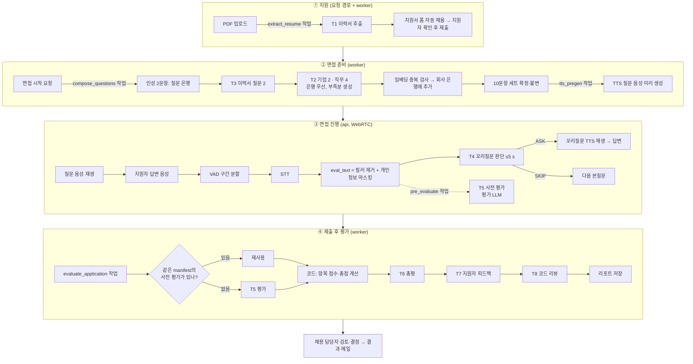

# AI 아키텍처 — LLM 오케스트레이션 구조

> 기준: 2026-10-30 현재 `ai-hiring-platform` 브랜치의 구현 (ADR-0003, 0005, 0006, 0008, 0013, 0014 / TRD 05).
> 특정 모델과 버전은 이 문서의 범위가 아니다. 각 모델은 **역할**로만 부른다. 모델을 바꿔도 아래 구조는 그대로 유지된다.

---

## 1. 한 줄 요약

**LLM끼리 서로 호출하거나 대화하지 않는다.** 오케스트레이터는 애플리케이션 코드(작업 큐와 파이프라인)다.
각 LLM 호출은 입력 하나에 대해 JSON 하나를 내는 **단일 목적 태스크**(T1~T8)다.
코드가 태스크를 순서대로 부르고, 출력을 규칙으로 검증하고, 다음 단계의 입력을 직접 만든다.
점수 계산과 합불 판단에는 LLM을 쓰지 않는다.

---

## 2. 설계 원칙

| # | 원칙 | 구현 위치 |
|---|---|---|
| P1 | LLM은 **판단과 문장 생성만** 한다. 점수 합산, 가중치 적용, 반올림은 코드가 한다. | `evaluation/scoring.py` |
| P2 | LLM 출력은 **JSON 스키마로 강제**한다(디코딩 단계 grammar). 그 뒤 Pydantic으로 다시 검증한다. | `ai/tasks/base.py` `ollama_schema`, `run_task` |
| P3 | LLM이 "인용"이라고 낸 문자열은 믿지 않는다. **원문에서 위치(start, end)를 찾은 경우에만** 원문 조각으로 저장한다. | `evaluation/quotes.py` (ADR-0008) |
| P4 | 규칙으로 판정할 수 있는 경우(무응답, 너무 짧은 답, 꼬리질문 한도)에는 **LLM을 부르지 않는다**(preflight). | 각 TaskSpec `preflight` |
| P5 | 태스크마다 **보는 데이터가 다르다**. 평가에는 이름·연락처·이력서를 넣지 않는다. 지원자용 피드백에는 점수·인용·가중치를 넣지 않는다. | `pipeline.unit_input`, `_feedback` |
| P6 | 실시간 경로와 배치 경로는 **서로 다른 LLM 서버**에서 돌아서 서로 기다리지 않는다. | `ai/direct.py` `LANE_SERVER` (ADR-0014) |
| P7 | 결과에 영향을 주는 것(모델 digest, 프롬프트, 옵션, 루브릭, 규칙 버전)은 모두 **manifest 해시**로 묶어 남긴다. | `ai/manifest.py` |
| P8 | LLM 호출은 수십 초에서 수 분 걸린다. 그동안 **DB 트랜잭션을 열어 두지 않는다**(읽기 → 모델 호출 → 쓰기). | `jobs/handlers.py`, `interview/turns.py` |
| P9 | 최종 결정은 사람이 한다. 모든 시스템 프롬프트에 "합격·불합격을 판단하거나 추천하지 않는다"가 붙는다. 출력에서도 P-8 탐지기로 한 번 더 걸러 낸다. | `TaskSpec.system_prompt`, `textrules.has_p8` |

---

## 3. 구성 요소 (역할 기준)

| 역할 | 하는 일 | 처리 장치 | 컨테이너 |
|---|---|---|---|
| **실시간 LLM** | RT 레인(면접 중 꼬리질문 판단), INTERACTIVE 레인(질문 구성, 이력서 추출). 동시 슬롯 2개 | GPU | `llm-rt` |
| **평가 LLM** | BATCH 레인(답변 평가, 리포트 총평, 지원자 피드백, 코드 리뷰). 동시 슬롯 1개 | CPU | `llm-eval` |
| **STT** | 지원자 음성을 텍스트로 변환 | GPU | `stt` |
| **TTS** | 질문 텍스트를 음성으로 변환(48 kHz PCM) | CPU | `tts` |
| **임베딩** | 생성 질문의 중복 검사(코사인 유사도 0.85 이상이면 중복) | CPU | `embed` |
| **오케스트레이터** | 위 서버를 부르는 쪽. 요청 경로는 `api`, 비동기 작업은 `worker` | — | `api`, `worker`, `scheduler` |

- 두 LLM 서버에는 **같은 모델을 올려도, 다른 모델을 올려도** 된다. 코드는 서버 URL과 레인만 안다.
- 런타임은 OpenAI 호환 llama.cpp 서버를 쓴다(`aisvc/llamacpp.py`). 다만 호출부는 `chat(messages, schema, options)` 하나로 추상화되어 있어서 다른 런타임으로 바꿀 수 있다(`aisvc/ollama.py`도 같은 형태다).
- `AIHIRE_AI_MODE`
  - `direct`: 분리된 컨테이너를 직접 호출한다(현재 배포 방식).
  - `service`: 단일 `ai` 프로세스를 거친다(로컬 개발용).
  - `fake`: 모델 없이 동작한다(구성 점검용, 운영에서는 거부).

---

## 4. 호출 계층

| 계층 | 책임 |
|---|---|
| **AIClient** | 레인을 서버로 라우팅한다(`RT/INTERACTIVE → 실시간 LLM`, `BATCH → 평가 LLM`). 레인별 기본 데드라인(RT 5 s, INTERACTIVE 120 s, BATCH 600 s)을 정하고, 인프라 장애를 `AIUnavailable`로 바꾸고, manifest 해시를 붙인다. |
| **run_task** | 태스크 하나의 생명주기를 맡는다. preflight, 입력 분할과 병합(`split`/`merge`), 형식 재시도, 종류별 재생성, 최종 fallback을 처리한다. |
| **TaskSpec** | 태스크가 소유한 것들이다. 시스템 프롬프트, 출력 스키마(Pydantic), 온도·토큰 수, 재시도 한도, 검증기(`check`). |
| **Gateway** | LLM 서버 하나 앞에 있는 레인 스케줄러다. 우선순위 `RT > INTERACTIVE > BATCH`, 절대 데드라인, 실행 시간 EWMA 추정, 장애 표시(15 s 동안 즉시 실패)를 처리한다. 같은 서버에서 상위 레인 요청이 오면 하위 레인 스트림을 끊고 그 요청을 자기 레인 맨 앞으로 되돌린다(선점). |

---

## 5. 태스크 카탈로그

| ID | 태스크 | 레인 | 입력 | 출력 | 검증·fallback |
|---|---|---|---|---|---|
| T1 | `resume_extract` | INTERACTIVE | PDF 추출 텍스트(6000자 단위로 나눠 호출한 뒤 병합) | 이력서 스키마(학력, 경력, 프로젝트 등) | 원문에 없는 값은 버린다(`dropped_values`). 실패하면 지원자가 직접 입력한다. |
| T2 | `question_generate` | INTERACTIVE | 공고, 회사 소개, 유형(COMPANY/JOB), 개수 | 질문과 `basis_quote` | 근거 인용 확인, 질문 형태, 금지 질문, 중복을 검사한다. 재생성 1회까지. 부족한 수는 질문 은행으로 채운다. |
| T3 | `resume_question` | INTERACTIVE | 이력서 스냅샷, 직무 요약 | 질문과 이력서 근거 문장 | 근거를 찾지 못한 슬롯은 직무 은행 질문으로 채운다(`BANK_FALLBACK`). |
| T4 | `followup_decide` | **RT** | 본질문, 답변(`eval_text`), 이력서 근거 | `ASK`/`SKIP`, 사유, anchor 인용, 꼬리질문 | 재시도하지 않는다(5 s 예산). anchor가 원문에 없거나, 새 주제이거나, 금지어가 있으면 INVALID로 SKIP한다. |
| T5 | `evaluate_answer` | BATCH | 질문, 직무 요약, 답변(이름·연락처 마스킹) | 4개 항목별 quote, comment, 1~5점 | 인용 불일치나 근거 없는 고득점이면 1회 재생성 후 `INSUFFICIENT`(1점) 처리한다. P-8 표현이 있으면 1회 재생성 후 해당 문장을 삭제한다. |
| T6 | `report_summary` | BATCH | 문항별 항목 점수, 코멘트, 근거 부족 여부 | 총평, 강점·개선점(문항 번호 포함) | 점수 숫자 재기재와 합불 표현이 있으면 재생성한다. |
| T7 | `candidate_feedback` | BATCH | 항목별 등급(상·중·하)과 코멘트 요지만 | 지원자에게 보여 줄 피드백 | 총점·순위·합불 단어를 금지한다. 답변을 15자 이상 연속으로 그대로 옮기는 것도 금지한다(인용 유출 방지). |
| T8 | `code_review` | BATCH | 문제 설명, 공개 예제, 제출 코드 | 코드 리뷰 문장 | 숨김 테스트는 프롬프트에 넣지 않는다. 실패하면 빈칸으로 둔다(점수에 영향 없음). |

공통 사항:

- 모든 사용자 입력은 **nonce 펜스**(`fence('ANSWER', …, nonce)`)로 감싸서 프롬프트 인젝션과 분리한다. 인젝션으로 의심되는 문구는 `flags.injection_suspected`로 표시한다.
- 출력 옵션은 `seed=42`로 고정하고, 평가 태스크는 `temperature=0`이다. 생성 태스크(T2·T4)만 온도를 조금 높인다.

---

## 6. 단계별 오케스트레이션

### 6.1 전체 흐름

### 6.2 면접 중 실시간 루프 (가장 지연에 민감한 경로)

1. 답변이 끝나면 STT 결과로 `eval_text`를 만들고 답변을 확정한다. 같은 트랜잭션에서 `pre_evaluate` 작업을 큐에 넣는다(outbox).
2. `decide_followup`이 한도와 규칙을 먼저 확인한다. 꼬리질문은 본질문당 1개, 전체 4개까지다. 무응답이거나 내용이 없으면 LLM을 부르지 않고 SKIP한다.
3. 규칙을 통과하면 T4를 **RT 레인**, 데드라인 "답변 확정 + 5 s"로 호출한다.
4. 결과가 `ASK`이고 검증을 통과하면 꼬리질문을 만든다. 같은 질문 줄에서 TTS를 바로 합성해 들려준다.
5. 타임아웃, INVALID, 인프라 장애가 나면 **면접을 멈추지 않고 SKIP**한다. 사유(`skip_cause`)는 `followup_decisions`에 남긴다.
6. 사전 평가(T5)는 별도 서버(평가 LLM)에서 비동기로 돌아서 실시간 루프를 막지 않는다.

### 6.3 제출 후 평가

- `load_report_inputs`: 짧은 트랜잭션 하나로 필요한 행을 모두 읽는다. 코딩 채점이 아직 끝나지 않았으면 여기서 멈추고 나중에 다시 시도한다.
- `build_report`: DB 없이 모델만 호출한다.
  - 사전 평가가 현재 manifest와 같으면 재사용하고, 다르면 T5를 다시 돌린다.
  - 점수는 `compute()`로 계산한다.
  - 그 결과를 입력으로 T6, T7, T8을 **순차** 호출한다.
- 저장: 새 트랜잭션에서 fencing token(lease)을 확인한 뒤 리포트, 항목 점수, 평가 run을 기록한다.
- T6과 T7은 **다른 입력**으로 따로 호출한다. 담당자용 총평이 지원자용 피드백에 섞이지 않게 하기 위해서다.

---

## 7. 작업 큐 (비동기 오케스트레이션)

| 작업 | 리소스 큐 | 우선순위 | 최대 시도 | 쓰는 AI |
|---|---|---|---|---|
| `compose_questions` | LLM | 10 | 3 | T2, T3, 임베딩 |
| `tts_pregen` | CPU | 15 | 3 | TTS |
| `extract_resume` | LLM | 20 | 2 | T1 |
| `grade_coding` | RUNNER | 20 | 3 | (샌드박스, AI 없음) |
| `pre_evaluate` | LLM_EVAL | 40 | 2 | T5 |
| `evaluate_application` | LLM_EVAL | 50 | 2 | T5, T6, T7, T8 |

- **PostgreSQL `jobs` 테이블이 원본이자 outbox**다. 작업은 호출 측 트랜잭션 안에서 함께 커밋된다.
- dispatcher가 실행할 때가 된 작업을 Redis sorted set(리소스별)으로 옮긴다. worker는 리소스 레인별로 꺼내서 PostgreSQL에서 lease를 잡는다.
- Redis가 죽으면 SQL claim으로 대신한다(ADR-0013).
- worker는 리소스마다 **헬스 프로브**를 둔다. LLM 서버가 내려가 있으면 그 레인의 작업을 가져가지 않는다.
- `AIUnavailable`이면 시도 횟수를 쓰지 않고 작업을 미룬다. 모델이 응답했는데 결과를 쓸 수 없는 경우(INVALID, TIMEOUT)만 시도로 친다.
- 평가가 2회 실패하면 `ON_HOLD`(평가 보류)가 된다. 점수 행을 만들지 않고, 담당자가 재평가할 수 있다.

---

## 8. 품질과 안전 장치 요약

| 위험 | 장치 |
|---|---|
| JSON 깨짐, 필드 누락 | 디코딩 단계 스키마 강제 → Pydantic 검증 → 오류 내용을 붙여 재요청(형식 재시도 기본 2회) |
| 근거 없는 판단, 환각 인용 | 원문 위치 검증(정규화 후 부분 문자열 매칭, 내부 구두점과 숫자는 엄격 비교). 실패하면 재생성 1회 후 `근거 부족` |
| 과도한 LLM 의존 | preflight 규칙(무응답, 짧은 답, 한도). 결정적 텍스트 규칙(`textrules.py`)마다 버전이 있어 manifest에 포함된다 |
| 프롬프트 인젝션 | nonce 펜스, 제어 토큰 제거, 인젝션 문구 탐지 플래그 |
| 차별·사적 질문 | 금지 질문 규칙(`fq-1`). 생성 질문과 꼬리질문 모두 검사한다 |
| 합불 추천 | 시스템 프롬프트 금지 + 출력 P-8 탐지 → 재생성 → 해당 문장 삭제 |
| 편향 입력 | 평가 입력에서 이름, 연락처, 나이, 성별 자기 언급을 마스킹한다(`redact`). 이력서는 평가에 넣지 않는다 |
| 정보 유출 | T7에는 점수, 인용, 가중치를 넣지 않는다. 답변을 15자 이상 그대로 옮기면 거부한다. T8에는 숨김 테스트를 넣지 않는다 |
| 재현성 | manifest 해시를 평가 run과 사전 평가에 저장한다. 해시가 다르면 사전 평가를 재사용하지 않는다 |

---

## 9. 실패 처리

| 상황 | 실시간 경로 (T4) | 비동기 작업 |
|---|---|---|
| LLM 서버 다운 | SKIP (`INFRA`), 면접은 계속 | 시도 횟수를 쓰지 않고 연기 |
| 데드라인 초과 | SKIP (`TIMEOUT`) | 시도 1회 소모 |
| 출력 검증 실패 | SKIP (`INVALID`) | 형식 재시도·재생성 → 그래도 실패하면 시도 1회 소모 |
| 2회 연속 실패 | — | 평가는 `ON_HOLD`, 이력서 추출은 `FAILED`(직접 입력) |
| 상위 레인에 선점됨 | — | 같은 레인 맨 앞에서 재개, 시도 횟수 미소모 |

---

## 10. 알려진 한계와 다음 과제

- **평가 LLM이 CPU에서 돈다.** T5 한 번에 수십 초가 걸리고, 평가 한 건 전체는 수 분이 걸린다. GPU 여유가 생기면 BATCH 레인을 GPU 서버로 옮기기만 하면 된다(`LANE_SERVER` 매핑).
- **질문 구성(`compose_questions`)도 LLM 호출 중 트랜잭션을 잡고 있다.** 지금은 GPU에서 빨라서 문제가 없지만, 평가처럼 읽기·호출·쓰기로 나누는 것이 맞다.
- **STT 환각.** 무음 구간에서 짧은 인사말을 지어낸 사례가 있었다. VAD 임계값과 STT 무음 필터를 조정해야 한다.
- **T6 문장 배치 오류.** 항목 점수가 모두 최저일 때 약점 문장을 "강점"에 넣은 사례가 있었다. 프롬프트나 검증 규칙을 보강해야 한다.
- 실시간 LLM의 두 슬롯은 RT와 INTERACTIVE가 함께 쓴다. 동시 면접 수가 늘면 RT 전용 서버를 따로 두는 것을 검토해야 한다.
