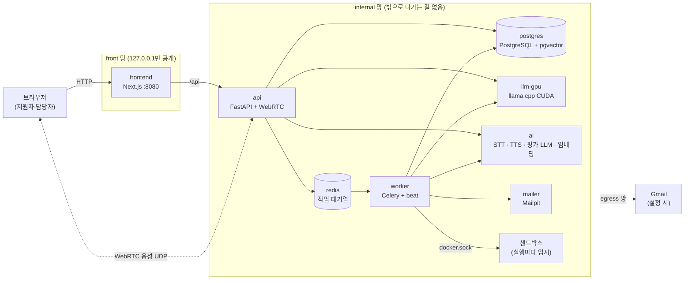

# 컨테이너 구성과 기술 스택

> 기준: 2026-10-30 `ai-hiring-platform` 브랜치, `deploy/docker-compose.yml` (ADR-0014, 통합 ADR-0015).
> 수치는 이 PC(GPU 6 GB, Docker Desktop)에서 2026-10-30에 측정한 값이다.

---

## 1. 한눈에 보기

모의면접 플랫폼 전체를 **컨테이너 8개**로 띄운다. 모든 AI 추론은 이 PC 안의 컨테이너 두 개(`llm-gpu`, `ai`)에서만 돌고, 외부 AI API는 쓰지 않는다.

| # | 컨테이너 | 하는 일 | 핵심 기술 |
|---|---|---|---|
| 1 | frontend | 웹 화면 | Next.js 16, React 19 |
| 2 | api | 백엔드 API, 면접 음성 연결, 시작 시 DB 구조 반영 | FastAPI, aiortc(WebRTC), Alembic |
| 3 | worker | 백그라운드 작업과 정기 작업 | Celery worker + Celery beat |
| 4 | postgres | 데이터베이스 | PostgreSQL 16, pgvector |
| 5 | redis | 작업 대기열, 실시간 알림 | Redis 7 |
| 6 | llm-gpu | 면접 중 실시간 LLM | llama.cpp (CUDA), Qwen3.5-4B |
| 7 | ai | 음성 인식·합성, 평가 LLM, 임베딩 | faster-whisper, Supertonic, llama.cpp (CPU), BGE-M3 |
| 8 | mailer | 메일 발송 | Mailpit |

- 코딩테스트 샌드박스는 상시 컨테이너가 아니다. 코드를 실행할 때마다 worker가 잠깐 띄웠다가 지운다.
- 파일 저장소 MinIO는 선택 사항이다. 켜면(`COMPOSE_PROFILES=minio`) 9번째 컨테이너가 되고, 끄면 파일은 로컬 볼륨에 저장된다. 지금 이 PC는 로컬 볼륨을 쓴다.

## 2. 구성도



**망 세 개**

- **front**: 브라우저가 들어오는 포트만 있다. 모두 127.0.0.1에만 열려 있다.
- **internal**: 모든 서비스가 여기에 있고, `internal: true`라 밖으로 나가는 길이 없다.
- **egress**: mailer만 붙어 있다. 외부(Gmail)로 나갈 수 있는 컨테이너는 mailer 하나뿐이다.

## 3. 컨테이너별 기술 스택

### 3.1 frontend — 웹 화면

| 구분 | 기술 |
|---|---|
| 런타임 | Node.js 22 |
| 프레임워크 | Next.js 16, React 19 |
| 화면 이동 | react-router 8 |
| 서버 데이터 조회·캐시 | TanStack React Query 5 |
| 입력 폼·검증 | react-hook-form 7, zod 4 |
| 글꼴 | Gothic A1, IBM Plex Sans KR (이미지에 포함, CDN 없음) |

- `/api` 요청은 api 컨테이너로 넘긴다. 실시간 알림(SSE)은 버퍼링 없이 중계한다.
- 공개 주소: http://localhost:8080

### 3.2 api — 백엔드 API

| 구분 | 기술 |
|---|---|
| 언어 | Python 3.12 |
| 웹 프레임워크·서버 | FastAPI, Uvicorn |
| DB 연결 | SQLAlchemy 2 (비동기), asyncpg |
| DB 구조 변경 | Alembic (컨테이너가 뜰 때 먼저 실행) |
| 입력 검증 | Pydantic 2 |
| 비밀번호 해시 | Argon2 |
| 이력서 PDF 글자 추출 | pypdf |
| 실시간 면접 음성 | aiortc (WebRTC), PyAV (FFmpeg) |
| 작업 등록 | Celery 클라이언트 → Redis |
| AI 호출 | httpx → llm-gpu, ai |

- 공개 포트: 127.0.0.1:8000(API), UDP 40000~40019(면접 음성)
- 마이그레이션이 실패하면 api가 뜨지 않는다. 예전의 1회성 `migrate` 컨테이너가 하던 일이다.

### 3.3 worker — 백그라운드 작업과 정기 작업

| 구분 | 기술 |
|---|---|
| 작업 처리 | Celery worker. 자원별 4그룹(실시간 LLM 1, 평가 LLM 1, 코드 실행 2, 기타 2) |
| 정기 작업 | Celery beat (예전 `scheduler` 컨테이너) |
| 코드 실행 | Docker CLI → 실행마다 샌드박스 컨테이너 생성 |
| 샌드박스 | Python 3.11, 네트워크 없음, CPU·메모리·시간 제한, 일반 사용자(uid 10001) |

- **작업 처리**: 질문 생성, 면접 답변 사전 평가, 종합 평가와 리포트, 메일 발송, 코딩테스트 채점
- **정기 작업**: 시간 지난 면접 자동 제출, 보관 기간 지난 데이터 삭제, 멈춘 작업 재시도, 샌드박스 재점검

### 3.4 postgres — 데이터베이스

| 구분 | 기술 |
|---|---|
| DB | PostgreSQL 16 |
| 확장 | pgvector (질문은행 유사 질문 찾기, 1024차원) |

- 회원, 공고, 지원, 면접 질문·답변, 평가 결과, 채용 결정 이력, 작업 기록, 감사 로그를 저장한다.
- 작업 기록이 여기에 있으므로 Redis가 재시작돼도 작업은 사라지지 않는다.

### 3.5 redis — 작업 대기열

| 구분 | 기술 |
|---|---|
| 서버 | Redis 7 |
| 용도 | Celery 작업 대기열, 화면 실시간 알림 전달 |
| 내구성 | AOF(디스크 기록) 켬. 재시작해도 대기 중인 작업이 남는다 |

- Redis는 할 일 목록을 보관만 하고, 실제 처리는 worker가 한다.

### 3.6 llm-gpu — 면접 중 실시간 LLM

| 구분 | 기술 |
|---|---|
| 추론 서버 | llama.cpp server (CUDA) |
| 모델 | Qwen3.5-4B, GGUF 양자화 |
| 동시 처리 | 슬롯 2개, 문맥 16,384 토큰 |

- 꼬리질문 여부 판단, 질문 생성처럼 면접 중 바로 답해야 하는 일을 맡는다.
- 처음 뜰 때 실제 프롬프트를 한 번 돌린 뒤에야 healthy가 된다. 오래된 GPU에서 첫 요청이 늦어지는 문제를 면접 전에 미리 겪고 넘어가기 위해서다.

### 3.7 ai — 음성과 평가용 AI (서버 4개)

| 기능 | 포트 | 기술 | 실행 위치 |
|---|---|---|---|
| STT (음성 → 글자) | 8201 | faster-whisper (CTranslate2), Whisper large-v3-turbo. GPU를 못 쓰면 small 모델로 CPU에서 실행 | GPU |
| TTS (글자 → 음성) | 8202 | Supertonic 3 (ONNX Runtime) | CPU |
| 평가 LLM | 8082 | llama.cpp server, Qwen3.5-4B (llm-gpu와 같은 모델 파일) | CPU |
| 임베딩 | 8083 | llama.cpp server, BGE-M3 | CPU |

- STT·TTS는 Python(FastAPI) 서버이고, 평가 LLM과 임베딩은 llama.cpp 서버다. 한 컨테이너 안에서 함께 돈다.
- 넷 중 하나라도 멈추면 컨테이너 전체가 재시작한다. 검증 때는 약 10초 걸렸다.
- 모델 파일은 `models/` 폴더를 읽기 전용으로 쓴다. 실행 중 인터넷에서 모델을 받지 않는다.

### 3.8 mailer — 메일

| 구분 | 기술 |
|---|---|
| 메일 서버 | Mailpit (SMTP) |
| 개발 중 | 받은 메일을 웹 받은편지함(http://127.0.0.1:8025)에 보관 |
| 실제 발송 | `.env`의 `MAIL_RELAY_*`를 채우면 Gmail로 중계 |

## 4. 요청 흐름 예시

**지원자가 면접을 마치고 제출할 때**

1. 브라우저가 frontend를 거쳐 api에 제출을 요청한다.
2. api가 postgres에 제출 상태와 '평가' 작업 기록을 한 트랜잭션으로 저장하고, Redis에 작업을 넣는다.
3. worker가 Redis에서 작업을 꺼내 ai의 평가 LLM을 호출하고, 점수는 코드로 계산한다.
4. worker가 리포트를 postgres에 저장하고, 담당자 화면에 알림을 보낸다(Redis를 거쳐 api → 브라우저).

**면접 중 한 문항**

1. api가 ai의 TTS로 질문 음성을 만들어 WebRTC로 들려준다. 질문 음성은 미리 합성해 둔 것을 쓴다.
2. 지원자 음성을 api가 받아 ai의 STT로 자막을 만든다.
3. 답변이 끝나면 api가 llm-gpu에 꼬리질문이 필요한지 묻는다.

## 5. 통합 전후 비교

| 통합 전 (12개 + 1회성 1개) | 통합 후 (8개) |
|---|---|
| frontend | frontend |
| api, migrate(1회성) | api |
| worker, scheduler | worker |
| postgres | postgres |
| redis | redis |
| llm-rt | llm-gpu |
| llm-eval, embed, stt, tts | ai |
| mailer | mailer |

**합치지 않은 것과 이유**

| 후보 | 이유 |
|---|---|
| llm-gpu + 평가 LLM | GPU 6 GB 중 약 5 GB(5,013 MiB)를 이미 쓴다. 평가 LLM까지 올리면 메모리가 모자라고, 긴 평가가 면접 중 꼬리질문 응답을 늦춘다 |
| redis를 worker에 | api도 작업을 넣기 때문에 worker가 재시작할 때마다 작업 등록이 끊긴다 |
| mailer | 밖으로 나갈 수 있는 유일한 컨테이너다. 합치면 다른 서비스도 외부망에 닿게 된다 |

메모리와 GPU 사용량은 통합 전과 같다. 컨테이너 수가 아니라 올라가는 모델이 정하기 때문이다.

## 6. 검증 결과 (2026-10-30)

| 항목 | 결과 |
|---|---|
| 8개 컨테이너 기동 | 모두 healthy |
| DB 마이그레이션 | api 기동 시 0007까지 적용 |
| 정기 작업 | worker 로그에 `celery beat v5.6.3 ... is starting` |
| 서비스 간 연결 | api·worker → ai(8201·8202·8082·8083), llm-gpu(8080) 모두 응답 200 |
| 임베딩 | 1024차원, 0.1초 |
| 평가 LLM | 응답 0.7초 (짧은 질문) |
| TTS → STT | 합성한 문장을 다시 같은 문장으로 인식 (large-v3-turbo, GPU, 1.5초) |
| 장애 시 재시작 | 임베딩 서버만 강제 종료 → ai 컨테이너 재시작 → 약 10초 뒤 healthy |
| 백엔드 자동 테스트 | pytest 133개 통과 |

**아직 확인하지 않은 것**

- 면접 진행 중 ai 컨테이너가 재시작될 때 브라우저 쪽 복구 흐름. 브라우저 E2E 테스트는 요청이 있을 때까지 보류 중이다.
- 여러 명이 동시에 응시할 때의 부하
- 외부망에서의 WebRTC 접속(TURN 서버 필요 여부)

## 7. 실행 방법

```powershell
cd C:\big21\final_test\deploy
copy .env.example .env      # 처음 한 번
docker compose up -d --build
docker compose ps           # 8개 모두 healthy가 될 때까지 1~3분
```

브라우저: http://localhost:8080 · 메일 받은편지함: http://127.0.0.1:8025
