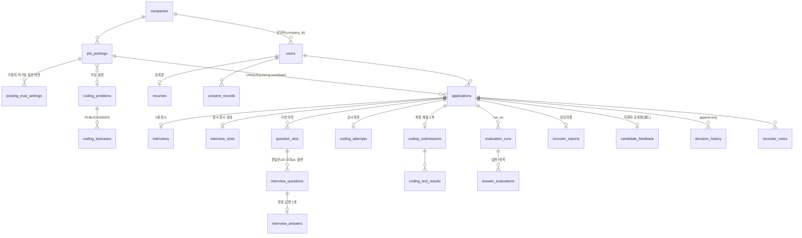

# 에이전트 B 설계안 — 백엔드·데이터베이스

- 단계: 설계 1단계(독립 설계안). 기준: `통합 PRD.pdf` v1.0 초안, `docs/requirements-traceability.md`, `docs/open-questions.md`, `docs/risks.md`.
- 표기: **[권장]** 이 문서의 제안(팀·조정자 확인 전), **[PRD]** PRD 원문 그대로, **[신규 OQ-Bn]** 이 문서가 새로 올리는 해석 질문(조정자가 `open-questions.md`로 옮겨 주길 요청).

## 1. 범위와 전제

**범위**: 도메인 모델·ERD·DDL·인덱스·제약조건, 상태 머신 강제, 영속 작업 큐·주기 작업·장애 복구, 동시 응시 슬롯, 회사별 격리, 점수 저장 구조, 보관·삭제, 마이그레이션, REST API 목록.
**범위 밖**(계약만 정의): WebRTC·STT·TTS·LLM 호출 내부(C), 화면(D), 샌드박스 구현·쿠키·CSRF 세부(E), 프로세스 배치·배포(A·F).

**전제 스택 — 조정자 잠정안에 동의**, 세부만 보탠다.

| 항목 | 권장 | 이유 |
|---|---|---|
| DB 드라이버 | psycopg 3 (async) + SQLAlchemy 2 `AsyncSession` | API·워커·aiortc가 모두 asyncio. psycopg 3은 동기 모드도 있어 Alembic·CLI와 같은 드라이버를 쓴다. `LISTEN/NOTIFY` 지원 |
| PostgreSQL 16 | 공식 이미지, **확장 없음** | `gen_random_uuid()`는 13+ 내장. 이메일은 `citext` 대신 소문자 정규화 + CHECK. 임베딩은 `real[]`(2.6) |
| 시간 | 모든 시각 `timestamptz`, DB·서버 TZ=UTC, 표시는 Asia/Seoul | 응답·코딩 마감은 **DB `now()` 하나를 기준 시계**로 쓴다(서버 여러 개여도 시계 하나) |
| 금액 아닌 점수 | `numeric(5,2)` + Python `Decimal` | OQ-10, 부동소수 금지 |
| DB 역할 | `app_owner`(마이그레이션), `app_api`, `app_worker` 3개 | 칼럼 단위 권한으로 P-8·COD-06 심층 방어(3.8) |
| 세션 설정 | `statement_timeout=5s`(API)·`60s`(워커), `idle_in_transaction_session_timeout=30s`, 응시 시작 트랜잭션 `lock_timeout=2s` | 잠금 장기 보유 방지 |

## 2. 설계 대안 비교

**2.1 지원 건 상태 표현**

| 대안 | 장점 | 단점·위험 |
|---|---|---|
| A. `applications`에 상태 칼럼 3개 + 허용 전이 표 + 트리거 + 전이 이벤트 로그 **[권장]** | 7장 "세 줄로 분리"와 1:1. 목록 필터(ADM-02)가 인덱스 한 번. CHECK로 교차 불변식(평가 전 결정 금지 등)을 한 행에서 강제 | 트리거 로직이 DB와 코드 두 곳에 존재 → 전이 표를 시드 테이블 하나로 두고 코드가 같은 표를 읽어 이중 정의 방지 |
| B. 상태 이벤트 테이블만 두고 현재 상태는 최신 이벤트로 계산(이벤트 소싱) | 이력 완전 | 현재 상태 조회마다 집계, 교차 불변식 CHECK 불가, 동시 전이 경합 처리 복잡 |
| C. 단일 상태 칼럼(B PRD의 SUBMITTED~REPORT_READY 방식) | 단순 | PRD 7장이 명시적으로 버린 안. 평가 실패가 응시 기록을 흔든다 |

**2.2 작업 큐**

| 대안 | 장점 | 단점·위험 |
|---|---|---|
| A. PostgreSQL `jobs` 테이블 + `FOR UPDATE SKIP LOCKED` + 임대·펜싱 **[권장]** | 제출과 작업 등록이 **같은 트랜잭션**(7.2, 8.3 누락 0건)이 자동 성립. 인프라 추가 없음(AC-22). 상태·이력을 SQL로 조회 | 처리량 한계(초당 수백 건 이상) — 이 서비스 규모(동시 응시 1~2명)에선 무관. 구현 코드 약 300줄 자체 유지 |
| B. Redis + Celery/RQ/arq | 생태계·대시보드 | 등록 원자성을 위해 결국 DB outbox가 필요(이중 구조). Redis 영속 설정·장애 시 유실 위험, 운영 구성요소 +1, 오프라인 반입 +1 |
| C. PG 기반 기존 라이브러리(procrastinate 등) | 코드 감소 | "LLM 불가 시 집지 않기(OQ-23)", 10분 시도 제한, 결과 펜싱 같은 요구를 맞추려면 확장이 필요. 원문 외 의존성 추가 |

**2.3 회사별 격리**

| 대안 | 장점 | 단점·위험 |
|---|---|---|
| A. 앱 레벨: 회사 컨텍스트 의존성 주입 + 리포지토리 헬퍼 + SQLAlchemy `with_loader_criteria` 자동 조건 + **복합 FK `(id, company_id)`** **[권장, P0]** | 디버깅 쉬움, 커넥션 풀과 무관, 워커·지원자 경로가 자연스럽다. 복합 FK로 자식 행의 company_id가 부모와 어긋나는 것을 DB가 막는다 | 원시 SQL(`text()`)에는 자동 조건이 안 붙음 → 담당자 모듈에서 원시 SQL 금지 검사 필요 |
| B. PostgreSQL RLS(`FORCE ROW LEVEL SECURITY` + `SET LOCAL app.company_id`) | 코드 실수까지 DB가 차단하는 심층 방어 | 트랜잭션마다 설정 누락 시 0행(오탐 디버깅 난해), 워커·지원자·통계 경로마다 우회 정책 필요, 테이블 소유자는 기본 우회, 마이그레이션·테스트 복잡도 증가 |
| C. 회사별 스키마/DB | 물리 분리 | 마이그레이션 N배, 운영자 메타데이터 조회 곤란. 과함 |

→ P0는 A. B는 **P1 선택 항목**으로 `applications`·`recruiter_reports`·`recruiter_notes` 3개 테이블에만 시범 적용을 제안(7절 이견 지점).

**2.4 동시 응시 슬롯(INT-13)**

| 대안 | 장점 | 단점 |
|---|---|---|
| A. 전역 `pg_advisory_xact_lock` + `interview_slots` 임대 테이블(만료 시각) **[권장]** | 상한 값 변경이 설정 하나. 끊긴 응시는 임대 만료로 자동 회수. 트랜잭션 끝나면 잠금 자동 해제 | 시작 요청이 전역 직렬화(초당 수 건 수준이라 무관) |
| B. 고정 슬롯 행 N개를 `FOR UPDATE SKIP LOCKED`로 점유 | 잠금 경합 없음 | 슬롯을 세션 내내 행 잠금으로 잡으면 커넥션 장기 점유 → 결국 임대 칼럼 필요. 상한 변경 시 행 관리 |
| C. SERIALIZABLE 격리에서 count 후 insert | 잠금 코드 없음 | 직렬화 실패 재시도 루프 필요, 테스트 어려움 |

**2.5 기타**

| 쟁점 | 대안 | 권장 |
|---|---|---|
| 출제 질문 스냅샷 | 본질문·꼬리질문 단일 테이블(`role`, `parent_id`) vs 별도 2테이블 | **단일 테이블**: 답변·평가가 한 FK로 질문을 참조, 불변 트리거 하나 |
| 기본 키 | UUID vs bigint | 외부 노출 리소스는 **UUID v4**(지원자 수·ID 추측 노출 방지), 내부 로그·큐는 bigint identity |
| 임베딩 저장(QST-01) | `real[]` + 앱에서 코사인 계산 vs pgvector | 질문은행은 수천 건 이하 → **`real[]`**. 1만 건 넘으면 pgvector 이미지로 교체(마이그레이션 1개) |
| 파일(이력서 PDF·음성) | DB bytea vs 파일시스템 + DB 키 | **파일시스템 볼륨 + DB에 상대 경로 키**. 이름은 서버가 UUID로 생성(사용자 파일명 미사용) |

## 3. 권장안과 근거

### 3.1 ERD(핵심 관계)



### 3.2 DDL 초안

공통 규칙: 회사 소유 테이블은 모두 `company_id NOT NULL`을 갖고 부모를 `(id, company_id)` 복합 FK로 참조한다. `created_at timestamptz NOT NULL DEFAULT now()`는 생략 표기. 사용자 정의 SQLSTATE: `AP001` 불허 전이, `AP002` 불변 행 변경, `AP003` 설정 잠김 → 앱이 409로 변환.

```sql
-- ── 계정·세션·동의 ─────────────────────────────────────────────
CREATE TABLE companies (id uuid PRIMARY KEY DEFAULT gen_random_uuid(), name text NOT NULL,
  intro text);                                              -- 기업 질문 근거(6.1)
CREATE TABLE users (
  id uuid PRIMARY KEY DEFAULT gen_random_uuid(),
  role text NOT NULL CHECK (role IN ('CANDIDATE','RECRUITER','OPERATOR')),
  company_id uuid REFERENCES companies(id),
  email text CHECK (email = lower(email)), password_hash text, name text, phone text,
  status text NOT NULL DEFAULT 'ACTIVE' CHECK (status IN ('ACTIVE','DISABLED','WITHDRAWN')),
  withdrawn_at timestamptz,
  CHECK ((role = 'RECRUITER') = (company_id IS NOT NULL)),
  CHECK (status = 'WITHDRAWN' OR (email IS NOT NULL AND password_hash IS NOT NULL AND name IS NOT NULL)),
  CHECK (role <> 'CANDIDATE' OR status = 'WITHDRAWN' OR phone ~ '^010-[0-9]{4}-[0-9]{4}$'),
  UNIQUE (id, company_id));
CREATE UNIQUE INDEX ux_users_email ON users(email) WHERE email IS NOT NULL;
-- 생년월일·성별·사진 칼럼은 존재하지 않는다(USR-02, 8.5). 스키마 테스트가 금지 칼럼명(birth|gender|sex|photo|age)을 검사.
CREATE TABLE sessions (
  token_hash bytea PRIMARY KEY,                             -- SHA-256(쿠키 토큰). 원문 저장 안 함
  user_id uuid NOT NULL REFERENCES users(id) ON DELETE CASCADE,
  role text NOT NULL, company_id uuid,                      -- 로그인 시 복사(요청마다 조인 회피)
  last_seen_at timestamptz NOT NULL, expires_at timestamptz NOT NULL,  -- last_seen+2h(USR-06), 60초 단위로만 갱신
  revoked_at timestamptz);
CREATE TABLE consent_documents (version text PRIMARY KEY,  -- 'consent-v0-draft'(OQ-04)
  body_md text NOT NULL, items jsonb NOT NULL,             -- [{code,label,required}]
  is_draft boolean NOT NULL, published_at timestamptz NOT NULL);
CREATE TABLE consent_records (                             -- INSERT 전용(트리거)
  id uuid PRIMARY KEY DEFAULT gen_random_uuid(),
  candidate_id uuid NOT NULL REFERENCES users(id), posting_id uuid NOT NULL REFERENCES job_postings(id),
  document_version text NOT NULL REFERENCES consent_documents(version),
  answers jsonb NOT NULL,                                   -- {"purpose":true,...} 항목별(SEC-02)
  all_required_agreed boolean NOT NULL, agreed_at timestamptz NOT NULL DEFAULT now());

-- ── 이력서 ──────────────────────────────────────────────────────
CREATE TABLE resume_files (
  id uuid PRIMARY KEY DEFAULT gen_random_uuid(), owner_id uuid NOT NULL REFERENCES users(id),
  purpose text NOT NULL CHECK (purpose IN ('REGISTERED','APPLICATION')),  -- 지원 건은 사본(보관 독립)
  storage_key text NOT NULL UNIQUE, size_bytes int NOT NULL CHECK (size_bytes BETWEEN 1 AND 10485760),
  sha256 bytea NOT NULL, page_count int,
  text_extractable boolean NOT NULL,                        -- false → '직접 입력' 안내(RES-04)
  extracted_text text);                                     -- 원문 대조용(RES-03, QST-03)
CREATE TABLE resumes (                                     -- 마이페이지 등록본(지원자당 1개)
  candidate_id uuid PRIMARY KEY REFERENCES users(id),
  content jsonb NOT NULL,                                   -- {name, education[], career[], projects[], skills[], certificates[]}
  source text NOT NULL CHECK (source IN ('PDF','MANUAL')), file_id uuid REFERENCES resume_files(id),
  schema_version smallint NOT NULL DEFAULT 1, updated_at timestamptz NOT NULL);

-- ── 공고·코딩 문제·가중치 ───────────────────────────────────────
CREATE TABLE coding_problems (                             -- 팀이 CLI로 등록(OQ-14), 등록 후 불변
  id uuid PRIMARY KEY DEFAULT gen_random_uuid(), title text NOT NULL, statement_md text NOT NULL,
  language text NOT NULL DEFAULT 'python' CHECK (language = 'python'),  -- X-10
  time_limit_ms int NOT NULL, memory_mb int NOT NULL, is_active boolean NOT NULL DEFAULT true);
CREATE TABLE coding_testcases (
  id uuid PRIMARY KEY DEFAULT gen_random_uuid(), problem_id uuid NOT NULL REFERENCES coding_problems(id),
  ordinal smallint NOT NULL, visibility text NOT NULL CHECK (visibility IN ('PUBLIC','HIDDEN')),
  input text NOT NULL, expected_output text NOT NULL, UNIQUE (problem_id, ordinal));
CREATE VIEW coding_public_examples AS SELECT id, problem_id, ordinal, input, expected_output
  FROM coding_testcases WHERE visibility = 'PUBLIC';      -- app_api는 이 뷰만 SELECT 가능(3.8)
CREATE TABLE job_postings (
  id uuid PRIMARY KEY DEFAULT gen_random_uuid(), company_id uuid NOT NULL REFERENCES companies(id),
  status text NOT NULL DEFAULT 'DRAFT' CHECK (status IN ('DRAFT','OPEN','CLOSED')),
  title text, job_family text, requirements text, preferred text, duties text,
  headcount int CHECK (headcount > 0),                      -- 표시만(JOB-01)
  deadline_at timestamptz,                                  -- 화면의 마감일 23:59:59 KST로 저장
  coding_enabled boolean NOT NULL DEFAULT false, coding_problem_id uuid REFERENCES coding_problems(id),
  coding_language text CHECK (coding_language = 'python'),
  coding_time_limit_min smallint CHECK (coding_time_limit_min BETWEEN 10 AND 180),  -- OQ-17 잠정
  current_settings_id uuid,                                 -- → posting_eval_settings(id) DEFERRABLE
  settings_locked_at timestamptz,                           -- 첫 INTERVIEWING 진입(JOB-06, OQ-05)
  published_at timestamptz, closed_at timestamptz, close_reason text CHECK (close_reason IN ('MANUAL','DEADLINE')),
  deleted_at timestamptz,                                   -- 지원자 0명일 때만 소프트 삭제(JOB-04)
  created_by uuid NOT NULL, row_version int NOT NULL DEFAULT 1,
  UNIQUE (id, company_id),
  FOREIGN KEY (created_by, company_id) REFERENCES users(id, company_id),
  CHECK (status = 'DRAFT' OR (title IS NOT NULL AND job_family IS NOT NULL AND deadline_at IS NOT NULL
         AND current_settings_id IS NOT NULL)),
  CHECK (status = 'DRAFT' OR NOT coding_enabled OR (coding_problem_id IS NOT NULL
         AND coding_language IS NOT NULL AND coding_time_limit_min IS NOT NULL)),
  CHECK ((status = 'CLOSED') = (closed_at IS NOT NULL)));
CREATE INDEX ix_postings_company ON job_postings(company_id, status, deadline_at) WHERE deleted_at IS NULL;
CREATE INDEX ix_postings_open_deadline ON job_postings(deadline_at) WHERE status = 'OPEN';
CREATE TABLE posting_eval_settings (                       -- INSERT 전용, 버전마다 새 행
  id uuid PRIMARY KEY DEFAULT gen_random_uuid(), posting_id uuid NOT NULL, company_id uuid NOT NULL,
  version int NOT NULL,
  w_expertise smallint NOT NULL CHECK (w_expertise BETWEEN 0 AND 100),
  w_logic smallint NOT NULL CHECK (w_logic BETWEEN 0 AND 100),
  w_specificity smallint NOT NULL CHECK (w_specificity BETWEEN 0 AND 100),
  w_delivery smallint NOT NULL CHECK (w_delivery BETWEEN 0 AND 100),
  w_coding smallint CHECK (w_coding BETWEEN 0 AND 100),     -- 코딩 끈 공고는 NULL(6.4)
  custom_question text CHECK (char_length(custom_question) BETWEEN 5 AND 500),  -- 1개(X-09)
  rubric_version text NOT NULL, created_by uuid NOT NULL,
  UNIQUE (posting_id, version), UNIQUE (id, posting_id),
  FOREIGN KEY (posting_id, company_id) REFERENCES job_postings(id, company_id),
  CHECK (w_expertise + w_logic + w_specificity + w_delivery + COALESCE(w_coding, 0) = 100));  -- ADM-05
-- 트리거: 공고 settings_locked_at이 있으면 INSERT 거부(AP003). job_postings의 coding_* 변경도 잠금 후 거부.
-- 지연 제약 트리거: 게시(OPEN) 시 coding_enabled = (현재 설정의 w_coding IS NOT NULL).

-- ── 지원 건: 상태 3개 분리 ─────────────────────────────────────
CREATE TABLE applications (
  id uuid PRIMARY KEY DEFAULT gen_random_uuid(), company_id uuid NOT NULL, posting_id uuid NOT NULL,
  candidate_id uuid NOT NULL REFERENCES users(id), consent_record_id uuid NOT NULL REFERENCES consent_records(id),
  resume_snapshot jsonb NOT NULL,                           -- 지원 시점 고정(RES-07), 트리거로 불변
  resume_file_id uuid REFERENCES resume_files(id),
  attempt_status text NOT NULL DEFAULT 'READY' CHECK (attempt_status IN
    ('READY','PREPARING','INTERVIEWING','CODING','INTERRUPTED','SUBMITTED','EXPIRED')),
  eval_status text CHECK (eval_status IN ('PENDING','RUNNING','DONE','ON_HOLD')),   -- NULL = 평가 없음(OQ-06)
  decision_status text NOT NULL DEFAULT 'UNDECIDED' CHECK (decision_status IN ('UNDECIDED','PASS','FAIL')),
  eval_settings_id uuid,                                    -- INTERVIEWING 진입 때 고정한 가중치 버전
  answered_main_count smallint NOT NULL DEFAULT 0 CHECK (answered_main_count BETWEEN 0 AND 10),
  applied_at timestamptz NOT NULL DEFAULT now(), interview_started_at timestamptz,
  submitted_at timestamptz, expired_at timestamptz, eval_done_at timestamptz,
  first_decided_at timestamptz, decided_at timestamptz, decided_by uuid,
  withdrawn_at timestamptz,                                 -- 탈퇴 익명화 표시(OQ-12). 상태 머신과 별개
  audio_purged_at timestamptz, content_purged_at timestamptz,
  UNIQUE (posting_id, candidate_id),                        -- JOB-02, AC-04
  UNIQUE (id, company_id),
  FOREIGN KEY (posting_id, company_id) REFERENCES job_postings(id, company_id),
  FOREIGN KEY (eval_settings_id, posting_id) REFERENCES posting_eval_settings(id, posting_id),
  FOREIGN KEY (decided_by, company_id) REFERENCES users(id, company_id),
  CHECK (attempt_status IN ('SUBMITTED','EXPIRED') OR eval_status IS NULL),
  CHECK (attempt_status <> 'SUBMITTED' OR eval_status IS NOT NULL OR withdrawn_at IS NOT NULL),
  CHECK (attempt_status <> 'EXPIRED' OR eval_status IS NOT NULL OR answered_main_count = 0
         OR withdrawn_at IS NOT NULL),                     -- OQ-07: 응답 0개면 평가 없음
  CHECK (decision_status = 'UNDECIDED' OR eval_status = 'DONE'
         OR (attempt_status = 'EXPIRED' AND eval_status IS NULL)),   -- 7.3: 평가 완료 전 결정 불가
  CHECK ((decision_status = 'UNDECIDED') = (decided_at IS NULL)),
  CHECK (attempt_status NOT IN ('INTERVIEWING','CODING','SUBMITTED') OR eval_settings_id IS NOT NULL));
CREATE INDEX ix_app_recruiter_list ON applications(company_id, posting_id, decision_status, eval_status);
CREATE INDEX ix_app_candidate ON applications(candidate_id, applied_at DESC);
CREATE INDEX ix_app_active ON applications(attempt_status)
  WHERE attempt_status IN ('PREPARING','INTERVIEWING','CODING','INTERRUPTED');
CREATE TABLE state_transitions (machine text, from_state text, to_state text, actor text NOT NULL,
  PRIMARY KEY (machine, from_state, to_state));            -- 3.4 표를 시드. 코드도 이 표를 로드
CREATE TABLE application_state_events (id bigint GENERATED ALWAYS AS IDENTITY PRIMARY KEY,
  application_id uuid NOT NULL, machine text NOT NULL, from_state text, to_state text NOT NULL,
  actor text NOT NULL, reason text, at timestamptz NOT NULL DEFAULT now());  -- AFTER UPDATE 트리거가 자동 기록

-- ── 면접 진행·슬롯·질문 ────────────────────────────────────────
CREATE TABLE interviews (                                   -- 지원 건당 1행 = 1회 응시(INT-12)
  application_id uuid PRIMARY KEY, company_id uuid NOT NULL,
  question_set_id uuid,                                     -- INTERVIEWING 진입 때 확정
  precheck_media_ok_at timestamptz, precheck_webrtc_ok_at timestamptz,  -- INT-01·17 서버 기록
  current_question_id uuid,
  current_phase text CHECK (current_phase IN ('PRESENTING','ANSWERING','FOLLOWUP_DECIDING')),
  answer_opened_at timestamptz, answer_deadline_at timestamptz,          -- 서버 시계(INT-06)
  presentation_count smallint NOT NULL DEFAULT 0,          -- 현재 문항 재출제 횟수(OQ-21)
  followups_used smallint NOT NULL DEFAULT 0 CHECK (followups_used BETWEEN 0 AND 4),  -- 6.2 전체 4
  text_mode_since timestamptz,                              -- INT-18
  last_heartbeat_at timestamptz, interruption_count smallint NOT NULL DEFAULT 0,
  started_at timestamptz, ended_at timestamptz,
  FOREIGN KEY (application_id, company_id) REFERENCES applications(id, company_id));
CREATE TABLE interview_slots (application_id uuid PRIMARY KEY REFERENCES applications(id),
  acquired_at timestamptz NOT NULL DEFAULT now(), lease_expires_at timestamptz NOT NULL);
CREATE TABLE question_bank (
  id uuid PRIMARY KEY DEFAULT gen_random_uuid(),
  kind text NOT NULL CHECK (kind IN ('PERSONALITY','COMPANY','JOB')), job_family text,
  company_id uuid REFERENCES companies(id),                 -- 공고에서 AI가 만든 질문은 그 회사 전용
  text text NOT NULL, text_norm_hash bytea NOT NULL,
  source text NOT NULL CHECK (source IN ('SEED','AI')),
  usage_count int NOT NULL DEFAULT 0, last_used_at timestamptz,
  embedding real[], embedding_model text, is_active boolean NOT NULL DEFAULT true,
  CHECK (kind <> 'JOB' OR job_family IS NOT NULL), CHECK (source <> 'AI' OR company_id IS NOT NULL));
CREATE UNIQUE INDEX ux_qbank_exact ON question_bank(kind, COALESCE(job_family,''),
  COALESCE(company_id,'00000000-0000-0000-0000-000000000000'), text_norm_hash);
CREATE INDEX ix_qbank_pick ON question_bank(kind, job_family, usage_count) WHERE is_active;
CREATE TABLE question_sets (
  id uuid PRIMARY KEY DEFAULT gen_random_uuid(), application_id uuid NOT NULL, company_id uuid NOT NULL,
  settings_id uuid NOT NULL,                                -- 어떤 커스텀 질문 버전으로 만들었나
  status text NOT NULL CHECK (status IN ('COMPOSING','READY','SUPERSEDED')),
  composer_version text NOT NULL, ready_at timestamptz,
  FOREIGN KEY (application_id, company_id) REFERENCES applications(id, company_id));
CREATE UNIQUE INDEX ux_qset_live ON question_sets(application_id) WHERE status IN ('COMPOSING','READY');
CREATE TABLE interview_questions (                          -- 출제 스냅샷(QST-06). UPDATE·DELETE 금지 트리거
  id uuid PRIMARY KEY DEFAULT gen_random_uuid(), question_set_id uuid NOT NULL REFERENCES question_sets(id),
  application_id uuid NOT NULL, company_id uuid NOT NULL,
  seq smallint NOT NULL CHECK (seq BETWEEN 1 AND 10),      -- 꼬리질문은 부모와 같은 번호(INT-07)
  role text NOT NULL CHECK (role IN ('MAIN','FOLLOWUP')), parent_id uuid REFERENCES interview_questions(id),
  slot_type text NOT NULL CHECK (slot_type IN ('PERSONALITY','RESUME','COMPANY','JOB')),
  source text NOT NULL CHECK (source IN ('BANK','AI','CUSTOM','BANK_FALLBACK')),  -- QST-03·07 대체 표시
  bank_question_id uuid REFERENCES question_bank(id), text text NOT NULL,
  grounding jsonb,                                          -- 근거 이력서 문장·발화 인용(QST-03, 6.2)
  answer_limit_sec smallint NOT NULL,
  CHECK ((role = 'MAIN') = (parent_id IS NULL)),
  CHECK ((role = 'MAIN' AND answer_limit_sec = 60) OR (role = 'FOLLOWUP' AND answer_limit_sec = 45)),
  CHECK (slot_type = CASE WHEN seq <= 2 THEN 'PERSONALITY' WHEN seq <= 4 THEN 'RESUME'
                          WHEN seq <= 6 THEN 'COMPANY' ELSE 'JOB' END),       -- 6.1 순서 고정
  CHECK (source <> 'CUSTOM' OR (slot_type = 'JOB' AND role = 'MAIN')),
  FOREIGN KEY (application_id, company_id) REFERENCES applications(id, company_id));
CREATE UNIQUE INDEX ux_iq_main ON interview_questions(question_set_id, seq) WHERE role = 'MAIN';
CREATE UNIQUE INDEX ux_iq_followup ON interview_questions(parent_id) WHERE role = 'FOLLOWUP';  -- 본질문당 1
CREATE UNIQUE INDEX ux_iq_custom ON interview_questions(question_set_id) WHERE source = 'CUSTOM';
CREATE TABLE question_tts_assets (question_id uuid PRIMARY KEY REFERENCES interview_questions(id),
  audio_key text NOT NULL, voice_model text NOT NULL);     -- 스냅샷과 분리(캐시). 응시 종료 후 삭제
CREATE TABLE interview_answers (                            -- 확정 답변만 저장(OQ-21). 불변(삭제 작업 예외)
  id uuid PRIMARY KEY DEFAULT gen_random_uuid(),
  question_id uuid NOT NULL UNIQUE REFERENCES interview_questions(id),   -- 버튼·시간만료 경합 시 먼저 온 1건
  application_id uuid NOT NULL, company_id uuid NOT NULL,
  input_mode text NOT NULL CHECK (input_mode IN ('VOICE','TEXT')),         -- INT-18
  end_reason text NOT NULL CHECK (end_reason IN ('BUTTON','TIMEOUT')),     -- X-02
  is_no_answer boolean NOT NULL,                            -- 무발화·STT 실패 '답변 없음'(INT-06·09)
  transcript text, audio_key text, audio_duration_ms int, stt_model text,
  opened_at timestamptz NOT NULL, confirmed_at timestamptz NOT NULL, reask_count smallint NOT NULL DEFAULT 0,
  FOREIGN KEY (application_id, company_id) REFERENCES applications(id, company_id),
  CHECK (NOT is_no_answer OR COALESCE(transcript, '') = ''), CHECK (input_mode = 'VOICE' OR audio_key IS NULL));
CREATE TABLE proctor_events (id bigint GENERATED ALWAYS AS IDENTITY PRIMARY KEY,  -- INT-16(P2)
  application_id uuid NOT NULL REFERENCES applications(id), kind text NOT NULL CHECK (kind IN ('LEAVE','RETURN')),
  occurred_at timestamptz NOT NULL, away_ms int);

-- ── 코딩테스트 ──────────────────────────────────────────────────
CREATE TABLE coding_attempts (application_id uuid PRIMARY KEY, company_id uuid NOT NULL,
  problem_id uuid NOT NULL REFERENCES coding_problems(id), language text NOT NULL,
  started_at timestamptz NOT NULL, deadline_at timestamptz NOT NULL,      -- 서버 시간으로 계속 흐름(7.1)
  draft_code text NOT NULL DEFAULT '' CHECK (octet_length(draft_code) <= 65536),
  draft_revision int NOT NULL DEFAULT 0, draft_saved_at timestamptz,
  FOREIGN KEY (application_id, company_id) REFERENCES applications(id, company_id));
CREATE TABLE coding_runs (id uuid PRIMARY KEY DEFAULT gen_random_uuid(), application_id uuid NOT NULL,
  code_sha256 bytea NOT NULL, status text NOT NULL CHECK (status IN ('QUEUED','RUNNING','DONE','ERROR')),
  ok boolean, stdout_head text, stderr_head text,           -- 각 4KB. 공개 예시만 실행(COD-03)
  created_at timestamptz NOT NULL DEFAULT now(), finished_at timestamptz);
CREATE UNIQUE INDEX ux_coding_run_inflight ON coding_runs(application_id) WHERE status IN ('QUEUED','RUNNING');
CREATE TABLE coding_submissions (id uuid PRIMARY KEY DEFAULT gen_random_uuid(),
  application_id uuid NOT NULL UNIQUE, company_id uuid NOT NULL,          -- 지원 건당 1개(COD-04)
  code text NOT NULL, code_sha256 bytea NOT NULL,
  kind text NOT NULL CHECK (kind IN ('MANUAL','AUTO_TIMEOUT','AUTO_EXPIRED')),  -- COD-05
  submitted_at timestamptz NOT NULL, grading_status text NOT NULL DEFAULT 'PENDING'
    CHECK (grading_status IN ('PENDING','DONE')),
  compile_ok boolean, passed smallint, total smallint, score numeric(5,2), runner_version text, graded_at timestamptz,
  FOREIGN KEY (application_id, company_id) REFERENCES applications(id, company_id),
  CHECK (grading_status = 'PENDING' OR (total > 0 AND passed BETWEEN 0 AND total AND score IS NOT NULL)));
CREATE TABLE coding_test_results (submission_id uuid REFERENCES coding_submissions(id),
  testcase_id uuid REFERENCES coding_testcases(id), passed boolean NOT NULL, outcome text NOT NULL,
  time_ms int, PRIMARY KEY (submission_id, testcase_id));

-- ── 평가·리포트·결정 ───────────────────────────────────────────
CREATE TABLE evaluation_runs (id uuid PRIMARY KEY DEFAULT gen_random_uuid(),
  application_id uuid NOT NULL, company_id uuid NOT NULL, run_no smallint NOT NULL,
  job_id bigint NOT NULL, lease_token bigint NOT NULL,
  trigger text NOT NULL CHECK (trigger IN ('SUBMIT','AUTO_RETRY','RECRUITER','OPERATOR')),
  status text NOT NULL CHECK (status IN ('RUNNING','SUCCEEDED','FAILED','TIMED_OUT','ABORTED_INFRA','FENCED_OUT')),
  model_name text NOT NULL, model_digest text, prompt_version text NOT NULL, rubric_version text NOT NULL,
  eval_settings_id uuid NOT NULL, scoring_version text NOT NULL,           -- EVL-08
  started_at timestamptz NOT NULL, finished_at timestamptz, error_code text,
  UNIQUE (application_id, run_no), UNIQUE (id, application_id),
  FOREIGN KEY (application_id, company_id) REFERENCES applications(id, company_id));
CREATE TABLE answer_evaluations (                           -- 답변(본·꼬리) × 루브릭 항목
  run_id uuid NOT NULL REFERENCES evaluation_runs(id), answer_id uuid NOT NULL REFERENCES interview_answers(id),
  criterion text NOT NULL CHECK (criterion IN ('EXPERTISE','LOGIC','SPECIFICITY','DELIVERY')),
  score smallint NOT NULL CHECK (score BETWEEN 1 AND 5),
  quote text, quote_verified boolean NOT NULL, insufficient_evidence boolean NOT NULL,
  insufficient_reason text CHECK (insufficient_reason IN ('NO_ANSWER','TOO_SHORT','QUOTE_MISMATCH','NO_EVIDENCE')),
  comment text, llm_attempts smallint NOT NULL DEFAULT 0,
  PRIMARY KEY (run_id, answer_id, criterion),
  CHECK (insufficient_evidence = (insufficient_reason IS NOT NULL)),
  CHECK (NOT insufficient_evidence OR score = 1),                          -- 6.4
  CHECK (insufficient_evidence OR (quote IS NOT NULL AND quote_verified)));  -- AC-16: 모든 점수에 검증된 인용
CREATE TABLE answer_pre_evaluations (answer_id uuid, fingerprint text, criterion text,  -- EVL-05 캐시(P1)
  payload jsonb NOT NULL, PRIMARY KEY (answer_id, fingerprint, criterion));
CREATE TABLE recruiter_reports (application_id uuid PRIMARY KEY, company_id uuid NOT NULL,
  run_id uuid NOT NULL UNIQUE,                              -- PK가 지원 건 → 리포트 이중 기록 불가(R-14)
  score_expertise numeric(5,2) NOT NULL, score_logic numeric(5,2) NOT NULL,
  score_specificity numeric(5,2) NOT NULL, score_delivery numeric(5,2) NOT NULL,
  score_coding numeric(5,2), total_score numeric(5,2) NOT NULL CHECK (total_score BETWEEN 0 AND 100),
  insufficient_count int NOT NULL, insufficient_by_criterion jsonb NOT NULL,
  answered_main_count smallint NOT NULL,                    -- "10문항 중 N문항 응답"(7.1)
  question_scores jsonb NOT NULL,                           -- [{seq, EXPERTISE:"3.50",...}] 코드 계산값
  weights jsonb NOT NULL, summary text NOT NULL, strengths jsonb NOT NULL, improvements jsonb NOT NULL,
  code_review text, proctor_summary jsonb,                  -- COD-07(점수 미반영), INT-16
  FOREIGN KEY (run_id, application_id) REFERENCES evaluation_runs(id, application_id),
  FOREIGN KEY (application_id, company_id) REFERENCES applications(id, company_id),
  CHECK (jsonb_array_length(strengths) BETWEEN 1 AND 3 AND jsonb_array_length(improvements) BETWEEN 1 AND 3));
CREATE TABLE candidate_feedback (application_id uuid PRIMARY KEY, company_id uuid NOT NULL,
  run_id uuid NOT NULL UNIQUE,                              -- 별도 데이터(RPT-03)
  score_expertise numeric(5,2) NOT NULL, score_logic numeric(5,2) NOT NULL,
  score_specificity numeric(5,2) NOT NULL, score_delivery numeric(5,2) NOT NULL,
  strengths jsonb NOT NULL, improvements jsonb NOT NULL, coding_all_passed boolean,  -- OQ-24
  FOREIGN KEY (application_id, company_id) REFERENCES applications(id, company_id));
  -- 총점·인용·가중치·메모 칼럼이 아예 없다(SEC-04, AC-19)
CREATE TABLE decision_history (id bigint GENERATED ALWAYS AS IDENTITY PRIMARY KEY,  -- append-only
  application_id uuid NOT NULL, company_id uuid NOT NULL,
  from_status text NOT NULL, to_status text NOT NULL CHECK (to_status IN ('PASS','FAIL')),
  decided_by uuid NOT NULL, decided_at timestamptz NOT NULL DEFAULT now(),
  FOREIGN KEY (decided_by, company_id) REFERENCES users(id, company_id),  -- 같은 회사 담당자만
  FOREIGN KEY (application_id, company_id) REFERENCES applications(id, company_id), CHECK (from_status <> to_status));
CREATE TABLE recruiter_notes (id uuid PRIMARY KEY DEFAULT gen_random_uuid(), application_id uuid NOT NULL,
  company_id uuid NOT NULL, author_id uuid NOT NULL, body text NOT NULL CHECK (char_length(body) <= 2000),
  updated_at timestamptz, deleted_at timestamptz,
  FOREIGN KEY (author_id, company_id) REFERENCES users(id, company_id),
  FOREIGN KEY (application_id, company_id) REFERENCES applications(id, company_id));

-- ── 감사·큐·주기 작업·파일 삭제 ───────────────────────────────
CREATE TABLE audit_logs (id bigint GENERATED ALWAYS AS IDENTITY PRIMARY KEY,  -- append-only
  occurred_at timestamptz NOT NULL DEFAULT now(), actor_id uuid, actor_role text NOT NULL,  -- SYSTEM·OPERATOR_CLI 포함
  company_id uuid, action text NOT NULL, target_type text NOT NULL, target_id text NOT NULL,
  detail jsonb NOT NULL DEFAULT '{}',                       -- ID·상태값만. 답변 원문·이메일·전화 금지(SEC-08)
  request_id text, ip inet);
CREATE INDEX ix_audit_company ON audit_logs(company_id, occurred_at DESC);
CREATE SEQUENCE job_lease_token_seq;
CREATE TABLE jobs (id bigint GENERATED ALWAYS AS IDENTITY PRIMARY KEY,
  kind text NOT NULL, payload jsonb NOT NULL,               -- ID만. 개인정보 금지
  application_id uuid, dedupe_key text, priority smallint NOT NULL DEFAULT 50,
  resource text NOT NULL CHECK (resource IN ('LLM','RUNNER','CPU','NONE')),
  state text NOT NULL DEFAULT 'QUEUED' CHECK (state IN ('QUEUED','RUNNING','SUCCEEDED','FAILED','CANCELLED')),
  run_after timestamptz NOT NULL DEFAULT now(),
  attempts smallint NOT NULL DEFAULT 0, max_attempts smallint NOT NULL,   -- 평가: 2(최초+자동 1회, EVL-06)
  lost_leases smallint NOT NULL DEFAULT 0, infra_deferrals int NOT NULL DEFAULT 0,
  depends_on bigint REFERENCES jobs(id),
  lease_owner text, lease_token bigint, lease_expires_at timestamptz, attempt_deadline_at timestamptz,
  last_error_code text, started_at timestamptz, finished_at timestamptz,
  CHECK ((state = 'RUNNING') = (lease_token IS NOT NULL)), CHECK (attempts BETWEEN 0 AND max_attempts));
CREATE UNIQUE INDEX ux_jobs_dedupe ON jobs(dedupe_key) WHERE state IN ('QUEUED','RUNNING');
CREATE INDEX ix_jobs_claim ON jobs(resource, priority, run_after) WHERE state = 'QUEUED';
CREATE INDEX ix_jobs_lease ON jobs(lease_expires_at) WHERE state = 'RUNNING';
CREATE TABLE periodic_tasks (name text PRIMARY KEY, interval_sec int NOT NULL,
  next_run_at timestamptz NOT NULL, last_ok_at timestamptz, last_error_code text);
CREATE TABLE file_deletions (id bigint GENERATED ALWAYS AS IDENTITY PRIMARY KEY,  -- 파일 삭제 outbox
  storage_key text NOT NULL, reason text NOT NULL, requested_at timestamptz NOT NULL DEFAULT now(), done_at timestamptz);
```

### 3.3 불변·전이 트리거

```sql
CREATE FUNCTION forbid_mutation() RETURNS trigger LANGUAGE plpgsql AS $$
BEGIN  -- 보관 삭제 작업만 SET LOCAL app.purge='on'으로 통과(권장: app_worker 역할일 때만 허용 조건 추가)
  IF current_setting('app.purge', true) = 'on' THEN RETURN COALESCE(NEW, OLD); END IF;
  RAISE EXCEPTION '% is immutable', TG_TABLE_NAME USING ERRCODE = 'AP002';
END $$;
-- BEFORE UPDATE OR DELETE: interview_questions, interview_answers, consent_records, posting_eval_settings,
--   decision_history, audit_logs, coding_submissions(code 칼럼), answer_evaluations
CREATE FUNCTION guard_application() RETURNS trigger LANGUAGE plpgsql AS $$
BEGIN
  IF NEW.attempt_status IS DISTINCT FROM OLD.attempt_status AND NOT EXISTS (SELECT 1 FROM state_transitions
     WHERE machine='ATTEMPT' AND from_state=OLD.attempt_status AND to_state=NEW.attempt_status) THEN
    RAISE EXCEPTION 'attempt % -> %', OLD.attempt_status, NEW.attempt_status USING ERRCODE='AP001'; END IF;
  -- EVAL(NULL은 '-'로 표기), DECISION도 같은 방식. resume_snapshot 변경은 app.purge일 때만.
  RETURN NEW;
END $$;
```

### 3.4 상태 전이 표 (`state_transitions` 시드 = 코드의 단일 원천)

모든 전이는 `UPDATE applications SET <col>=:to ... WHERE id=:id AND <col> = ANY(:from) RETURNING ...` 조건부 갱신으로만 한다. 0행이면 다시 읽어 409 `INVALID_STATE`(현재 상태 포함)로 응답. 트리거가 2차 방어.

| 기계 | 전이 | 주체 | 조건(같은 트랜잭션에서 하는 일) |
|---|---|---|---|
| 응시 | READY→PREPARING | 지원자 | 공고 OPEN·마감 전. `interviews` 행 생성, `compose_questions` 작업 등록 |
| 응시 | PREPARING→READY | 지원자·sweeper | 이전 단계 복귀, 30분 무활동, 슬롯 상한 거부(7.1 "상한에 걸려도 READY") |
| 응시 | PREPARING→INTERVIEWING | 지원자 | 3.7 시작 트랜잭션: 점검 기록 30분 이내, AI 상태 OK(OQ-08), 질문 세트 READY·설정 버전 일치, 슬롯 확보, **설정 잠금**(OQ-05), `eval_settings_id` 고정, 은행 사용 횟수 +1 |
| 응시 | INTERVIEWING→CODING | 시스템 | 10번째 본질문(및 꼬리) 확정 + coding_enabled. `coding_attempts` 생성(deadline=now()+제한시간) |
| 응시 | INTERVIEWING→SUBMITTED | 시스템 | 마지막 문항 확정 + 코딩 없음. eval NULL→PENDING, `evaluate_application` 등록, 슬롯 삭제 |
| 응시 | INTERVIEWING/CODING→INTERRUPTED | 런타임·sweeper | WebRTC 재연결 실패 30초 또는 하트비트 90초 단절. 슬롯은 유예 120초 후 회수 |
| 응시 | CODING→SUBMITTED | 지원자·시스템 | 최종 제출 또는 마감 자동 제출. 제출 행 + 채점 작업 + 평가 작업(채점에 의존) |
| 응시 | INTERRUPTED→INTERVIEWING / CODING | 지원자 | 공고 OPEN, 면접 재진입은 슬롯 재확보, 코딩은 마감 전 |
| 응시 | INTERRUPTED→EXPIRED | 시스템 | 공고 마감. 응답 수>0이면 eval PENDING + 평가 작업, 코딩 초안 있으면 AUTO_EXPIRED 제출 |
| 응시 | **INTERRUPTED→SUBMITTED** [신규 OQ-B2] | 시스템 | 코딩 중 끊긴 채 제한시간 만료 → 자동 제출(COD-05). PRD 7.1 표에 없음 |
| 응시 | **READY/PREPARING→EXPIRED** [신규 OQ-B1] | 시스템 | 공고 마감. PRD 7.1 표에 없지만 EXPIRED 정의("끝내지 못한 채 마감")에 해당. 응답 0 → 평가 없음(OQ-07) |
| 평가 | ∅→PENDING | 시스템 | SUBMITTED·EXPIRED(응답>0) 진입과 같은 트랜잭션(7.2, OQ-06) |
| 평가 | PENDING→RUNNING | 워커 | 작업 집기와 같은 트랜잭션. 자동 재시도 동안 RUNNING 유지 |
| 평가 | RUNNING→DONE | 워커 | 펜싱 통과 + 리포트·지원자 피드백 삽입과 같은 트랜잭션 |
| 평가 | RUNNING→ON_HOLD | 워커·reaper | 재시도 소진. 점수 행을 만들지 않음 |
| 평가 | ON_HOLD→PENDING | 담당자·운영자 | ADM-06 재평가. 새 작업(max_attempts=2), 감사 로그 RE_EVALUATE |
| 결정 | UNDECIDED→PASS/FAIL | 담당자 | eval DONE(또는 EXPIRED·평가 없음, OQ-07). `decision_history` 삽입 |
| 결정 | PASS↔FAIL | 담당자 | 이력 삽입. **→UNDECIDED 복귀는 불허**(PRD에 없음, [신규 OQ-B6]) |
| 공고 | DRAFT→OPEN→CLOSED | 담당자·시스템 | 게시 시 완결성 CHECK, 마감은 수동 또는 마감일. CLOSED→OPEN 없음 |

마감 시 진행 중(INTERVIEWING·CODING)인 건은 **끝까지 진행하게 둔다**[권장, 신규 OQ-B3]: 7.1 표에 INTERVIEWING→EXPIRED가 없고, 면접 중 강제 종료는 지원자 귀책이 아니다. 단 마감 후 끊기면 재진입 불가 → EXPIRED.

### 3.5 OQ 권장 처리

| OQ | 처리 |
|---|---|
| OQ-05 | 채택(INTERVIEWING 진입 시 잠금). 경합 처리: 시작 트랜잭션과 설정 변경 API가 모두 `job_postings` 행을 `FOR UPDATE`로 잡는다. 시작 시 질문 세트의 `settings_id` ≠ 공고 `current_settings_id`이면 409 `QUESTIONS_NOT_READY` + 재구성 작업 등록(이전 세트는 SUPERSEDED, 삭제 안 함) |
| OQ-06 | 채택. `eval_status` NULL + CHECK 3개(3.2) |
| OQ-07 | 채택 + 구체화: "답변 기회가 있었던 문항" = **확정 답변 행이 있는 본질문**(시간만료 '답변 없음' 포함, 끊겨서 확정 못 한 문항 제외). 항목 점수 분모는 N. 코딩 미도달 0점, 초안이 있으면 AUTO_EXPIRED 제출 후 채점 |
| OQ-15 | 부분 채택: 슬롯은 INTERVIEWING만 점유하고 **CODING 진입 시 반환**[권장] — 코딩은 LLM·STT를 쓰지 않으며(상한의 이유는 GPU), 끊긴 코딩 응시자가 상한 때문에 재진입을 거부당하면 서버 시계로 흐르는 제한시간을 잃는다. INTERRUPTED는 120초 유예 후 반환(새로고침으로 슬롯을 뺏기지 않게). 기본 상한 2 |
| OQ-16 | 채택(면접 시작 요청 시점에 확보). PREPARING은 점유 안 함 |
| OQ-21 | 채택. 부분 음성 폐기, 답변 행은 확정 시에만 INSERT. `interviews.presentation_count`를 확정 시 `reask_count`로 복사해 리포트 표시 |
| OQ-23 | 채택. 3.6의 자원 게이트 + 인프라 반환 |

### 3.6 영속 작업 큐

**작업 종류**

| kind | resource | 우선 | max_attempts | dedupe_key | 등록 시점 |
|---|---|---|---|---|---|
| compose_questions | LLM | 10 | 3 (실패 시 은행 대체 QST-07) | `compose:{app}:{settings}` | READY→PREPARING, 설정 불일치 |
| tts_pregen | CPU | 15 | 3 | `tts:{qset}` | 질문 세트 READY |
| extract_resume | LLM | 20 | 2 | `extract:{file}` | PDF 업로드 |
| grade_coding | RUNNER | 20 | 3 | `grade:{app}` | 코딩 제출(수동·자동) |
| pre_evaluate (P1) | LLM | 40 | 1 | `pre:{answer}` | 답변 확정 |
| evaluate_application | LLM | 50 | **2** | `eval:{app}` | SUBMITTED·EXPIRED 트랜잭션, 재평가 |
| purge_files | NONE | 90 | 무제한 | `purge:{batch}` | 보관 삭제 |

**집기(claim)** — 워커는 LLM 상태 탐침(10초 캐시)이 OK일 때만 `:available`에 `'LLM'`을 넣는다(OQ-23). `NOTIFY jobs`로 깨우고 2초 폴링으로 보완.

```sql
WITH next AS (
  SELECT j.id FROM jobs j
  WHERE j.state = 'QUEUED' AND j.run_after <= now() AND j.resource = ANY(:available)
    AND (j.depends_on IS NULL OR EXISTS (SELECT 1 FROM jobs d WHERE d.id = j.depends_on AND d.state IN ('SUCCEEDED','FAILED')))
  ORDER BY j.priority, j.run_after, j.id LIMIT 1 FOR UPDATE SKIP LOCKED)
UPDATE jobs j SET state = 'RUNNING', attempts = j.attempts + 1, lease_owner = :worker,
  lease_token = nextval('job_lease_token_seq'), lease_expires_at = now() + interval '60 seconds',
  attempt_deadline_at = now() + interval '10 minutes', started_at = now()
FROM next WHERE j.id = next.id RETURNING j.*;
-- evaluate_application이면 같은 트랜잭션에서: evaluation_runs INSERT(run_no+1, lease_token, 버전 일체, status RUNNING),
--   applications SET eval_status='RUNNING' WHERE id=:app AND eval_status='PENDING' (재시도면 이미 RUNNING)
```

**하트비트·펜싱·결과 반영**
- 실행 중 15초마다 `UPDATE jobs SET lease_expires_at = now()+'60 s' WHERE id=:id AND lease_token=:tok AND state='RUNNING'` → 0행이면 즉시 작업 중단(임대 상실).
- 중간 결과(`answer_evaluations`)는 **자기 run_id에만** 쓰므로 펜싱이 필요 없다. 다른 run의 결과와 섞이지 않는다.
- 최종 반영은 한 트랜잭션: ① `UPDATE jobs SET state='SUCCEEDED', lease_token=NULL ... WHERE id=:id AND lease_token=:tok AND state='RUNNING'` — **0행이면 ROLLBACK**(늦게 깨어난 좀비 워커) ② `recruiter_reports`·`candidate_feedback` INSERT(PK=application_id라 두 번째는 실패) ③ `evaluation_runs` SUCCEEDED ④ `applications SET eval_status='DONE' WHERE eval_status='RUNNING'`.
- 워커는 시도마다 `asyncio.timeout(10분)`을 스스로 건다. 초과 → run TIMED_OUT, 시도 소모.

**실패 분류와 시도 횟수**

| 상황 | 판정 | 처리 |
|---|---|---|
| LLM 연결 거부·503·탐침 실패 | 인프라 | `attempts-1`, `infra_deferrals+1`, QUEUED, run_after 지수 백오프(30초~5분), run ABORTED_INFRA. **시도 미소모**(OQ-23, AC-18). 워커는 LLM 회로를 열어 탐침 OK까지 LLM 작업을 집지 않음 |
| 워커 프로세스 사망(임대 만료) | 인프라 | reaper가 `attempts-1`, `lost_leases+1`로 재대기. `lost_leases ≥ 3`(작업이 워커를 죽이는 독성 작업)부터는 시도 소모 [신규 OQ-B5] |
| 10분 초과, JSON 재요청(EVL-03) 한도 초과, 코드 예외 | 모델 실행 실패 | 시도 소모. `attempts < max` → QUEUED(trigger AUTO_RETRY), 아니면 FAILED + `eval_status` RUNNING→ON_HOLD를 **같은 트랜잭션**에서 |
| 채점 작업 FAILED | 의존 실패 | 평가 작업이 GRADING_FAILED로 실패 → ON_HOLD. 재평가가 채점 작업도 다시 등록 |

**reaper(15초)**: `state='RUNNING' AND (lease_expires_at < now() OR attempt_deadline_at < now())`를 `FOR UPDATE SKIP LOCKED`로 잡아 위 표대로 처리. 이전 토큰의 run은 FENCED_OUT/TIMED_OUT으로 닫는다.

**재시작 복구**: 별도 복구 절차가 필요 없도록 설계 — 모든 진행 상태가 DB에 있고, 워커 기동 직후 reaper를 1회 실행. API 재시작으로 끊긴 면접은 sweeper가 INTERRUPTED 처리 → 지원자가 재진입(INT-11). `coding_runs`의 30초 넘은 RUNNING은 ERROR로 정리.

**주기 작업** — `UPDATE periodic_tasks SET next_run_at = now() + make_interval(secs => interval_sec) WHERE name=:n AND next_run_at <= now() RETURNING name`로 한 워커만 실행. 본문은 모두 멱등.

| 이름 | 주기 | 동작 |
|---|---|---|
| job_reaper | 15초 | 위 참조 |
| attempt_sweeper | 30초 | 하트비트 90초 단절 INTERVIEWING·CODING→INTERRUPTED, PREPARING 30분 무활동→READY, 유예 지난 슬롯 삭제 |
| coding_autosubmit | 15초 | `deadline_at + 3초 유예 < now()`이고 제출 없는 건 → 마지막 `draft_code`로 AUTO_TIMEOUT 제출 + SUBMITTED + 채점·평가 등록. `coding_attempts` 행 `FOR UPDATE` + `ON CONFLICT (application_id) DO NOTHING`으로 수동 제출과 경합해도 1건 |
| posting_autoclose | 60초 | `status='OPEN' AND deadline_at <= now()` → CLOSED(DEADLINE) + 3.4의 EXPIRED 처리. **조회 시점 판정도 병행**: 지원·시작 API는 `status='OPEN' AND deadline_at > now()`를 직접 검사 |
| retention_purge | 매일 03:00 KST | 3.10 |
| file_gc / session_gc / job_gc | 1시간 / 1시간 / 매일 | outbox 파일 삭제·미참조 파일 정리, 만료 세션, 30일 지난 완료 작업 |

### 3.7 동시 응시 슬롯과 시작 트랜잭션(INT-13)

```text
(트랜잭션 밖) AI 상태 확인: LLM·STT 불가 → 503 AI_UNAVAILABLE (TTS 불가는 경고만, OQ-08)
BEGIN; SET LOCAL lock_timeout = '2s';
 SELECT ... FROM applications WHERE id=:aid AND candidate_id=:uid FOR UPDATE          -- 없으면 404
 SELECT ... FROM job_postings WHERE id=:pid FOR UPDATE                                 -- 설정 변경과 직렬화(잠금 순서: 지원 건→공고→advisory)
 검사: 공고 OPEN·마감 전 / attempt_status='PREPARING' / 점검 기록 / 질문 세트 READY·settings 일치
 SELECT pg_advisory_xact_lock(7301001);                                               -- 슬롯 전용 키(키 목록은 4절 A)
 n := SELECT count(*) FROM interview_slots WHERE lease_expires_at > now() AND application_id <> :aid;
 IF n >= :limit THEN ROLLBACK; 별도 트랜잭션으로 PREPARING→READY; 409 CAPACITY_FULL(INT-13 고정 문구)
 INSERT INTO interview_slots VALUES (:aid, now(), now()+'90 s') ON CONFLICT (application_id) DO UPDATE SET lease_expires_at = EXCLUDED.lease_expires_at;
 UPDATE job_postings SET settings_locked_at = now() WHERE id=:pid AND settings_locked_at IS NULL;
 UPDATE applications SET attempt_status='INTERVIEWING', eval_settings_id=:cur, interview_started_at=now() WHERE id=:aid AND attempt_status='PREPARING';
 UPDATE interviews SET question_set_id=:qs, started_at=now(), last_heartbeat_at=now() ...;
 UPDATE question_bank SET usage_count = usage_count + 1, last_used_at = now() WHERE id = ANY(:bank_ids);
COMMIT;
```
하트비트는 **서버 측 음성 런타임**이 WebRTC 연결이 살아 있는 동안 15초마다 `interview_slots.lease_expires_at`과 `interviews.last_heartbeat_at`을 갱신한다(브라우저 신호만 믿지 않음). 상한은 회사별이 아니라 **서버 전역**(GPU 1개 공유).

### 3.8 회사별 격리 구현

1. **의존성**: `get_recruiter_ctx()`가 세션에서 `RecruiterCtx(user_id, company_id)`를 만든다. 역할이 다르면 403 `ROLE_FORBIDDEN`(USR-05). 담당자 라우터는 이 의존성 없이는 등록할 수 없게 라우터 팩토리로 강제.
2. **리포지토리**: 담당자 모듈의 모든 조회는 `get_scoped(Model, id, ctx)` / `scoped_select(Model, ctx)`만 사용 → `WHERE id=:id AND company_id=:cid`, 없으면 **404 `NOT_FOUND`**(존재 비노출, SEC-03).
3. **안전망**: `CompanyScoped` 믹스인 모델에 `do_orm_execute` 이벤트로 `with_loader_criteria(CompanyScoped, company_id == session.info['company_id'])`를 자동 부착. 담당자 요청 세션에만 `company_id`를 넣는다.
4. **DB 무결성**: 복합 FK로 자식의 company_id가 부모와 항상 같다 → 리포트·답변 조회 시 company_id 조건 하나로 충분.
5. **DB 권한**: `app_api`는 `coding_testcases` 직접 SELECT 불가(뷰만), `applications.decision_status`는 `app_api`만 UPDATE 가능하고 `app_worker`에는 칼럼 권한 없음 → AI(워커)가 결정을 못 바꾼다(P-8)는 것을 DB가 보장.
6. **정적 검사**: `app/recruiter/**`에서 `text(`·`exec_driver_sql` 사용 금지 테스트, 모든 담당자 라우트를 순회하는 IDOR 매트릭스 테스트(6절).
7. **지원자 경로**: `candidate_id = 현재 사용자` 조건, 남의 지원 건은 404.

### 3.9 점수 저장·계산(6.4·6.5, OQ-10)

- 답변×항목 점수 `s∈{1..5}`는 `answer_evaluations`. 규칙 판정(무응답·매우 짧음, OQ-09)은 LLM 호출 없이 `score=1, insufficient_reason` 기록.
- 문항 점수 `q = s_main` 또는 꼬리 답변 행이 있으면 `(s_main + s_follow)/2`(정확값, 소수 .5). 꼬리 답변 전 중단은 본답변만(6.2).
- 항목 점수 `C = (Σq / N) × 20` → `quantize(0.01, ROUND_HALF_UP)`. N=10(SUBMITTED, 코드가 단언), EXPIRED는 확정 본질문 수.
- 코딩 `K = passed / total × 100` → 0.01 반올림. 빈 코드·컴파일 실패는 실행 없이 0(6.5).
- 총점 `T = Σ(C_i × w_i / 100) + K × w_coding / 100` → **저장된(반올림된) C_i·K로 계산** 후 0.01 반올림[권장]. 담당자·검증자가 리포트에 보이는 값으로 같은 총점을 재현할 수 있어 AC-17 판정이 결정적이다.
- 근거 부족 개수: 해당 run에서 `insufficient_evidence=true`인 (답변, 항목) 행 수. 전체와 항목별을 리포트에 저장.
- 화면 표시는 소수 첫째 자리: API가 `"87.35"`(문자열)와 `"87.4"`(표시값)를 함께 내려 JS 부동소수 반올림 오류를 피한다.
- `scoring_version`(예: `score-v1`)을 run에 기록. 공식이 바뀌면 버전만 올린다(가중치 잠금으로 재계산은 없음, 6.4).

### 3.10 보관·삭제(8.5, SEC-07, USR-07)

- 기산점(OQ-11 잠정): `anchor = COALESCE(first_decided_at, 공고 closed_at)`. 기간은 설정값 `RETENTION_AUDIO_DAYS=30`, `RETENTION_CONTENT_DAYS=365`.
- **음성 30일**: 대상 지원 건 200개씩 `FOR UPDATE SKIP LOCKED` → `file_deletions`에 audio_key INSERT → `SET LOCAL app.purge='on'` → `interview_answers.audio_key=NULL` → `audio_purged_at=now()` 커밋. 파일 실제 삭제는 file_gc가 outbox를 처리(없는 파일은 성공 처리 → 멱등).
- **내용 365일**: 같은 방식으로 답변 텍스트·질문 스냅샷·평가·리포트·지원자 피드백·코딩 코드·이력서 스냅샷과 사본 PDF·메모·이탈 기록 삭제. 남기는 것: 지원 건 행(공고, 날짜, 상태 3개, 결정 값), `decision_history`, 감사 로그(개인정보 없음).
- **탈퇴**: 진행 중 응시(PREPARING·INTERVIEWING·CODING)가 있으면 409 `ACTIVE_ATTEMPT`[권장, 신규 OQ-B7]. 그 외엔 한 트랜잭션에서 세션 폐기, 진행 중 작업 CANCELLED(펜싱으로 늦은 쓰기 차단), 모든 지원 건 내용 삭제 + `withdrawn_at`, 등록 이력서·파일 삭제, `users`를 익명화(email·이름·전화·해시 NULL, status WITHDRAWN). 동의 기록·결정 이력·감사 로그는 개인정보 없이 유지(OQ-12, 법률 확인 필요).
- 삭제 작업은 `as_of` 인자를 받아 테스트에서 시간을 고정할 수 있게 한다. 실행마다 감사 로그 `DATA_PURGE`(건수만).

### 3.11 마이그레이션 전략

- Alembic, 리비전 파일명 `YYYYMMDD_HHMM_<slug>`. autogenerate 결과는 사람이 검토하고, 트리거·뷰·CHECK·시드(`state_transitions`, `consent_documents`, `periodic_tasks`)는 `op.execute`로 명시.
- 순서: ① 확장 없는 기본 테이블 ② 트리거 함수 ③ 시드 ④ DB 역할·GRANT(운영 환경 변수로 비밀번호 주입, 저장소에 비밀번호 없음).
- 배포 시 앱 기동 전 `alembic upgrade head`를 별도 명령으로 실행(A·F). 운영 데이터가 생긴 뒤에는 expand→migrate→contract 2단계 원칙.
- CI: 빈 DB에 `upgrade head → downgrade base → upgrade head`, `alembic check`로 모델과 스키마 차이 0 확인.

### 3.12 API 엔드포인트 초안

공통: JSON, 쿠키 세션. 오류 형식 `{"error":{"code":"CAPACITY_FULL","message":"...","request_id":"..."}}`. 목록은 `?page=&size=`(최대 50). 시간은 ISO 8601 UTC + 시간 의존 응답에는 `server_now` 포함. `{a}` = application id. 지원자 경로의 "본인"은 아니면 404.

| 메서드·경로 | 역할 | 범위 검사 | 요청 → 응답 핵심 | 주요 오류 |
|---|---|---|---|---|
| POST /api/auth/signup | 공개 | — | name, email, password, password_confirm, phone → 201 | 422 VALIDATION, 409 EMAIL_UNAVAILABLE |
| POST /api/auth/login | 공개 | — | role, email, password → 204 + 쿠키 | 401 INVALID_CREDENTIALS(역할 불일치 포함), 429 |
| POST /api/auth/logout · GET /api/auth/me | 로그인 | 본인 | → {id, role, name, company?} | 401 |
| DELETE /api/candidate/me | 지원자 | 본인 | password → 202 | 409 ACTIVE_ATTEMPT |
| GET /api/system/ai-health | 로그인 | — | → {llm, stt, tts, can_start} | — |
| GET /api/consent/current | 지원자 | — | → {version, is_draft, body, items[]} | — |
| GET /api/postings, /api/postings/{id} | 지원자 | OPEN·마감 전 | q, job_family → 목록·상세(+has_applied) | 404 |
| POST /api/candidate/postings/{id}/consents | 지원자 | OPEN | version, answers → {consent_id} | 422 REQUIRED_CONSENT_MISSING, 409 CONSENT_VERSION_STALE |
| GET·PUT /api/candidate/resume | 지원자 | 본인 | 표준 항목 | 422 RESUME_MIN_FIELDS |
| POST /api/candidate/resume-files | 지원자 | 본인 | multipart → {file_id, text_extractable, job_id} | 413 FILE_TOO_LARGE, 415 NOT_PDF, 422 PDF_UNREADABLE |
| GET /api/candidate/resume-files/{id}/extraction | 지원자 | 소유자 | → {status, fields, manual_input_required} | 404 |
| POST /api/candidate/postings/{id}/applications | 지원자 | OPEN | consent_id, resume{source, file_id?, content} → {application_id} | 409 ALREADY_APPLIED, 409 POSTING_CLOSED, 403 ROLE_FORBIDDEN |
| GET /api/candidate/applications[/{a}] | 지원자 | 본인 | → display_status, attempt_status, 공개용 평가 상태, decision | 404 |
| GET /api/candidate/applications/{a}/result | 지원자 | 본인 | → CandidateResult(아래) | 404 |
| POST .../{a}/interview/prepare · /leave-prepare | 지원자 | 본인 | READY↔PREPARING | 409 INVALID_STATE, 409 POSTING_CLOSED |
| POST .../{a}/interview/precheck | 지원자 | 본인 | mic_ok, camera_ok (WebRTC 점검은 C의 시그널링이 서버에서 기록) | 409 |
| POST .../{a}/interview/start | 지원자 | 본인 | → InterviewState | 409 CAPACITY_FULL, 503 AI_UNAVAILABLE, 409 PRECHECK_REQUIRED, 409 QUESTIONS_NOT_READY(Retry-After) |
| GET .../{a}/interview/state | 지원자 | 본인 | → {attempt_status, seq, total:10, is_followup, question_text, phase, answer_deadline_at, text_mode, next:"CODING"?} | 404 |
| POST .../{a}/interview/resume | 지원자 | 본인 | INTERRUPTED→INTERVIEWING·CODING | 409 CAPACITY_FULL, 409 POSTING_CLOSED |
| POST .../{a}/interview/questions/{q}/finish | 지원자 | 본인·현재 문항 | input_mode, text?(INT-18) → 다음 상태 | 409 NOT_CURRENT_QUESTION |
| POST .../{a}/interview/proctor-events | 지원자 | 본인 | kind, occurred_at, away_ms (P2) | — |
| GET .../{a}/coding | 지원자 | 본인·CODING | → problem(공개 예시만), deadline_at, draft | 409 INVALID_STATE |
| PUT .../{a}/coding/draft | 지원자 | 본인 | code, base_revision → revision | 409 TIME_OVER, 409 DRAFT_CONFLICT, 413 |
| POST .../{a}/coding/runs · GET .../runs/{r} | 지원자 | 본인 | code → {run_id} / {status, ok, stdout, stderr} | 429 RUN_IN_PROGRESS, 503 RUNNER_UNAVAILABLE |
| POST .../{a}/coding/submit | 지원자 | 본인 | code, confirmed → SUBMITTED | 409 ALREADY_SUBMITTED, 409 TIME_OVER |
| GET /api/recruiter/dashboard | 담당자 | 회사 | → {open_postings, pending_review} | — |
| GET·POST /api/recruiter/postings | 담당자 | 회사 | status 탭 → 목록(+applicant_count, completed_count, effective_status) / 생성(DRAFT) | 422 |
| GET·PUT·DELETE /api/recruiter/postings/{id} | 담당자 | 회사(404) | PUT은 If-Match row_version | 409 SETTINGS_LOCKED, 409 VERSION_CONFLICT, 409 HAS_APPLICATIONS |
| POST .../postings/{id}/publish · /close | 담당자 | 회사 | 상태 전이 | 422 INCOMPLETE_POSTING, 422 DEADLINE_IN_PAST, 422 WEIGHTS_CODING_MISMATCH |
| GET·PUT .../postings/{id}/evaluation-settings, POST .../reset | 담당자 | 회사 | weights{...}, custom_question → {version, locked} | 422 WEIGHT_SUM_NOT_100, 409 SETTINGS_LOCKED |
| GET /api/recruiter/coding-problems | 담당자 | 공용 | → [{id, title, public_examples}] | — |
| GET /api/recruiter/applications | 담당자 | 회사 | posting_id, decision, eval_status → [{id, name, total_score\|null, eval_status, progress, decision}] | — |
| GET /api/recruiter/applications/{a} [/report] | 담당자 | 회사(404) | RecruiterApplicationDetail / RecruiterReport. 감사 REPORT_VIEW | 409 REPORT_NOT_READY |
| GET .../applications/{a}/resume-file | 담당자 | 회사 | PDF 스트림. 감사 RESUME_FILE_VIEW | 404 |
| POST .../applications/{a}/decision · GET .../decision-history | 담당자 | 회사 | decision, expected_current → 결정·이력 | 409 EVAL_NOT_DONE, 409 DECISION_CONFLICT |
| POST .../applications/{a}/re-evaluate | 담당자 | 회사 | → 202 | 409 NOT_ON_HOLD |
| GET·POST .../applications/{a}/notes, PATCH·DELETE /api/recruiter/notes/{n} | 담당자 | 회사, 수정은 작성자 | body | 404, 403 NOT_AUTHOR |
| GET /api/recruiter/stats | 담당자 | 회사 | from, to → 월별 응시자, 직무별 평균, 합격률 | — |

운영자는 웹 API 없음(OQ-19). CLI: `create-company`, `create-recruiter`, `disable-user`, `import-coding-problem`, `seed-question-bank`, `requeue-evaluation`, `jobs-status`, `purge --dry-run`. 모두 감사 로그(actor_role=OPERATOR_CLI).

**응답 스키마 분리**: `app/schemas/candidate/*`와 `app/schemas/recruiter/*`를 다른 모듈로 두고, 지원자 모델은 `extra='forbid'` + 허용 필드 화이트리스트. `CandidateResult`는 `candidate_feedback`과 `applications.decision_status`만 읽는다(리포트 모듈 import 금지).

```json
{"application_id":"…","decision":"UNDECIDED|PASS|FAIL","progress":"평가 진행 중",
 "feedback": null | {"criteria":{"expertise":"80.00","logic":"72.50","specificity":"70.00","delivery":"75.00"},
   "strengths":["…"],"improvements":["…"],"coding":"ALL_PASSED|NOT_ALL_PASSED|null",
   "notice":"이 피드백은 AI가 만든 참고 자료입니다"}}
```
`feedback`은 `decision_status <> 'UNDECIDED'`일 때만 채운다(쿼리 조건으로). 지원자 표시 상태: READY "응시 전" / PREPARING~INTERRUPTED "응시 중(이어하기)" / SUBMITTED+PENDING·RUNNING·**ON_HOLD** "평가 진행 중"(보류를 지원자에게 노출하지 않음[권장]) / DONE+UNDECIDED "검토 중" / 결정됨 "결과 확인" / EXPIRED "기간 만료(10문항 중 N문항 응답)".

## 4. 다른 에이전트에게 필요한 인터페이스·계약

**A(아키텍처)**: 프로세스 = api, worker(큐+주기 작업, LLM 작업 동시성 1), runner(Docker 접근 단독). DB가 유일한 통합 지점. 트랜잭션 경계는 서비스 계층(`async with uow:`)이 소유하고 외부 HTTP 호출(LLM·runner)은 트랜잭션 밖. advisory lock 키 목록: `7301001` 슬롯, `7301002+hash(kind,job_family)` 질문은행 유사 중복 삽입 직렬화. 기동 순서: DB → `alembic upgrade head` → api·worker.

**C(AI·음성)**:
- `confirm_answer(app_id, question_id, transcript, is_no_answer, end_reason, input_mode, audio_key)` — `INSERT ... ON CONFLICT (question_id) DO NOTHING`으로 버튼·만료 경합 시 먼저 온 것만, 본질문이면 `answered_main_count+1`, `pre_evaluate` 등록. 음성 파일은 임시 경로에 쓰고 rename 후 행 INSERT(고아 파일은 file_gc가 정리).
- `add_followup(app_id, parent_id, text, grounding)` — 먼저 `UPDATE interviews SET followups_used = followups_used+1 WHERE application_id=:a AND followups_used < 4`, 0행이면 생략. `ux_iq_followup`이 본질문당 1개 보장.
- `heartbeat(app_id)` 15초, WebRTC 재연결 실패 30초 시 `mark_interrupted(app_id)`.
- 평가 결과 DTO: 답변·항목별 `{score, quote, quote_verified, insufficient_reason, comment, llm_attempts}` + 총평·강점·개선점(담당자용/지원자용 분리) + 버전 `{model_name, model_digest, prompt_version, rubric_version}`. 점수 합산은 B의 `scoring.py`가 한다(LLM 출력에서 합계 받지 않음).
- 자원 탐침 `is_available('LLM'|'STT'|'TTS'|'RUNNER') -> bool`(10초 캐시), 인프라 오류는 `InfraUnavailable` 예외로 구분해 던질 것.
- runner 계약: `run(code, public_cases) -> {ok, stdout_head, stderr_head}`, `grade(code, all_cases) -> [{testcase_id, passed, outcome, time_ms}], compile_ok`. 비공개 케이스는 worker만 조회해 runner로 전달.

**D(프런트엔드)**: 3.12 표와 오류 코드, `server_now` 기준 타이머 계산(브라우저 시계 불신), `CAPACITY_FULL`의 고정 문구, 점수는 문자열 + 표시값, 지원자 표시 상태 매핑, 마감일은 KST 날짜로 받아 서버가 23:59:59로 저장.

**E(보안·품질)**: 세션 토큰은 해시만 저장, 슬라이딩 2시간. 감사 action 목록: REPORT_VIEW, RESUME_FILE_VIEW, NOTE_CREATE/UPDATE/DELETE, DECISION_SET, CONSENT_RECORD, RE_EVALUATE, SETTINGS_CHANGE, POSTING_CLOSE, ACCOUNT_WITHDRAW, DATA_PURGE. 지원자 응답 금지 필드명: `total_score, quote, weight*, note*, memo, hidden*, comment, run_*, model_*`. DB 역할 3개와 칼럼 권한(3.8-5). RLS 도입 여부 결정 요청.

**F(통합·릴리스)**: 신규 OQ-B1~B9를 `open-questions.md`에 반영 요청. 시드 CLI(회사·담당자·코딩 문제·질문은행·동의 문서 초안). 6절 테스트 ID를 추적표에 연결.

## 5. PRD 요구사항 대응

| ID | 설계 대응 |
|---|---|
| USR-02, 8.5 | `users`에 생년월일·성별·사진 칼럼 없음 + 금지 칼럼명 스키마 테스트, 전화번호 형식 CHECK |
| USR-03·05 | 가입 API는 CANDIDATE만 생성, 담당자는 CLI. `get_candidate_ctx`/`get_recruiter_ctx` 403 |
| USR-04 | 존재하지 않는 계정도 해시 검증, 401 단일 코드 |
| USR-06 | `sessions.expires_at` 슬라이딩 |
| USR-07, OQ-12 | 3.10 탈퇴 절차, `withdrawn_at` |
| JOB-02, AC-04 | `UNIQUE(posting_id, candidate_id)` → 409 |
| JOB-03·04, 7.4 | 공고 상태 CHECK, posting_autoclose + 조회 시점 판정, 지원자 0명일 때만 소프트 삭제(지원 INSERT는 공고 `FOR SHARE`, 삭제는 `FOR UPDATE`로 경합 차단) |
| JOB-05·06, AC-21 | `coding_*` 칼럼, `settings_locked_at` + 트리거 AP003 + 409 |
| ADM-05, AC-21 | `posting_eval_settings` 합 100 CHECK + API 422, 버전 행 |
| RES-02·07 | 크기 CHECK, 지원 건 스냅샷 + PDF 사본, 스냅샷 불변 트리거 |
| QST-01·02·03·06·07 | `question_bank`(사용 횟수·임베딩·회사 전용), `question_sets`, `interview_questions` 순서 CHECK·불변 트리거, `source=BANK_FALLBACK` |
| 6.1, 6.2 | seq↔유형 CHECK, CUSTOM 1개 유니크, 꼬리 본질문당 1(유니크)·전체 4(CHECK+조건부 UPDATE) |
| INT-06·09·11, OQ-21 | 서버 시계 마감 칼럼, 확정 답변만 INSERT, `current_question_id`로 재진입 |
| INT-12 | `interviews` PK=application_id, SUBMITTED·EXPIRED 이후 전이 없음 |
| INT-13, AC-14 | 3.7 advisory lock + 임대 슬롯 |
| INT-16, INT-18 | `proctor_events`, `input_mode`·`text_mode_since` |
| COD-04·05·06 | 제출 유니크, coding_autosubmit, 공개 예시 뷰 + 칼럼 권한 |
| EVL-01·02·04·08 | `answer_evaluations` CHECK(인용 검증 또는 근거 부족), 3.9 계산, `evaluation_runs` 버전 칼럼 |
| EVL-06, 7.2, AC-18 | 3.6 큐(같은 트랜잭션 등록, 10분 제한, 1회 자동 재시도, ON_HOLD, 인프라 미소모) |
| ADM-04, 7.3, AC-20 | 결정 CHECK, `decision_history` append-only, 워커 칼럼 권한 없음(P-8) |
| ADM-06·07·08 | re-evaluate 조건부 갱신, `recruiter_notes`, 통계 쿼리(`ix_app_recruiter_list`) |
| RPT-02·03, 6.6, SEC-04, AC-19 | `recruiter_reports`와 `candidate_feedback` 분리, 결정 전 `feedback=null` |
| SEC-02, AC-05 | `consent_records` 항목별·버전·일시, 지원 건이 consent FK 필수 |
| SEC-03, AC-03 | 3.8 |
| SEC-07·08 | 3.10 보관 작업, `audit_logs` append-only, jobs·audit에 개인정보 금지 |

## 6. 위험과 검증 방법

| 위험 | 검증(테스트 케이스) |
|---|---|
| 중복 지원 경합 | T-JOB-02: 같은 (공고, 지원자)로 동시 요청 10개 → 201 1건, 409 9건 |
| 슬롯 상한 초과(R-05) | T-INT-13: 상한 2, 서로 다른 지원 건 10개가 동시에 start → 정확히 2건 성공, 나머지 409 CAPACITY_FULL이며 상태 READY. 임대를 과거로 돌리면 다음 start 성공. 같은 지원 건 재진입은 슬롯을 하나만 사용 |
| 불허 전이 | T-STATE-7.1: 모든 (from,to) 조합을 SQL로 직접 UPDATE → 허용 표 외는 AP001. API는 409. 결정 상태를 eval PENDING에서 PASS로 → CHECK 위반 |
| 스냅샷 변조 | T-QST-06: `interview_questions`·`interview_answers` UPDATE/DELETE → AP002. `app.purge` 설정 시에만 통과 |
| 좀비 워커 이중 기록(R-14) | T-STATE-7.2a: 워커 A 집기 → 임대 강제 만료 → 워커 B 집기(토큰 2) → B 성공 → A 최종 반영 시 0행·ROLLBACK, 리포트 1건, A의 run FENCED_OUT |
| 평가 서버 중단(AC-18) | LLM 탐침을 DOWN으로 → 제출 → 5분간 attempts 0 유지·eval PENDING → 탐침 UP → DONE. 실행 중 프로세스 kill → 임대 만료 후 재집기, attempts 소모 없음 |
| 10분 초과·재시도(EVL-06) | 시도 제한을 테스트 설정 2초로, 가짜 LLM이 1회 지연 → run1 TIMED_OUT, run2 SUCCEEDED, DONE. 2회 지연 → ON_HOLD, 리포트·피드백 0행 → re-evaluate → PENDING → DONE |
| 제출·작업 원자성 | 제출 트랜잭션 중간(작업 INSERT 직후) 예외 주입 → 상태 SUBMITTED 아님 + 작업 0건. 정상 시 둘 다 존재 |
| 점수 오차(AC-17) | `fractions.Fraction`로 짠 독립 참조 구현과 무작위 1000개 사례(꼬리 유무, EXPIRED N, 가중치 조합) 비교, 반올림 경계(x.xx5) 고정 사례 포함 |
| 가중치·설정 잠금(AC-21) | 합 99 → 422 및 직접 INSERT CHECK 위반. start 후 PUT → 409. start와 PUT 동시 실행 → 둘 중 하나만 성공하고 질문 세트 settings가 잠긴 버전과 일치 |
| IDOR(R-15, AC-03) | 회사 A·B 픽스처로 모든 담당자 라우트(경로 ID 있는 것 전부 자동 수집)를 B 담당자로 호출 → 404. 지원자 X가 Y의 지원 건 → 404. 복합 FK 위반 INSERT 시도 → 실패 |
| 지원자 응답 누출(R-16, AC-19) | 결정 전 result → feedback null. 결정 후 응답 JSON 키 재귀 검사에 금지 필드 0개. OpenAPI의 지원자 스키마 전체에도 같은 검사 |
| 코딩 자동 제출(COD-05) | 브라우저 없음 + 마감 경과 → autosubmit이 마지막 초안 제출. 수동 제출과 자동 제출 동시 → 제출 1건. 마감 3초 유예 후 draft PUT → 409 TIME_OVER |
| 마감 후 지원·응시 | sweeper 정지 상태에서 마감일 경과 → 지원·start 409 POSTING_CLOSED(조회 시점 판정) |
| 보관 삭제(SEC-07) | `as_of`를 기산점+29일/31일/366일로 실행 → 음성·내용 순서대로 삭제, 파일도 사라짐, 재실행 시 변화 0 |
| 탈퇴 잔존 개인정보 | 탈퇴 후 모든 text·jsonb 칼럼과 파일 저장소에서 해당 이메일·전화·이름 문자열 검색 → 0건 |
| 마이그레이션 드리프트 | CI에서 upgrade→downgrade→upgrade, `alembic check` |

추가 위험: (1) 트리거·CHECK가 많아 개발 속도 저하 — 트리거는 불변·전이 2종으로 한정하고 나머지는 CHECK. (2) 단일 LLM에 평가 작업이 면접 실시간 요청과 경합(R-05) — 큐는 우선순위와 동시성 1만 보장, 실시간 우선 정책은 C의 LLM 게이트웨이 소관.

## 7. 이견이 예상되는 지점

1. **CODING 중 슬롯 반환**(OQ-15와 다름): 상한의 원인(GPU)과 무관하고 재진입 거부 시 지원자 손해. 팀 결정 필요.
2. **RLS를 P0에서 빼는 것**: E는 R-15(H) 때문에 RLS를 원할 수 있다. 앱 레벨 + 복합 FK + 칼럼 권한 + IDOR 매트릭스로 P0를 막고, RLS는 3개 테이블 시범(P1)으로 절충 제안.
3. **자체 DB 큐**: A·C가 Redis(실시간 이벤트 등)를 원하면, 실시간 이벤트는 WebRTC 데이터채널·`LISTEN/NOTIFY`로 충분하다는 입장. 큐를 라이브러리로 바꾸더라도 같은 트랜잭션 등록·펜싱·자원 게이트는 유지 조건.
4. **시도 횟수 해석**: 임대 상실(워커 사망)과 인프라 오류를 EVL-06 "실패"로 세지 않음(OQ-23 확장, [신규 OQ-B5]). 10분은 **시도 시작부터** 측정(대기 시간 제외, [신규 OQ-B4]); 8.2의 "제출 후 3분/10분"은 `submitted_at→eval_done_at`으로 별도 측정·보고.
5. **PRD 7.1 표에 없는 전이 추가**: READY/PREPARING→EXPIRED(B1), INTERRUPTED→SUBMITTED(B2). 추가하지 않으면 마감된 공고에 READY가 영구히 남고, 코딩 중 끊긴 지원자의 자동 제출(COD-05)이 불가능하다.
6. **질문 구성 시점**: PREPARING 진입 시 구성(점검 시간과 겹쳐 대기 감소, 설정 변경 반영). C가 지원 직후 구성을 원하면 설정 불일치 시 재구성 규칙(3.5 OQ-05)으로 수용 가능.
7. **총점을 반올림된 항목 점수로 계산**(OQ-10 보완): 미반올림 값 기반을 원하면 AC-17 검증 기준을 "저장된 내부 값"으로 명시해야 한다.
8. **지원자에게 ON_HOLD 비노출**: 6.6은 "평가 진행 상태 바로"라 D가 그대로 노출을 원할 수 있음. 보류는 내부 운영 상태이고 재응시를 요구하지 않으므로 "평가 진행 중"으로 합치는 것을 권장.
9. **결정 →검토 전 복귀 불허**(B6), **응시 중 탈퇴 차단**(B7): 팀 확인 필요.
10. 그 밖의 신규 질문: B8 감사 로그 보관 기간(8.5에 없음, 잠정 365일 + 법률 검토), B9 가입 시 이메일 중복 응답이 계정 존재를 노출(USR-04는 로그인만 규정 — E 판단 요청).
