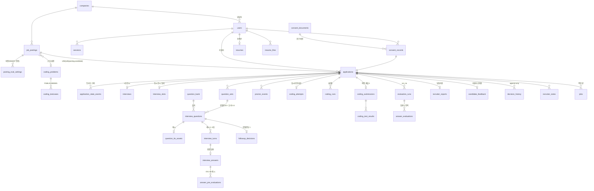

# TRD 03 — 데이터 모델

- 작성: 에이전트 B. 기준: `docs/design/consolidation-round1.md`(통합 결정), ADR-0006, ADR-0011.
- **원천**: `backend/migrations/versions/20261027_0001_initial.py`(원시 SQL, CHECK·트리거·시드 포함)가 유일한 원천이다. `backend/app/models.py`는 그중 앱이 쓰는 칼럼만 매핑한다. 이 문서와 마이그레이션이 다르면 마이그레이션이 맞다. 바꿔야 할 점은 12절 "변경 제안"에만 적었다.
- 규모: 앱 테이블 40개(+ `alembic_version`), 시퀀스 1개(`job_lease_token_seq`), 트리거 함수 5개.
- 공통 규칙
  - 외부에 노출되는 ID는 UUID(`gen_random_uuid()`)다. 로그·큐·이력 ID는 `bigint identity`다.
  - 시각은 모두 `timestamptz`이고 DB 세션 TZ는 UTC다(`app/core/db.py`).
  - 점수는 `numeric(5,2)`로 저장하고, Python에서는 `Decimal`로 다룬다.
  - 생년월일·성별·사진 칼럼은 어느 테이블에도 없다(USR-02, 8.5). 스키마 테스트가 금지 칼럼명을 검사한다.

## 1. ERD



## 2. 테이블

### 2.1 계정·세션

| 테이블 | 목적 | 핵심 칼럼 | 제약·인덱스 |
|---|---|---|---|
| `companies` | 회사 | `name`, `intro`(기업 질문 근거, 6.1) | — |
| `users` | 지원자·담당자·운영자 | `role` CANDIDATE/RECRUITER/OPERATOR, `company_id`, `email`(소문자), `password_hash`(Argon2id), `name`, `phone`, `status` ACTIVE/DISABLED/WITHDRAWN, `withdrawn_at` | CHECK: 담당자 ⇔ `company_id` 있음 / 탈퇴가 아니면 email·hash·name 필수 / 지원자 전화 `^010-[0-9]{4}-[0-9]{4}$`. `UNIQUE(id, company_id)`(복합 FK 대상), `ux_users_email`(email이 있을 때만 유일) |
| `sessions` | 서버 세션(USR-06) | `token_hash`(쿠키 토큰의 SHA-256, PK), `role`, `company_id`(로그인 때 복사), `csrf_token`, `last_seen_at`, `expires_at` | `ix_sessions_user`. 로그아웃·만료·비활성은 행 삭제. 갱신은 60초 단위(`app/auth/sessions.py`) |
| `auth_throttle` | 로그인 실패 제한(SC-04) | `key`(`e:`HMAC(email) / `i:`IP), `failures`, `window_started_at`, `locked_until` | 15분 창, 이메일 5회·IP 30회(`app/auth/throttle.py`). 없는 이메일도 같은 카운터를 쓴다 |

### 2.2 공고·코딩 문제·평가 설정

| 테이블 | 목적 | 핵심 칼럼 | 제약·인덱스 |
|---|---|---|---|
| `coding_problems` | 팀이 CLI로 등록한 문제(OQ-14) | `language`='python'(X-10), `time_limit_ms` 100~20000, `memory_mb` 32~512, `is_active` | 공고에 쓰인 뒤에는 수정하지 않는다(운영 규칙) |
| `coding_testcases` | 공개·비공개 테스트 | `visibility` PUBLIC/HIDDEN, `input`, `expected_output` | `UNIQUE(problem_id, ordinal)`. HIDDEN은 worker 채점 경로만 읽는다(COD-06, ADR-0007) |
| `job_postings` | 공고(7.4) | `status` DRAFT/OPEN/CLOSED, 본문 필드, `headcount`(표시만, JOB-01), `deadline_at`, `coding_enabled`, `coding_problem_id`, `coding_language`, `coding_time_limit_min` 10~180(OQ-17), `current_settings_id`, `settings_locked_at`, `published_at`, `closed_at`, `close_reason` MANUAL/DEADLINE, `deleted_at`, `row_version` | CHECK: 게시 이후 제목·직무·마감·설정 필수 / 게시 이후 코딩을 켰으면 문제·언어·시간 필수 / CLOSED ⇔ `closed_at`. `UNIQUE(id, company_id)`, `FK(created_by, company_id)→users`, `fk_postings_current_settings`(DEFERRABLE INITIALLY DEFERRED). 인덱스 `ix_postings_company`(삭제 제외), `ix_postings_open_deadline`(OPEN만) |
| `posting_eval_settings` | 가중치·커스텀 질문 버전(INSERT 전용) | `version`, `w_expertise`·`w_logic`·`w_specificity`·`w_delivery` 0~100, `w_coding`(코딩을 끈 공고는 NULL, 6.4), `custom_question` 5~500자(1개, X-09), `rubric_version` | CHECK: 합 = 100(ADM-05, AC-21). `UNIQUE(posting_id, version)`, `UNIQUE(id, posting_id)`, `FK(posting_id, company_id)` |

### 2.3 동의·이력서

| 테이블 | 목적 | 핵심 칼럼 | 제약·인덱스 |
|---|---|---|---|
| `consent_documents` | 동의 문구 버전 | `version` PK(예: `consent-v0-draft`, OQ-04), `body_md`, `items`(`[{code,label,required}]`), `is_draft` | — |
| `consent_records` | 동의 기록(SEC-02) | `candidate_id`, `posting_id`, `document_version`, `answers`(항목별 여부), `all_required_agreed`, `agreed_at` | **엄격 불변**(삭제 작업으로도 못 고침). `ix_consent_candidate` |
| `resume_files` | 업로드 PDF | `purpose` REGISTERED/APPLICATION/UPLOAD, `storage_key`(서버 생성, UNIQUE), `size_bytes` 1~10,485,760(RES-02), `sha256`, `page_count`, `text_extractable`(false면 직접 입력 안내, RES-04), `extracted_text`, `extraction_status` PENDING/DONE/NO_TEXT/FAILED, `extracted_fields` | 파일 본문은 DB 밖 볼륨에 둔다. `APPLICATION`은 지원 시점 사본이라 보관 기간이 따로 간다 |
| `resumes` | 마이페이지 등록본(지원자당 1개) | `content`(`{name, education[], career[], projects[], skills[], certificates[]}`), `source` PDF/MANUAL, `file_id`, `schema_version` | 지원 때 자동으로 덮어쓰지 않는다(RES-07) |

### 2.4 지원 건과 상태

| 테이블 | 목적 | 핵심 칼럼 | 제약·인덱스 |
|---|---|---|---|
| `applications` | 지원 건. 상태 3개 분리(7장) | `attempt_status`(7.1, 기본 READY), `eval_status`(7.2, NULL = 평가 없음, OQ-06), `decision_status`(7.3, 기본 UNDECIDED), `resume_snapshot`(불변) + `resume_snapshot_text`(QST-03 근거 원문), `resume_file_id`, `consent_record_id`, `eval_settings_id`, `answered_main_count` 0~10, `interrupted_from` INTERVIEWING/CODING, 시각 칼럼(`applied_at`~`decided_at`), `decided_by`, `withdrawn_at`, `audio_purged_at`, `content_purged_at` | `UNIQUE(posting_id, candidate_id)`(JOB-02, AC-04), `UNIQUE(id, company_id)`, 복합 FK 3개. 교차 CHECK는 4.5절. 인덱스 `ix_app_recruiter_list`, `ix_app_candidate`, `ix_app_active`(PREPARING~INTERRUPTED) |
| `state_transitions` | 허용 전이 표(4절). 코드도 같은 표를 읽는다 | `machine`, `from_state`(`-`는 NULL), `to_state` | PK 3칼럼. 마이그레이션의 `TRANSITIONS`로 시드 |
| `application_state_events` | 전이 이력 | `machine`, `from_state`, `to_state`, `at` | `guard_application` 트리거가 자동 INSERT. `ix_state_events_app` |

### 2.5 면접

| 테이블 | 목적 | 핵심 칼럼 | 제약·인덱스 |
|---|---|---|---|
| `interviews` | 지원 건당 1행 = 1회 응시(INT-12) | `question_set_id`, `precheck_media_ok_at`(지원자 신고), `precheck_webrtc_ok_at`(서버 확인, INT-17), `current_question_id`, `current_phase` PRESENTING/ANSWERING/FINALIZING/DECIDING/DONE, `answer_opened_at`, `answer_deadline_at`(서버 시계, INT-06), `presentation_count`, `followups_used` 0~4(6.2), `text_mode_since`(INT-18), `last_heartbeat_at`, `interruption_count` | PK = `application_id`, `FK(application_id, company_id)` |
| `interview_slots` | 서버 전체 동시 응시 상한(INT-13) | `acquired_at`, `lease_expires_at` | PK = `application_id`. 6절 |
| `question_bank` | 질문은행(QST-01) | `kind` PERSONALITY/COMPANY/JOB, `job_family`, `company_id`, `text`, `text_norm_hash`, `source` SEED/AI, `usage_count`, `embedding real[]`, `embedding_model`, `is_active` | CHECK: JOB이면 직무 필수 / **`source=AI`이면 `company_id` 필수**(C2). `ux_qbank_exact`(유형·직무·회사·정규화 해시), `ix_qbank_pick` |
| `question_sets` | 질문 구성 결과 | `settings_id`(어떤 커스텀 질문 버전으로 만들었나), `status` COMPOSING/READY/SUPERSEDED, `composer_version`, `ready_at` | `ux_qset_live`: 지원 건당 COMPOSING·READY 1개 |
| `interview_questions` | 출제 스냅샷(QST-06) | `seq` 1~10, `role` MAIN/FOLLOWUP, `parent_id`, `slot_type`, `source` BANK/AI/CUSTOM/BANK_FALLBACK, `bank_question_id`, `text`, `grounding`, `answer_limit_sec`, `prompt_version` | CHECK: MAIN ⇔ 부모 없음 / MAIN 60초·FOLLOWUP 45초 / seq별 유형 고정(1~2 인성, 3~4 이력서, 5~6 기업, 7~10 직무, 6.1) / CUSTOM은 JOB 슬롯의 MAIN만. `ux_iq_main`, `ux_iq_followup`(본질문당 꼬리 1), `ux_iq_custom`(세트당 1). 수정·삭제 금지 트리거 |
| `question_tts_assets` | 사전 합성 TTS 캐시 | `audio_key`, `duration_ms`, `voice_model` | 스냅샷과 분리. 사전 합성은 시작 조건이 아니다(T20) |
| `interview_turns` | 문항 제시 1회 = 턴(C3, ADR-0009) | `question_id`, `presentation_no` 1~3(재출제 2회, T11), `state` PRESENTING/ANSWERING/FINALIZING/CLOSED/ABANDONED, `input_mode` VOICE/TEXT, `presented_at`, `tts_ended_at`, `opened_at`, `deadline_at`, `closed_at`, `end_reason` BUTTON/TIMEOUT/DISCONNECT | `UNIQUE(question_id, presentation_no)`, `ux_turn_live`: 지원 건당 진행 중 턴 1개 |
| `interview_answers` | 확정 답변만(OQ-21) | `turn_id`(UNIQUE), `question_id`(UNIQUE: 문항당 확정 1개), `input_mode`, `end_reason` BUTTON/TIMEOUT(X-02), `is_no_answer`, `stt_failed`, `transcript`(지원자가 본 확정 자막), `eval_text`(비식별화본, 평가·인용 기준, EVL-07), `audio_key`, `audio_duration_ms`, `stt_model`, `opened_at`, `confirmed_at`, `reask_count` | CHECK: 답변 없음이면 transcript 비어 있음 / TEXT면 음성 없음. `FK(application_id, company_id)`, `ix_answers_app`. 수정·삭제 금지(보관 삭제만 예외) |
| `followup_decisions` | 꼬리질문을 묻거나 건너뛴 이유(6.2) | `main_question_id` PK, `decision` ASK/SKIP, `reason`, `skip_cause` RULE/LLM/TIMEOUT/INVALID/LIMIT/INFRA, `latency_ms` | 리포트의 "생략 사유"와 튜닝에 쓴다. 지원자에게는 보내지 않는다 |
| `proctor_events` | 화면 이탈 기록(INT-16, P2) | `kind` LEAVE/RETURN, `occurred_at`, `away_ms` | 응시 상태를 바꾸지 않는다(X-06) |

### 2.6 코딩테스트

| 테이블 | 목적 | 핵심 칼럼 | 제약·인덱스 |
|---|---|---|---|
| `coding_attempts` | 코딩 단계 | `problem_id`, `language`, `started_at`, `deadline_at`(서버 시계, 7.1), `draft_code` ≤ 64 KiB, `draft_revision`, `draft_saved_at` | PK = `application_id`, 복합 FK |
| `coding_runs` | [실행] 기록. 공개 예시만 쓴다(COD-03) | `code_sha256`, `status` RUNNING/DONE/ERROR, `verdict` OK/RUNTIME_ERROR/TIMEOUT/MEMORY_LIMIT/OUTPUT_LIMIT/SANDBOX_ERROR, `stdout_head`, `stderr_head` | `ux_coding_run_inflight`: 지원 건당 실행 중 1건 |
| `coding_submissions` | 최종 제출(COD-04) | `code`, `code_sha256`, `kind` MANUAL/AUTO_TIMEOUT/AUTO_EXPIRED(COD-05), `submitted_at`, `grading_status` PENDING/DONE, `compile_ok`, `passed`, `total`, `score` | `application_id` UNIQUE(지원 건당 1개). CHECK: DONE이면 `total>0`, 0≤passed≤total, score 있음 |
| `coding_test_results` | 테스트별 결과(담당자 공개, 6.6) | `passed`, `outcome`, `time_ms` | PK(`submission_id`, `testcase_id`). 비공개 테스트의 출력은 저장하지 않는다 |

### 2.7 평가·리포트·결정

| 테이블 | 목적 | 핵심 칼럼 | 제약·인덱스 |
|---|---|---|---|
| `evaluation_runs` | 평가 실행 1회 | `run_no`(지원 건 단위), `job_id`, `lease_token`(펜싱 토큰 사본), `trigger` SUBMIT/AUTO_RETRY/RECRUITER/OPERATOR, `status` RUNNING/SUCCEEDED/FAILED/TIMED_OUT/ABORTED_INFRA/FENCED_OUT, `model_name`, `model_digest`, `prompt_version`, `rubric_version`, `eval_settings_id`, `scoring_version`(EVL-08), `error_code` | `UNIQUE(application_id, run_no)`, `UNIQUE(id, application_id)`, 복합 FK |
| `answer_evaluations` | 답변(본·꼬리) × 루브릭 항목 | `score` 1~5, `evidence_status` OK/INSUFFICIENT/NO_ANSWER, `insufficient_reason` TOO_SHORT/QUOTE_MISMATCH/NO_EVIDENCE, `quote`(**eval_text의 원문 부분 문자열**, ADR-0008), `quote_start`, `quote_end`, `comment`, `llm_attempts` | PK(`run_id`, `answer_id`, `criterion`). CHECK: INSUFFICIENT ⇔ 사유 있음 / OK가 아니면 1점(6.4) / OK면 인용 필수(AC-16). 수정·삭제 금지 |
| `answer_pre_evaluations` | 선평가 캐시(EVL-05, T15) | `answer_id`, `manifest_hash`, `payload` | PK(`answer_id`, `manifest_hash`). 최종 run이 manifest가 같은 단위만 재사용 |
| `recruiter_reports` | 담당자 리포트(RPT-02) | 항목 점수 4개 + `score_coding`, `total_score` 0~100, `insufficient_count`, `no_answer_count`, `insufficient_by_criterion`, `answered_main_count`, `question_scores`, `weights`, `summary`, `strengths`·`improvements` 1~3개, `code_review`(COD-07, 점수 미반영), `proctor_summary` | PK = `application_id`(이중 기록 불가, R-14), `run_id` UNIQUE, `FK(run_id, application_id)→evaluation_runs` |
| `candidate_feedback` | 지원자 공개용 별도 데이터(RPT-03) | 항목 점수 4개, `strengths`, `improvements`, `coding_all_passed`(OQ-24) | PK = `application_id`. **총점·인용·가중치·메모 칼럼이 없다**(SEC-04) |
| `decision_history` | 결정 이력(ADM-04) | `from_status`, `to_status` PASS/FAIL, `decided_by`, `decided_at` | 엄격 불변. `FK(decided_by, company_id)→users`: 같은 회사 담당자만 기록 가능. CHECK from ≠ to |
| `recruiter_notes` | 담당자 메모(ADM-07) | `author_id`, `body` 1~2000자, `updated_at`, `deleted_at` | `FK(author_id, company_id)`, `FK(application_id, company_id)` |

### 2.8 감사·큐·운영

| 테이블 | 목적 | 핵심 칼럼 | 제약·인덱스 |
|---|---|---|---|
| `audit_logs` | 감사 로그(SEC-08) | `actor_id`, `actor_role`, `company_id`, `action`, `target_type`, `target_id`, `detail`(ID·상태값만), `request_id` | 엄격 불변. `ix_audit_company` |
| `jobs` | 영속 작업 큐(7절) | `kind`, `payload`(ID만), `application_id`, `dedupe_key`, `priority`, `resource` LLM/RUNNER/CPU/NONE, `state` QUEUED/RUNNING/SUCCEEDED/FAILED/CANCELLED, `run_after`, `attempts`/`max_attempts`, `lost_leases`, `infra_deferrals`, `depends_on`, `lease_owner`, `lease_token`, `lease_expires_at`, `attempt_deadline_at`, `last_error_code` | CHECK: RUNNING ⇔ 토큰 있음 / 0 ≤ attempts ≤ max. `ux_jobs_dedupe`(QUEUED·RUNNING 중 유일), `ix_jobs_claim`, `ix_jobs_lease`, `ix_jobs_app` |
| `periodic_tasks` | 주기 작업 일정 | `name`, `interval_sec`, `next_run_at`, `last_ok_at`, `last_error_code` | 마이그레이션 `PERIODIC`으로 시드(7.5절) |
| `file_deletions` | 파일 삭제 outbox | `storage_key`, `reason`, `requested_at`, `done_at` | DB 참조를 먼저 지우고, 파일은 나중에 멱등으로 지운다 |

## 3. 시드

- `state_transitions`: 4절의 표(마이그레이션 `TRANSITIONS`).
- `periodic_tasks`: `job_reaper` 15초, `attempt_sweeper` 30초, `coding_autosubmit` 15초, `posting_autoclose` 60초, `retention_purge`·`file_gc`·`session_gc` 각 3600초.
- 동의 문구, 코딩 문제, 질문은행 SEED, 회사·담당자 계정은 운영자 CLI가 넣는다(OQ-19). 마이그레이션에는 없다.

## 4. 상태 기계

모든 전이는 서비스 코드의 조건부 갱신 `UPDATE applications SET <칼럼>=:to WHERE id=:id AND <칼럼> = ANY(:from)`로만 한다. 0행이면 현재 상태를 다시 읽어 409 `INVALID_STATE`로 응답한다. `guard_application` 트리거가 표에 없는 전이를 SQLSTATE `AP001`로 거부하고, 허용된 전이는 `application_state_events`에 남긴다(2차 방어). 아래 표의 전이 쌍은 `state_transitions` 시드와 정확히 같다.

### 4.1 응시 상태 `ATTEMPT` (PRD 7.1)

| # | 전이 | 주체 | 같은 트랜잭션에서 하는 일 | 근거 |
|---|---|---|---|---|
| A1 | READY → PREPARING | 지원자 `prepare` | 공고 OPEN·마감 전 확인, `interviews` 행 생성, `compose_questions` 작업 등록(중복 키) | 7.1 |
| A2 | PREPARING → READY | 지원자 `leave-prepare` / sweeper(30분 무활동) / 시작 시 상한 초과 | 상한 초과면 별도 트랜잭션에서 READY로(7.1 "상한에 걸려도 READY") | 7.1, INT-13 |
| A3 | PREPARING → INTERVIEWING | 지원자 `start` | 6절의 시작 트랜잭션: 점검 기록, 질문 세트 READY·설정 버전 일치, 슬롯 확보, `settings_locked_at`(JOB-06, OQ-05), `eval_settings_id`, `interview_started_at`, 은행 `usage_count+1` | 7.1, INT-13·14 |
| A4 | INTERVIEWING → CODING | 면접 진행기 | 마지막 본질문(꼬리 포함) 확정 + 코딩 켠 공고 → `coding_attempts`(deadline = now + 제한시간), 슬롯 삭제(T10) | COD-01 |
| A5 | INTERVIEWING → SUBMITTED | 면접 진행기 | 코딩 끈 공고에서 마지막 문항 확정 → `eval_status` ∅→PENDING, `evaluate_application` 등록, 슬롯 삭제 | 7.1, 7.2 |
| A6 | INTERVIEWING → INTERRUPTED | 진행기(연결 상실)·sweeper | `interrupted_from`=INTERVIEWING, 진행 중 턴 ABANDONED, 슬롯 `lease_expires_at`=now+120초(유예, T10), `interruption_count+1` | INT-11 |
| A7 | CODING → SUBMITTED | 지원자 `submit` / `coding_autosubmit` | 제출 행(MANUAL/AUTO_TIMEOUT), `grade_coding` + `evaluate_application`(`depends_on`=채점), eval PENDING | COD-04·05 |
| A8 | CODING → INTERRUPTED | sweeper | 코딩 API·하트비트가 120초 없음(C7). 코딩 마감은 계속 흐름 | C7 |
| A9 | INTERRUPTED → INTERVIEWING | 지원자 `resume`·`text-mode` | 공고 OPEN·마감 전(T23), 슬롯 재확보(유예 중이면 자기 행 재사용), `interrupted_from`=NULL | INT-11, INT-18 |
| A10 | INTERRUPTED → CODING | 지원자 `resume` | `interrupted_from`=CODING, 공고 OPEN, 코딩 마감 전. 슬롯 불필요 | T10 |
| A11 | INTERRUPTED → EXPIRED | `posting_autoclose`·수동 마감 | 응답 수>0이면 eval PENDING + 작업. 코딩 초안이 있으면 AUTO_EXPIRED 제출·채점 | 7.1, OQ-07 |
| A12 | INTERRUPTED → SUBMITTED | `coding_autosubmit` | `interrupted_from`=CODING이고 코딩 마감 경과 → AUTO_TIMEOUT 제출 | **OQ-25**(7.1 표 밖, 임시) |
| A13 | READY → EXPIRED, PREPARING → EXPIRED | 공고 마감 | 응답 0 → `eval_status` NULL, 담당자 결정 허용(OQ-07) | **OQ-26**(7.1 표 밖, 임시) |

- 공고가 마감돼도 INTERVIEWING·CODING은 끝까지 진행한다(OQ-27, T23). 이 둘에서 EXPIRED로 가는 전이는 없다. 마감 후 끊기면 A11로 간다.
- SUBMITTED·EXPIRED에서 나가는 전이는 없다(INT-12).

### 4.2 평가 상태 `EVAL` (PRD 7.2, `-` = NULL)

| 전이 | 주체 | 조건·동작 |
|---|---|---|
| - → PENDING | 시스템 | SUBMITTED 진입, 또는 응답 1개 이상인 EXPIRED 진입과 **같은 트랜잭션**에서 작업 등록(7.2, 8.3) |
| PENDING → RUNNING | worker | 작업 집기와 같은 트랜잭션 |
| RUNNING → DONE | worker | 펜싱 통과 + 리포트·지원자 피드백 INSERT와 같은 트랜잭션 |
| RUNNING → ON_HOLD | worker·reaper | 시도 소진. 작업 FAILED와 같은 트랜잭션. 점수 행을 만들지 않는다(EVL-06) |
| RUNNING → PENDING | worker·reaper | 작업이 다시 QUEUED가 될 때(인프라 반납·임대 상실·자동 재시도). OQ-23 |
| ON_HOLD → PENDING | 담당자 재평가(ADM-06)·운영자 CLI | 새 작업(`max_attempts`=2) |

규칙: `eval_status`는 평가 작업의 상태를 따라간다(QUEUED ↔ PENDING, RUNNING ↔ RUNNING). DONE은 끝 상태다.

### 4.3 채용 결정 `DECISION` (PRD 7.3)

UNDECIDED → PASS, UNDECIDED → FAIL, PASS → FAIL, FAIL → PASS. '검토 전'으로 돌아가는 전이는 없다(OQ-28, T24). 결정할 때 `decision_history` 행, `decided_at`·`decided_by`, 첫 결정이면 `first_decided_at`을 같은 트랜잭션에서 쓴다. 결정 칼럼은 담당자 결정 서비스만 바꾼다(P-8, E SC-19).

### 4.4 공고 상태 (PRD 7.4, `state_transitions` 밖)

| 전이 | 주체 | 조건 |
|---|---|---|
| DRAFT → OPEN | 담당자 게시 | CHECK(필수 필드·코딩 설정) + 서비스 검사: 마감 시각이 미래, 코딩 여부와 현재 가중치 항목 일치 |
| OPEN → CLOSED | 담당자 마감 / `posting_autoclose` | `closed_at`, `close_reason` MANUAL/DEADLINE. 같은 트랜잭션에서 A11·A13 처리 |
| 삭제 | 담당자 | 지원 건이 0개일 때만 `deleted_at`(JOB-04). 지원 생성은 공고 행 `FOR SHARE`, 삭제는 `FOR UPDATE`로 경합을 막는다 |

CLOSED → OPEN은 없다. 지원·시작·재개 API는 `status='OPEN' AND deadline_at > now()`를 직접 검사하므로, 주기 작업이 늦어도 마감 후 요청은 막힌다.

### 4.5 교차 불변식 (CHECK)

| CHECK | 뜻 |
|---|---|
| `attempt_status IN (SUBMITTED, EXPIRED) OR eval_status IS NULL` | 제출 전에는 평가가 없다(OQ-06) |
| `attempt_status <> SUBMITTED OR eval_status IS NOT NULL OR withdrawn_at IS NOT NULL` | 제출 건은 반드시 평가가 걸린다(탈퇴 예외) |
| `decision_status = UNDECIDED OR eval_status = DONE OR (EXPIRED AND eval_status IS NULL)` | 평가 완료 전 결정 불가(7.3), 응답 0개 만료 건은 결정 허용(OQ-07) |
| `(decision_status = UNDECIDED) = (decided_at IS NULL)` | 결정 시각 일관성 |
| `(attempt_status = INTERRUPTED) = (interrupted_from IS NOT NULL)` | 재개 대상 단계 기록 |
| `attempt_status NOT IN (INTERVIEWING, CODING, SUBMITTED) OR eval_settings_id IS NOT NULL` | 면접이 시작되면 가중치 버전이 고정돼 있다 |

### 4.6 면접 턴

PRESENTING(TTS 송출) → ANSWERING(`opened_at`, `deadline_at` = 개방 + 60/45초) → FINALIZING([답변 완료] 또는 마감 + 유예) → CLOSED(`interview_answers` INSERT, `end_reason` BUTTON/TIMEOUT). 진행 중인 턴은 연결 상실 시 ABANDONED(`end_reason`=DISCONNECT)가 되고, 같은 문항이 `presentation_no+1`로 다시 제시된다(OQ-21). 다만 `presentation_no` 상한이 3이라 재출제는 2회까지다. 그 뒤에는 서버가 텍스트 모드를 허용한다(T11·T12).

- 확정은 `UPDATE interview_turns SET state='FINALIZING' WHERE id=:turn AND state='ANSWERING'` 조건부 갱신으로 한 번만 일어난다.
- `interview_answers.turn_id`·`question_id`가 UNIQUE라서 문항당 확정 답변은 1개다. `reask_count`는 `presentation_no − 1`이다.
- 꼬리질문 상한은 두 장치로 지킨다. `ux_iq_followup`이 본질문당 1개를, `UPDATE interviews SET followups_used = followups_used + 1 WHERE … AND followups_used < 4`가 전체 4개를 막는다(6.2).

## 5. 트리거

| 트리거 | 대상 | 동작 | 우회 |
|---|---|---|---|
| `t_iq_immutable` | `interview_questions` UPDATE·DELETE | `AP002` | `SET LOCAL app.purge='on'`(보관 삭제 전용) |
| `t_answers_immutable` | `interview_answers` UPDATE·DELETE | `AP002` | `app.purge` |
| `t_answer_eval_immutable` | `answer_evaluations` UPDATE·DELETE | `AP002` | `app.purge` |
| `t_settings_immutable` | `posting_eval_settings` UPDATE·DELETE | `AP002` | `app.purge` |
| `t_consent_immutable` | `consent_records` UPDATE·DELETE | `AP002` | **불가**(T14) |
| `t_decisions_immutable` | `decision_history` UPDATE·DELETE | `AP002` | **불가** |
| `t_audit_immutable` | `audit_logs` UPDATE·DELETE | `AP002` | **불가** |
| `t_guard_application` | `applications` UPDATE | 표에 없는 전이 `AP001`, 허용된 전이는 이벤트 기록. `resume_snapshot` 변경은 `app.purge`일 때만(`AP002`) | — |
| `t_settings_locked` | `posting_eval_settings` INSERT | 공고 `settings_locked_at`이 있으면 `AP003` | 없음 |
| `t_posting_coding_lock` | `job_postings` UPDATE | 잠긴 뒤 `coding_*`·`current_settings_id` 변경 시 `AP003`(JOB-06) | 없음 |

SQLSTATE 변환(ADR-0011): `AP001` → 409 `INVALID_STATE`, `AP002` → 500(코드 결함, 경보), `AP003` → 409 `SETTINGS_LOCKED`, 유일 위반 → 각 엔드포인트의 409 코드.

## 6. 동시 응시 슬롯·하트비트·시작 트랜잭션

- **점유**: INTERVIEWING만 슬롯을 점유한다(T10). 면접 시작(A3)·재개(A9) 때 확보하고, CODING 진입(A4)·제출(A5) 때 행을 지운다. INTERRUPTED(A6)가 되면 `lease_expires_at`을 now+120초로 두고, 그 사이에는 같은 지원 건만 다시 쓸 수 있다. 상한은 회사별이 아니라 **서버 전체**이며 설정 `max_concurrent_interviews`(기본 2)다.
- **시작 트랜잭션**: AI·샌드박스 상태 확인은 트랜잭션 **밖**(캐시값)에서 한다. 잠금 순서는 지원 건 → 공고 → advisory로 고정한다.
  ```text
  BEGIN; SET LOCAL lock_timeout='2s';
   SELECT … FROM applications WHERE id=:a AND candidate_id=:me FOR UPDATE;      -- 없으면 404
   SELECT … FROM job_postings WHERE id=:p FOR UPDATE;                           -- 설정 변경과 직렬화
   검사: OPEN·마감 전 / PREPARING / 점검 기록 / 질문 세트 READY·settings_id = current_settings_id
   SELECT pg_advisory_xact_lock(7301001);                                      -- 슬롯 전용 키
   n := count(*) FROM interview_slots WHERE lease_expires_at > now() AND application_id <> :a;
   n >= 상한 → ROLLBACK → (별도 트랜잭션) PREPARING→READY → 409 CAPACITY_FULL
   INSERT INTO interview_slots … ON CONFLICT (application_id) DO UPDATE SET lease_expires_at = now() + 슬롯 임대;
   UPDATE job_postings SET settings_locked_at = now() WHERE id=:p AND settings_locked_at IS NULL;
   UPDATE applications SET attempt_status='INTERVIEWING', eval_settings_id=:cur, interview_started_at=now() WHERE id=:a AND attempt_status='PREPARING';
   UPDATE interviews …; UPDATE question_bank SET usage_count = usage_count + 1 … ;
  COMMIT;
  ```
- **하트비트 출처**(C7):

  | 상태 | 출처 | 끊긴 것으로 보는 기준 |
  |---|---|---|
  | 음성 INTERVIEWING | 음성 런타임이 15초마다 `interviews.last_heartbeat_at`과 슬롯 임대를 갱신 | WebRTC 상실을 감지하면 즉시 A6. sweeper는 `slot_lease_seconds`(90초)를 보조 기준으로 쓴다 |
  | 텍스트 모드 INTERVIEWING | HTTP 하트비트(30초)·상태 조회 | 같음 |
  | CODING | 코딩 API(조회·임시저장·실행·제출)와 명시 하트비트 30초 | 120초 → A8 |
  | PREPARING | 점검 API | 30분 → A2 |

## 7. 영속 작업 큐

### 7.1 작업 종류

| kind | resource | priority | max_attempts | dedupe_key | 등록 시점 |
|---|---|---|---|---|---|
| `compose_questions` | LLM | 10 | 3 | `prep:{app}:{settings_id}` | A1, 설정 버전 불일치 시 재구성 |
| `tts_pregen` | CPU | 15 | 3 | `tts:{question_set}` | 질문 세트 READY |
| `extract_resume` | LLM | 20 | 2 | `extract:{file}` | PDF 업로드(텍스트 추출 성공) |
| `grade_coding` | RUNNER | 20 | 3 | `grade:{app}` | 코딩 제출(A7·A11·A12) |
| `pre_evaluate` | LLM | 40 | 2 | `pre:{answer}` | 답변 확정(EVL-05, T15) |
| `evaluate_application` | LLM | 50 | 2 | `eval:{app}` | eval → PENDING인 모든 전이 |
| `purge_files` | NONE | 90 | 10 | `purge:{batch}` | 보관 삭제의 파일 정리 |

- 종류·자원·우선순위·최대 시도는 `app/jobs/queue.py`의 `JOB_KINDS`가 원천이다. 등록은 `enqueue()`로 호출자 트랜잭션 안에서 하고, 같은 `dedupe_key`의 살아 있는 작업이 있으면 아무것도 하지 않는다. 등록 때 `pg_notify('jobs', kind)`.
- 질문 생성의 "1회 재시도 후 은행 대체"(QST-07, T17)는 작업 **안**에서 처리한다. 작업 시도 횟수와는 따로 센다.
- LLM 레인(RT > INTERACTIVE > BATCH)과 선점은 ai 게이트웨이가 맡는다(ADR-0003). 선점(PREEMPTED)은 작업 시도 실패가 아니다.

### 7.2 집기·하트비트·펜싱

```sql
WITH next AS (
  SELECT j.id FROM jobs j
  WHERE j.state='QUEUED' AND j.run_after <= now() AND j.attempts < j.max_attempts
    AND j.resource = ANY(:available)                  -- 상태 탐침이 OK인 자원만 (OQ-23)
    AND (j.depends_on IS NULL OR EXISTS (SELECT 1 FROM jobs d WHERE d.id=j.depends_on AND d.state IN ('SUCCEEDED','FAILED')))
  ORDER BY j.priority, j.run_after, j.id LIMIT 1 FOR UPDATE SKIP LOCKED)
UPDATE jobs j SET state='RUNNING', attempts=j.attempts+1, lease_owner=:worker,
  lease_token=nextval('job_lease_token_seq'), lease_expires_at=now()+:lease, attempt_deadline_at=now()+interval '10 minutes',
  started_at=now()
FROM next WHERE j.id=next.id RETURNING j.*;
```

- 평가 작업이면 같은 트랜잭션에서 두 가지를 한다. `evaluation_runs` INSERT(`run_no`=지원 건 최대+1, `lease_token` 사본, 버전 일체, RUNNING)와 `applications.eval_status` PENDING → RUNNING이다.
- 하트비트: 실행 중 15초마다 `UPDATE jobs SET lease_expires_at=now()+:lease WHERE id=:id AND lease_token=:tok AND state='RUNNING'`. 0행이면 즉시 중단한다.
- **펜싱**: 중간 결과(`answer_evaluations`)는 자기 `run_id`에만 쓰므로 펜싱이 필요 없다. 최종 반영 트랜잭션은 다음 순서다.
  1. `UPDATE jobs SET state='SUCCEEDED', lease_token=NULL … WHERE id=:id AND lease_token=:tok AND state='RUNNING'` — 0행이면 ROLLBACK(좀비 워커).
  2. 리포트·피드백 INSERT(PK가 지원 건이라 두 번째는 실패).
  3. run SUCCEEDED.
  4. `eval_status` RUNNING → DONE.
- 시도 시간 10분은 **임대 시작부터** 잰다(T16, EVL-06). worker가 스스로 시간 제한을 걸고, reaper가 보조한다.
- 깨우기는 `NOTIFY jobs`(등록 트랜잭션 커밋 때 전달)로 하고, 2초 폴링으로 보완한다.

### 7.3 실패 분류

| 상황 | 시도 횟수 | 처리 |
|---|---|---|
| LLM·runner 연결 거부, 503, 탐침 실패 | **미소모** | `attempts−1`, `infra_deferrals+1`, QUEUED, `run_after` 지수 백오프(30초~5분), run ABORTED_INFRA, eval RUNNING→PENDING. 자원 회로가 열려 탐침이 OK가 될 때까지 그 자원의 작업을 집지 않는다 |
| 임대 만료(워커 사망·재시작) | **미소모**(`lost_leases` < 3) | reaper가 `attempts−1`, `lost_leases+1`로 QUEUED, run FENCED_OUT. 3회째부터는 소모(독성 작업) |
| 10분 초과, JSON 재요청(EVL-03) 한도 초과, 코드 예외 | 소모 | `attempts < max`이면 QUEUED(다음 run trigger AUTO_RETRY), 아니면 FAILED + eval ON_HOLD(같은 트랜잭션), run TIMED_OUT/FAILED |
| 채점 작업 FAILED | — | 평가 작업이 `GRADING_FAILED`로 실패 → ON_HOLD. 재평가가 채점도 다시 등록. `SANDBOX_ERROR`는 0점이 아니다(ADR-0007) |

### 7.4 reaper (`job_reaper`, 15초)

`state='RUNNING' AND (lease_expires_at < now() OR attempt_deadline_at < now())`인 행을 `FOR UPDATE SKIP LOCKED`로 잡아 7.3 표대로 처리한다. 서버 재시작 뒤에는 따로 복구 절차가 없다. 모든 진행 상태가 DB에 있고, worker가 기동 직후 reaper를 한 번 돌린다(AC-18).

### 7.5 주기 작업

`UPDATE periodic_tasks SET next_run_at = now() + make_interval(secs => interval_sec) WHERE name=:n AND next_run_at <= now() RETURNING name`으로 한 worker만 실행한다. 본문은 모두 멱등이다.

| 이름 | 주기 | 동작 |
|---|---|---|
| `job_reaper` | 15초 | 7.4 |
| `attempt_sweeper` | 30초 | 6절 하트비트 기준으로 A6·A8·A2. 유예가 지난 슬롯 삭제. 응시가 INTERVIEWING이 아닌데 진행 중인 턴 → ABANDONED. 30초 넘게 RUNNING인 `coding_runs` → ERROR |
| `coding_autosubmit` | 15초 | 코딩 마감 + 유예가 지났고 제출이 없는 건 → 마지막 `draft_code`로 AUTO_TIMEOUT 제출(A7/A12). `coding_attempts` `FOR UPDATE` + `ON CONFLICT (application_id) DO NOTHING`으로 수동 제출과 경합해도 1건 |
| `posting_autoclose` | 60초 | `status='OPEN' AND deadline_at <= now()` → CLOSED(DEADLINE) + A11·A13 |
| `retention_purge` | 3600초 | 8절 |
| `file_gc` | 3600초 | `file_deletions` 처리(없는 파일도 성공), 하루 지난 미참조 파일 삭제 |
| `session_gc` | 3600초 | 만료 세션·풀린 `auth_throttle` 삭제 |

## 8. 보관·삭제 (8.5, SEC-07, USR-07)

- **기산점**(OQ-11 잠정): `COALESCE(applications.first_decided_at, job_postings.closed_at)`. 기간은 설정값 `retention_audio_days`=30, `retention_content_days`=365이다(법률 확인 전, X-13).
- **절차**: 대상 지원 건을 200개씩 `FOR UPDATE SKIP LOCKED`로 잡는다. 파일 키를 `file_deletions`에 넣고, `SET LOCAL app.purge='on'` 상태에서 DB 참조를 지운 뒤 `*_purged_at`을 찍고 커밋한다. 실제 파일은 `file_gc`가 지운다. 실행마다 감사 `DATA_PURGE`(건수만)를 남긴다. 삭제 작업은 `as_of` 인자를 받아 테스트에서 시간을 고정할 수 있다.

| 대상 | 시점 | 처리 |
|---|---|---|
| 답변 음성(`interview_answers.audio_key`) | 기산 + 30일 | 키 NULL, 파일 삭제, `audio_purged_at` |
| 카메라 영상 | — | 저장하지 않는다(서버로 오지 않음, INT-08) |
| TTS 캐시(`question_tts_assets`) | 응시 종료(SUBMITTED·EXPIRED) 뒤 첫 실행 | 행·파일 삭제 |
| 답변 텍스트·질문 스냅샷·턴·평가·선평가·리포트·지원자 피드백·꼬리질문 판단·이탈 기록·코딩 코드·초안·실행·채점 결과·메모·이력서 스냅샷·지원 시점 PDF | 기산 + 365일 | 행 삭제(불변 테이블은 `app.purge`), `resume_snapshot`={}·`resume_snapshot_text`='', `content_purged_at` |
| 남기는 것 | — | 지원 건 행(공고·날짜·상태 3개), `decision_history`, `consent_records`, `audit_logs`, `evaluation_runs`(버전 메타데이터) |
| 탈퇴(USR-07, OQ-12) | 즉시 | 진행 중 응시(PREPARING·INTERVIEWING·CODING)가 있으면 거부(OQ-12 잠정). 그 외: 전 세션 삭제, 진행 중 작업 CANCELLED(늦은 쓰기는 펜싱으로 차단), 모든 지원 건 내용 삭제 + `withdrawn_at`, 등록 이력서·파일 삭제, `users` 익명화(email·이름·전화·해시 NULL, WITHDRAWN). 동의·결정·감사 기록은 개인정보 없이 유지 |

## 9. 점수 저장 (6.4·6.5, T18·T19)

- **답변 × 항목**(`answer_evaluations`): LLM은 정수 1~5, 인용, 코멘트만 낸다. `evidence_status`의 뜻은 다음과 같다.
  - `OK`: 인용이 eval_text 원문 범위로 검증됨.
  - `INSUFFICIENT`: 근거 부족(TOO_SHORT는 LLM 전 규칙, QUOTE_MISMATCH는 1회 재생성 후 실패, NO_EVIDENCE는 인용 없음 선언).
  - `NO_ANSWER`: 답변 없음. 전 항목 1점.
  - OK가 아니면 1점이다.
- **문항 점수**: 꼬리 답변 행이 있으면 `(본답변 + 꼬리답변) / 2`, 없으면 본답변 점수다(정확값). 꼬리질문에 답하기 전에 끊기면 본답변만 쓰고 감점하지 않는다(6.2).
- **항목 점수**: `(Σ 문항 점수 / N) × 20`을 `quantize(0.01, ROUND_HALF_UP)`해 저장한다. N은 SUBMITTED면 10, EXPIRED면 확정 답변이 있는 본질문 수다(OQ-07).
- **코딩 점수**: `passed / total × 100`을 0.01 단위로 반올림한다. 빈 코드·컴파일 실패는 실행 없이 0이다(6.5). 코딩 단계에 도달하지 못했으면 0이다(OQ-07).
- **총점**: **저장된(반올림된) 항목 점수와 코딩 점수**로 `Σ(점수 × 가중치 / 100)`를 계산하고 0.01 단위 HALF_UP으로 반올림한다(T18, AC-17 결정적 재현). 화면 표시는 소수 첫째 자리이고, 표시값은 서버가 만든다.
- **개수**(T19): `insufficient_count`는 INSUFFICIENT 행 수(답변×항목), `no_answer_count`는 '답변 없음' 답변 수, `insufficient_by_criterion`은 항목별 근거 부족 수다. 두 개수는 따로 센다.
- **스냅샷**: `question_scores` = `[{seq, main_answer_id, followup_answer_id|null, scores:{EXPERTISE:"3.50",…}}]`(면접 순서), `weights` = 적용한 가중치 사본, run의 `scoring_version`.
- **지원자 피드백**: 항목 점수 4개는 리포트와 같은 값이다. `coding_all_passed`는 코딩을 켠 공고면 `passed = total`, 끈 공고면 NULL이다.

## 10. 회사별 격리 (SEC-03)

1. **복합 FK**: 회사 소유 테이블은 `company_id`를 갖고, 부모를 `(id, company_id)`로 참조한다. 자식의 회사가 부모와 다를 수 없다.
   - 대상: `job_postings`·`posting_eval_settings`·`applications`·`interviews`·`question_sets`·`interview_questions`·`interview_answers`·`coding_attempts`·`coding_submissions`·`evaluation_runs`·`recruiter_reports`·`candidate_feedback`·`decision_history`·`recruiter_notes`.
   - 담당자를 가리키는 칼럼(`created_by`, `decided_by`, `author_id`)도 `(user_id, company_id)`로 묶어, 다른 회사 담당자의 기록을 막는다.
2. **부모 경유 테이블**: 다음 테이블은 `company_id` 없이 지원 건·문항·제출·run을 거쳐서만 조회한다. 담당자 쿼리는 반드시 `applications.company_id` 조건이 있는 조인을 거친다.
   - `interview_turns`, `coding_runs`, `coding_test_results`, `followup_decisions`, `proctor_events`, `answer_evaluations`, `answer_pre_evaluations`, `question_tts_assets`, `application_state_events`, `interview_slots`.
3. **소유자 범위**: `resumes`·`resume_files`·`consent_records`는 지원자(`owner_id`·`candidate_id`) 범위다. `question_bank`는 `company_id IS NULL OR = 공고 회사`로만 고른다(C2). `coding_problems`는 공용이다.
4. **스코프 헬퍼**(`app/auth/scope`, ADR-0012):
   - 담당자 경로: `get_for_company(Model, id, ctx)` / `select_for_company(Model, ctx)`.
   - 지원자 경로: `get_for_owner(Model, id, ctx)`.
   - 회사와 사용자 ID는 세션(`RecruiterCtx`·`CandidateCtx`)에서만 온다.
   - 범위 밖이면 존재하지 않을 때와 같은 404 `NOT_FOUND`를 돌려준다(`app/core/errors.not_found`).
5. **보류**: DB 역할 분리·칼럼 권한·RLS는 P1로 미뤘다(통합 결정). P0의 1차 방어는 헬퍼, IDOR 매트릭스 테스트(E 3.5), 정적 검사(담당자 모듈의 원시 SQL 금지)다.

## 11. 마이그레이션 운영

- Alembic 리비전 `YYYYMMDD_NNNN_<slug>.py`. 원시 SQL 중심이며, `split_sql`로 문장 하나씩 실행한다(asyncpg).
- 트리거·CHECK·시드는 마이그레이션에만 둔다. 모델(`models.py`)은 매핑만 한다.
- 배포는 앱 기동 전에 `alembic upgrade head`를 별도 명령으로 실행한다. 운영 데이터가 생긴 뒤에는 expand → migrate → contract 2단계로 한다. `downgrade`는 개발용(스키마 초기화)이다.
- CI: 빈 DB에 upgrade → 스키마 검사(금지 칼럼명, 트리거 존재, `state_transitions` = 코드 상수) → downgrade → upgrade.

## 12. 변경 제안 (코드·스키마는 수정하지 않았다)

| # | 제안 | 근거 | 영향 |
|---|---|---|---|
| P-1 | `applications`에 CHECK `attempt_status <> 'EXPIRED' OR eval_status IS NOT NULL OR answered_main_count = 0 OR withdrawn_at IS NOT NULL` 추가 | 응답이 있는 만료 건에 평가 작업이 빠지는 것을 DB가 막지 못한다(7.2 "분석 누락 0건", OQ-07). SUBMITTED에는 같은 CHECK가 있다 | 마이그레이션 0002 |
| P-2 | 설정 정합: `answer_grace_seconds` 기본 1.5 → **1.0**(T9). 새 설정 `slot_interrupted_grace_seconds=120`(T10), `coding_idle_interrupt_seconds=120`(C7), `precheck_max_connections=4`(C4), `job_lease_seconds=60`, `job_heartbeat_seconds=15` | 통합 결정 값이 `app/core/config.py`에 없거나 다르다 | `config.py` |
| P-3 | `evaluation_runs.manifest_hash text NOT NULL` 추가 | 선평가 재사용 키(`answer_pre_evaluations.manifest_hash`)와 최종 run을 이을 칼럼이 없어, 재사용이 맞았는지 사후 검증할 수 없다(EVL-08, T15) | 0002, C의 manifest 계약 |
| P-4 | `coding_submissions`에 트리거 추가: `code`·`code_sha256`·`kind`·`submitted_at` 변경 금지(채점 칼럼만 허용, `app.purge` 예외) | 최종 제출 스냅샷(COD-04)이 앱 결함으로 바뀔 수 있다. 다른 스냅샷 테이블과 수준을 맞춘다 | 0002 |
| P-5 | `recruiter_reports`·`candidate_feedback`에 `forbid_mutation` 트리거 추가 | DONE이 끝 상태라 갱신할 경로가 없다. 지원자 공개 데이터가 사후에 바뀌는 것을 막는다 | 0002 |
| P-6 | `interviews.state_version int NOT NULL DEFAULT 0`(턴·상태가 바뀔 때마다 +1) | D의 상태 스냅샷 재동기화(D 4.2 IV-7 `version`). 지금은 `turn_id`+`state`로 대신한다(04 문서) | 0002, 선택 |
| P-7 | `audit_logs`에 `prev_hash`, `row_hash`, `sealed_at` 추가 + 1분 주기 봉인 작업(P1) | E SC-68. 요청마다 체인을 계산하면 동시 INSERT에서 체인이 갈라진다(B 리뷰 R-15). 감사 보관 기간은 OQ-33 | 0003(P1) |
| P-8 | 이력서 표준 항목 JSON 키를 이 문서 2.3의 `career`·`certificates`로 통일(C의 T1 출력 `experience`·`certifications`를 변환) | 같은 데이터에 키가 두 벌이면 스냅샷 검증·화면이 갈라진다(B 리뷰 R-20) | 05 문서·추출 코드 |
