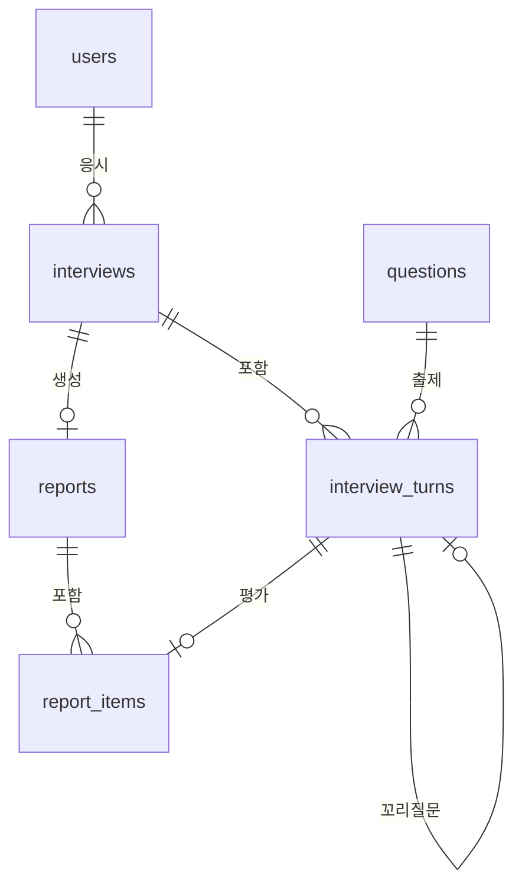

# AI 모의면접 플랫폼 MVP 기능정의서

| 항목 | 내용 |
|---|---|
| 문서 버전 | v1.0 |
| 작성일 | 2026-10-25 |
| 작성자 | 성준 |
| 관련 문서 | [화면정의서](./화면정의서.md) |

---

## 1. 개요

### 1.1 목적
구직자가 직무와 난이도를 골라 AI 면접관과 모의면접을 진행하고, 루브릭 기반 피드백 리포트를 받는 웹 서비스를 만든다. 관리자는 회원, 질문 데이터, 면접 결과를 관리한다.

### 1.2 핵심 흐름
```
질문 제시 → 음성/텍스트 답변 → (필요 시) 꼬리질문 → 다음 질문 … → 면접 종료 → 루브릭 기반 피드백 리포트
```

### 1.3 사용자 역할
| 역할 | 설명 | 계정 생성 방법 |
|---|---|---|
| 구직자 (candidate) | 모의면접을 보고 본인 리포트를 확인한다 | 회원가입 화면에서 직접 가입 |
| 관리자 (admin) | 회원·질문·면접 결과를 관리한다 | 초기 시드 스크립트로 생성 (회원가입 화면으로는 만들 수 없음) |

### 1.4 범위
| 구분 | 내용 |
|---|---|
| 포함 | 회원관리(구직자/관리자), 질문 데이터 적재와 임베딩, 벡터 검색 기반 질문 선택, LLM 꼬리질문, 텍스트 답변, 음성 답변(녹음 후 업로드 → STT), 루브릭 기반 리포트, 관리자 화면 |
| 제외 | WebRTC 실시간 영상·음성 스트리밍, 표정·음성 감정 분석, 코딩 IDE, 화이트보드, AI 음성(TTS), 클라우드 배포, Kubernetes, 유료 API |

### 1.5 실행 환경 (학원 PC 기준)
| 항목 | 사양 |
|---|---|
| GPU | NVIDIA GTX 1660 Super (VRAM 6GB) |
| RAM | 64GB |
| 배포 | 로컬 실행. PostgreSQL은 Docker, 백엔드·프론트엔드는 로컬 프로세스로 실행 (GPU 연동을 단순하게 하기 위함) |

---

## 2. 기술 스택

| 구분 | 기술 | 비고 |
|---|---|---|
| 프론트엔드 | React + Vite, TypeScript | SPA. 음성 녹음은 브라우저 MediaRecorder API |
| 백엔드 | FastAPI (Python 3.11), SQLAlchemy, Pydantic | 리포트 생성은 FastAPI BackgroundTasks로 비동기 처리 |
| DB | PostgreSQL 16 | Docker 이미지 `pgvector/pgvector:pg16` |
| 벡터 DB | pgvector | 질문 임베딩 저장, 코사인 유사도 검색 |
| 인증 | JWT (Access Token), bcrypt | |
| LLM | `Qwen2.5-7B-Instruct` GGUF Q4_K_M (약 4.7GB) + llama-cpp-python | GPU 실행. 느리면 `EXAONE-3.5-2.4B-Instruct` GGUF로 교체. 1660 Super는 FP16 연산이 불안정해 transformers 대신 GGUF 사용 |
| STT | `faster-whisper` small (필요 시 medium), int8, CPU | 언어 `ko` 고정 |
| 임베딩 | `BAAI/bge-m3` (1024차원), CPU | sentence-transformers |
| 질문 데이터 | AI Hub 「채용면접 인터뷰 데이터」, Hugging Face 면접 질문 데이터셋 | 사용 전 데이터 라이선스 확인 |

> 모든 모델은 Hugging Face에서 직접 내려받아 로컬에서 추론한다. VRAM 6GB는 LLM 전용으로 쓰고, STT와 임베딩은 CPU에서 실행한다.

---

## 3. 기능 목록

우선순위: **필수** = MVP에 반드시 포함, **선택** = 일정이 남으면 구현

| 기능 ID | 대분류 | 기능명 | 설명 | 사용자 | 우선순위 |
|---|---|---|---|---|---|
| AUTH-01 | 회원 | 회원가입 | 이메일, 비밀번호, 이름으로 구직자 계정 생성 | 비회원 | 필수 |
| AUTH-02 | 회원 | 로그인 | 이메일·비밀번호로 로그인, JWT 발급 | 전체 | 필수 |
| AUTH-03 | 회원 | 로그아웃 | 클라이언트에 저장된 토큰 삭제 | 전체 | 필수 |
| AUTH-04 | 회원 | 내 정보 조회·수정 | 이름 조회·수정 (이메일은 수정 불가) | 전체 | 필수 |
| AUTH-05 | 회원 | 비밀번호 변경 | 현재 비밀번호 확인 후 변경 | 전체 | 선택 |
| AUTH-06 | 회원 | 회원 탈퇴 | 계정과 면접 기록, 녹음 파일 영구 삭제 | 구직자 | 필수 |
| QST-01 | 질문 | 질문 데이터 적재 | AI Hub/HF 데이터를 정제해 DB에 일괄 저장 (CLI 스크립트) | 개발자 | 필수 |
| QST-02 | 질문 | 질문 임베딩 생성 | 질문 본문을 bge-m3로 임베딩해 pgvector에 저장 | 시스템 | 필수 |
| QST-03 | 질문 | 질문 목록·검색 | 직무, 유형, 난이도, 키워드로 질문 조회 | 관리자 | 필수 |
| QST-04 | 질문 | 질문 등록·수정·삭제 | 질문 관리. 등록·수정 시 임베딩 재생성 | 관리자 | 필수 |
| QST-05 | 질문 | 유사 질문 검색 | 입력 문장과 의미가 비슷한 질문 상위 N개 조회 | 관리자 | 필수 |
| INT-01 | 면접 | 면접 설정 | 직무, 난이도, 본질문 수 선택 | 구직자 | 필수 |
| INT-02 | 면접 | 면접 시작 | 면접 세션 생성 후 첫 질문 제시 | 구직자 | 필수 |
| INT-03 | 면접 | 질문 제시 | 현재 질문과 진행률(본질문 n/N) 표시 | 구직자 | 필수 |
| INT-04 | 면접 | 텍스트 답변 | 답변을 입력해 제출 | 구직자 | 필수 |
| INT-05 | 면접 | 음성 답변 | 녹음 → 업로드 → STT 변환 → 텍스트 확인·수정 → 제출 | 구직자 | 필수 |
| INT-06 | 면접 | 다음 질문 선택 | 직전 답변을 기준으로 벡터 검색 + MMR로 다음 본질문 선택 | 시스템 | 필수 |
| INT-07 | 면접 | 꼬리질문 생성 | 본질문 답변을 LLM이 분석해 필요하면 꼬리질문 1개 생성 | 시스템 | 필수 |
| INT-08 | 면접 | 면접 종료 | 모든 질문 완료 시 자동 종료, 또는 사용자가 중단 | 구직자 | 필수 |
| INT-09 | 면접 | 면접 이력 조회 | 본인 면접 목록과 상태, 점수 조회 | 구직자 | 필수 |
| INT-10 | 면접 | 점수 추이 | 최근 완료 면접 10개의 항목별 점수 그래프 (구직자 홈) | 구직자 | 선택 |
| RPT-01 | 리포트 | 리포트 생성 | 면접 완료 후 문항별·종합 평가를 LLM으로 생성 | 시스템 | 필수 |
| RPT-02 | 리포트 | 리포트 조회 | 문항별 점수, 피드백, 모범 답변 예시, 종합 평가 조회 | 구직자 | 필수 |
| RPT-03 | 리포트 | 리포트 재생성 | 생성 실패 시 다시 생성 요청 | 구직자, 관리자 | 필수 |
| ADM-01 | 관리자 | 대시보드 | 회원 수, 면접 수, 평균 점수, 최근 7일 면접 수, 직무별 평균 점수, 최근 면접 목록 | 관리자 | 필수 |
| ADM-02 | 관리자 | 회원 목록·상세 | 회원 검색, 회원별 면접 이력 조회 | 관리자 | 필수 |
| ADM-03 | 관리자 | 회원 활성/비활성 | 비활성 회원은 로그인 불가 | 관리자 | 선택 |
| ADM-04 | 관리자 | 면접·리포트 열람 | 전체 면접 목록과 리포트 조회 | 관리자 | 필수 |

---

## 4. 기능 상세

### AUTH-01 회원가입
| 항목 | 내용 |
|---|---|
| 입력 | 이메일, 비밀번호, 비밀번호 확인, 이름 |
| 검증 | 이메일 형식, 이메일 중복 불가, 비밀번호 8자 이상(영문+숫자 포함), 비밀번호 확인 일치, 이름 1~20자 |
| 처리 | 비밀번호를 bcrypt로 해시해 `role=candidate`로 저장 |
| 출력 | 가입 완료 후 로그인 화면으로 이동 |
| 예외 | 중복 이메일 → "이미 가입된 이메일입니다." |

### AUTH-02 로그인
| 항목 | 내용 |
|---|---|
| 입력 | 이메일, 비밀번호 |
| 처리 | 비밀번호 검증 후 JWT Access Token 발급 (유효시간 60분, payload: user_id, role) |
| 출력 | 구직자 → 구직자 홈, 관리자 → 관리자 대시보드 |
| 예외 | 불일치 → "이메일 또는 비밀번호가 올바르지 않습니다." / 비활성 계정 → "이용이 제한된 계정입니다." / 토큰 만료 → 로그인 화면으로 이동 |

### AUTH-06 회원 탈퇴
| 항목 | 내용 |
|---|---|
| 입력 | 현재 비밀번호, 탈퇴 확인 체크 |
| 처리 | 사용자, 면접, 턴, 리포트를 CASCADE 삭제하고 서버의 녹음 파일 폴더도 삭제 |
| 출력 | 로그아웃 후 로그인 화면으로 이동 |

### QST-01 질문 데이터 적재
| 항목 | 내용 |
|---|---|
| 입력 | AI Hub/HF 원본 파일 (JSON/CSV) |
| 처리 | ① 질문 문장 추출 ② 직무·유형(기술/인성)·난이도 매핑 ③ 공백·중복 제거 (정규화한 문장 기준) ④ DB 저장 ⑤ QST-02 호출 |
| 출력 | 적재 건수, 중복 제외 건수, 실패 건수 로그 |
| 비고 | 난이도 정보가 없는 데이터는 기본값 `2(보통)`로 저장하고 관리자가 수정 |

### QST-02 질문 임베딩 생성
| 항목 | 내용 |
|---|---|
| 처리 | 질문 본문을 bge-m3로 임베딩 (정규화된 1024차원 벡터) 후 `questions.embedding`에 저장 |
| 시점 | 적재 시 일괄 생성, 관리자가 질문을 등록·수정할 때 해당 건만 재생성 |
| 인덱스 | `embedding`에 HNSW 인덱스 (`vector_cosine_ops`) |

### QST-05 유사 질문 검색
| 항목 | 내용 |
|---|---|
| 입력 | 검색 문장, 개수 N (기본 10), 선택 필터(직무, 유형, 난이도) |
| 처리 | 검색 문장을 임베딩해 코사인 거리 순으로 상위 N개 조회 |
| 출력 | 질문 목록과 유사도 점수 |
| 용도 | 관리자의 중복 질문 확인, 벡터 검색 동작 검증 |

### INT-01 면접 설정
| 항목 | 입력값 |
|---|---|
| 직무 | 질문 데이터에 있는 직무 목록에서 선택 (예: 백엔드 개발, 프론트엔드 개발, 데이터 분석 등) |
| 난이도 | 쉬움(1) / 보통(2) / 어려움(3) |
| 본질문 수 | 3~10개, 기본 5개 |
| 질문 유형 | 기술 / 인성 / 혼합 (기본 혼합) |

### INT-02 면접 시작
| 항목 | 내용 |
|---|---|
| 처리 | ① `interviews` 레코드 생성 (`status=in_progress`) ② 첫 질문 선택: 설정 조건에 맞는 질문 중 무작위 1개 (첫 질문은 직전 답변이 없으므로 벡터 검색을 쓰지 않음) ③ 턴 저장 |
| 출력 | 면접 진행 화면으로 이동, 첫 질문 표시 |
| 예외 | 조건에 맞는 질문이 본질문 수보다 적으면 → "선택한 조건의 질문이 부족합니다. 조건을 바꿔주세요." / 진행 중(`in_progress`)인 면접이 있으면 확인 후 이전 면접을 `aborted`로 바꾸고 새로 시작 (구직자당 진행 중 면접은 1개) |

### INT-04 텍스트 답변
| 항목 | 내용 |
|---|---|
| 입력 | 답변 텍스트 (1~2,000자) |
| 처리 | 턴에 답변 저장 (`answer_type=text`) → 본질문이면 INT-07, 꼬리질문이면 INT-06 실행 |
| 출력 | 다음 질문(꼬리질문 또는 다음 본질문) 또는 면접 종료 |
| 예외 | 빈 답변 제출 불가. "잘 모르겠습니다" 같은 짧은 답변은 허용 |

### INT-05 음성 답변
| 단계 | 내용 |
|---|---|
| 1. 녹음 | 브라우저 MediaRecorder로 녹음 (webm/opus). 최대 3분, 남은 시간 표시. 최초 사용 시 마이크 권한 요청 |
| 2. 업로드 | 녹음 종료 시 서버로 업로드. 서버는 `storage/audio/{interview_id}/{turn_id}.webm`에 저장 |
| 3. STT | faster-whisper로 텍스트 변환 (`language=ko`) |
| 4. 확인·수정 | 변환된 텍스트를 답변 입력창에 채움. 사용자가 수정 가능 |
| 5. 제출 | INT-04와 같은 방식으로 제출하되 `answer_type=voice`, 녹음 길이(초) 함께 저장 |
| 예외 | 마이크 권한 거부 → "마이크 권한이 필요합니다. 텍스트로 답변할 수도 있어요." / 인식 결과가 비어 있음 → "음성을 인식하지 못했습니다. 다시 녹음해주세요." |

### INT-06 다음 질문 선택 (벡터 검색 + MMR)
| 항목 | 내용 |
|---|---|
| 시점 | 본질문의 답변(꼬리질문이 있었다면 꼬리질문의 답변까지) 처리 후 |
| 쿼리 | `직전 본질문 + 직전 답변` 문장을 bge-m3로 임베딩 |
| 후보 검색 | 설정 조건(직무, 난이도, 유형) 필터 + 이번 면접에서 이미 나온 질문 제외 → 코사인 유사도 상위 20개 |
| MMR 선택 | `score = λ × 쿼리와의 유사도 − (1 − λ) × 이미 나온 질문들과의 최대 유사도`, λ = 0.5. 가장 높은 1개 선택 |
| 의도 | 직전 답변과 이어지는 주제를 고르되, 이미 물어본 질문과 비슷한 질문은 피한다 |
| 유형 혼합 | 유형이 '혼합'이면 기술/인성을 번갈아 필터링 |
| 종료 조건 | 본질문 수에 도달하면 INT-08로 이동 |

### INT-07 꼬리질문 생성
| 항목 | 내용 |
|---|---|
| 시점 | 본질문에 답변한 직후. 본질문 1개당 꼬리질문 최대 1개 |
| 입력 | 직무, 본질문, 답변 |
| 처리 | LLM에 아래 JSON 스키마로 출력을 강제 (llama.cpp JSON 스키마 제약) |
| 판단 기준 | 답변이 구체적인 경험·기술을 언급해 더 깊게 물을 수 있으면 생성. 답변이 비어 있거나 "모르겠다"이면 생성하지 않음 |
| 실패 처리 | JSON 파싱 실패 시 최대 2회 재시도, 그래도 실패하면 꼬리질문 없이 INT-06 진행 |

```json
{
  "need_followup": true,
  "followup_question": "MSA 도입 시 서비스 간 트랜잭션은 어떻게 관리하셨나요?",
  "reason": "MSA 경험을 언급했지만 구체적인 문제 해결 과정이 없음"
}
```

시스템 프롬프트 요지:
> 당신은 {직무} 분야의 시니어 면접관입니다. 지원자의 답변을 읽고, 답변에서 언급한 경험이나 개념을 더 깊이 확인할 수 있는 꼬리질문이 필요한지 판단하세요. 꼬리질문은 한 문장, 정중한 존댓말로 작성하고 정답을 알려주지 마세요.

### INT-08 면접 종료
| 구분 | 처리 |
|---|---|
| 정상 종료 | 마지막 본질문(과 꼬리질문)에 답하면 `status=completed`, `ended_at` 저장 → RPT-01 시작 → 리포트 화면으로 이동 |
| 중단 | 사용자가 [면접 중단] 클릭 → 확인 창 → `status=aborted`. 리포트를 만들지 않음 |
| 이탈 | 진행 중 브라우저를 닫으면 `in_progress`로 남음. 면접 이력에서 [이어하기]로 마지막 미답변 질문부터 재개 |

### RPT-01 리포트 생성
| 항목 | 내용 |
|---|---|
| 시점 | 면접 정상 종료 직후 백그라운드 실행 |
| 상태 | `pending` → `generating` → `done` / `failed` |
| 1단계: 문항별 평가 | 본질문 1개와 그 꼬리질문을 한 묶음으로 LLM에 전달해 루브릭 점수와 피드백 생성 (5장 루브릭 사용) |
| 2단계: 종합 평가 | 문항별 결과를 모아 종합 요약, 강점 3개, 개선점 3개 생성 |
| 점수 계산 | 항목별 점수 = 문항 점수 평균 (소수점 1자리). 종합 점수 = 세 항목 평균 × 20 (100점 환산) |
| 실패 처리 | 문항 단위로 2회 재시도. 그래도 실패하면 `failed`와 오류 메시지 저장 → RPT-03으로 재생성 |
| 화면 반영 | 리포트 화면이 3초마다 상태를 조회해 완료되면 결과 표시 |

### RPT-02 리포트 조회
| 구성 | 내용 |
|---|---|
| 종합 | 종합 점수(100점), 항목별 점수(5점), 종합 요약, 강점, 개선점 |
| 문항별 | 질문, 내 답변(음성이면 녹음 재생), 꼬리질문과 답변, 항목별 점수, 피드백, 모범 답변 예시 |
| 권한 | 구직자는 본인 리포트만, 관리자는 전체 조회 |

---

## 5. 평가 루브릭

원본 계획서 8.1절의 루브릭을 사용한다. 각 항목은 1~5점이며, 2점과 4점은 인접 기준의 중간이다.

| 평가 항목 | 1점 (미흡) | 3점 (보통) | 5점 (탁월) |
|---|---|---|---|
| 개념 이해도 | 핵심 개념을 정의하지 못하거나 오개념을 가지고 있음 | 개념은 정확히 정의하나 실무 적용 사례를 제시하지 못함 | 개념을 정확히 이해하고 장단점(Trade-off)과 실제 적용 사례를 논리적으로 설명함 |
| 문제 해결력 | 문제 해결의 실마리를 찾지 못함 | 문제를 해결하나 최적화된 방법은 아님 | 문제를 스스로 정의하고 여러 해결책을 비교해 최적해를 도출함 |
| 커뮤니케이션 | 답변이 장황하고 핵심이 불분명함 | 질문 의도를 파악해 대답하나 구조화가 부족함 | 두괄식으로 명확히 답변하고 논리적으로 구조화됨 |

> 인성 질문의 '개념 이해도'는 "질문 의도와 자기 경험의 연결", '문제 해결력'은 "STAR(상황·과제·행동·결과) 구조로 경험을 설명했는지"로 해석해 평가하도록 프롬프트에 명시한다.
> 원본 루브릭의 비언어적 태도·시선 처리 기준은 영상 분석을 제외했으므로 쓰지 않는다.

### 5.1 문항별 평가 출력 스키마
```json
{
  "concept_score": 4,
  "problem_solving_score": 3,
  "communication_score": 4,
  "feedback": "트랜잭션 관리 경험은 구체적이지만 Saga 패턴을 선택한 이유가 빠졌습니다.",
  "model_answer": "저는 주문·결제 서비스를 분리하면서 Saga 패턴을 도입했습니다. ..."
}
```

### 5.2 종합 평가 출력 스키마
```json
{
  "summary": "기술 개념은 정확하지만 경험을 구조화해 설명하는 연습이 필요합니다.",
  "strengths": ["...", "...", "..."],
  "improvements": ["...", "...", "..."]
}
```

---

## 6. 데이터 모델



### users (회원)
| 컬럼 | 타입 | 제약 | 설명 |
|---|---|---|---|
| id | BIGSERIAL | PK | |
| email | VARCHAR(255) | UNIQUE, NOT NULL | 로그인 ID |
| password_hash | VARCHAR(255) | NOT NULL | bcrypt |
| name | VARCHAR(20) | NOT NULL | |
| role | VARCHAR(10) | NOT NULL | `candidate` / `admin` |
| is_active | BOOLEAN | DEFAULT true | |
| created_at, updated_at | TIMESTAMPTZ | | |

### questions (질문)
| 컬럼 | 타입 | 제약 | 설명 |
|---|---|---|---|
| id | BIGSERIAL | PK | |
| content | TEXT | NOT NULL | 질문 본문 |
| job_role | VARCHAR(50) | NOT NULL | 직무 |
| category | VARCHAR(12) | NOT NULL | `tech` / `personality` |
| difficulty | SMALLINT | 1~3 | |
| source | VARCHAR(50) | | `aihub` / `huggingface` / `admin` |
| embedding | VECTOR(1024) | | bge-m3 임베딩, HNSW 인덱스 |
| is_active | BOOLEAN | DEFAULT true | 삭제 대신 비활성 처리 (기존 면접 기록 보존) |
| created_at, updated_at | TIMESTAMPTZ | | |

### interviews (면접 세션)
| 컬럼 | 타입 | 제약 | 설명 |
|---|---|---|---|
| id | BIGSERIAL | PK | |
| user_id | BIGINT | FK → users, ON DELETE CASCADE | |
| job_role | VARCHAR(50) | NOT NULL | 설정값 |
| category | VARCHAR(12) | NOT NULL | `tech` / `personality` / `mixed` |
| difficulty | SMALLINT | NOT NULL | 설정값 |
| question_count | SMALLINT | NOT NULL | 본질문 수 |
| status | VARCHAR(12) | NOT NULL | `in_progress` / `completed` / `aborted` |
| started_at, ended_at | TIMESTAMPTZ | | |

### interview_turns (질문·답변 턴)
| 컬럼 | 타입 | 제약 | 설명 |
|---|---|---|---|
| id | BIGSERIAL | PK | |
| interview_id | BIGINT | FK → interviews, ON DELETE CASCADE | |
| seq | SMALLINT | NOT NULL | 면접 내 순서 |
| question_id | BIGINT | FK → questions, NULL | 꼬리질문이면 NULL |
| parent_turn_id | BIGINT | FK → interview_turns, NULL | 꼬리질문이면 본질문 턴 ID |
| question_text | TEXT | NOT NULL | 출제 당시 질문 문장 (질문이 수정돼도 보존) |
| answer_text | TEXT | NULL | 미답변이면 NULL |
| answer_type | VARCHAR(5) | NULL | `text` / `voice` |
| audio_path | VARCHAR(255) | NULL | 녹음 파일 경로 |
| answer_seconds | INTEGER | NULL | 녹음 길이 |
| asked_at, answered_at | TIMESTAMPTZ | | |

### reports (리포트)
| 컬럼 | 타입 | 제약 | 설명 |
|---|---|---|---|
| id | BIGSERIAL | PK | |
| interview_id | BIGINT | FK → interviews, UNIQUE, ON DELETE CASCADE | |
| status | VARCHAR(10) | NOT NULL | `pending` / `generating` / `done` / `failed` |
| overall_score | NUMERIC(4,1) | | 100점 환산 |
| concept_score, problem_solving_score, communication_score | NUMERIC(2,1) | | 항목별 평균 |
| summary | TEXT | | |
| strengths, improvements | JSONB | | 문자열 배열 |
| error_message | TEXT | | 실패 사유 |
| created_at, completed_at | TIMESTAMPTZ | | |

### report_items (문항별 평가)
| 컬럼 | 타입 | 제약 | 설명 |
|---|---|---|---|
| id | BIGSERIAL | PK | |
| report_id | BIGINT | FK → reports, ON DELETE CASCADE | |
| turn_id | BIGINT | FK → interview_turns | 본질문 턴 |
| concept_score, problem_solving_score, communication_score | SMALLINT | 1~5 | |
| feedback | TEXT | | |
| model_answer | TEXT | | 모범 답변 예시 |

---

## 7. API 목록

공통: 접두사 `/api/v1`, 인증이 필요한 API는 `Authorization: Bearer {token}` 헤더 사용. 오류 응답은 `{"detail": "메시지"}` 형식.

| 기능 ID | Method | URL | 설명 | 권한 |
|---|---|---|---|---|
| AUTH-01 | POST | `/auth/signup` | 회원가입 | 비회원 |
| AUTH-02 | POST | `/auth/login` | 로그인, 토큰 발급 | 비회원 |
| AUTH-04 | GET | `/users/me` | 내 정보 조회 | 로그인 |
| AUTH-04 | PATCH | `/users/me` | 내 정보 수정 | 로그인 |
| AUTH-05 | PATCH | `/users/me/password` | 비밀번호 변경 | 로그인 |
| AUTH-06 | DELETE | `/users/me` | 회원 탈퇴 | 구직자 |
| QST-03 | GET | `/questions?job_role=&category=&difficulty=&keyword=&page=` | 질문 목록 | 관리자 |
| QST-04 | POST | `/questions` | 질문 등록 | 관리자 |
| QST-04 | PATCH | `/questions/{id}` | 질문 수정 | 관리자 |
| QST-04 | DELETE | `/questions/{id}` | 질문 비활성화 | 관리자 |
| QST-05 | GET | `/questions/similar?q=&limit=` | 유사 질문 검색 | 관리자 |
| INT-01 | GET | `/interviews/options` | 직무 목록, 난이도별 질문 수 | 구직자 |
| INT-02 | POST | `/interviews` | 면접 생성·시작, 첫 질문 반환 | 구직자 |
| INT-03 | GET | `/interviews/{id}` | 면접 상태, 턴 목록, 현재 질문 | 본인, 관리자 |
| INT-04, 05 | POST | `/interviews/{id}/answers` | 현재 질문에 답변 제출 → 다음 질문 또는 종료 응답 | 본인 |
| INT-05 | POST | `/interviews/{id}/stt` | 녹음 파일 업로드(multipart) → 변환 텍스트, audio_id 반환 | 본인 |
| INT-08 | POST | `/interviews/{id}/abort` | 면접 중단 | 본인 |
| INT-09 | GET | `/interviews?status=&job_role=&page=` | 내 면접 목록 | 구직자 |
| RPT-02 | GET | `/interviews/{id}/report` | 리포트 조회 (생성 중이면 status만) | 본인, 관리자 |
| RPT-03 | POST | `/interviews/{id}/report/retry` | 리포트 재생성 | 본인, 관리자 |
| - | GET | `/interviews/{id}/turns/{turn_id}/audio` | 녹음 파일 재생 | 본인, 관리자 |
| ADM-01 | GET | `/admin/stats` | 대시보드 통계 | 관리자 |
| ADM-02 | GET | `/admin/users?keyword=&page=` | 회원 목록 | 관리자 |
| ADM-02 | GET | `/admin/users/{id}` | 회원 상세와 면접 이력 | 관리자 |
| ADM-03 | PATCH | `/admin/users/{id}` | 활성/비활성 변경 | 관리자 |
| ADM-04 | GET | `/admin/interviews?status=&job_role=&from=&to=&keyword=&page=` | 전체 면접 목록 | 관리자 |

### 7.1 답변 제출 응답 예시 (`POST /interviews/{id}/answers`)
```json
{
  "finished": false,
  "next_turn": {
    "turn_id": 12,
    "seq": 4,
    "is_followup": true,
    "question_text": "그때 트랜잭션은 어떻게 관리하셨나요?"
  },
  "progress": { "main_done": 2, "main_total": 5 }
}
```
마지막 답변이면 `"finished": true, "next_turn": null`을 반환하고 리포트 생성을 시작한다.

---

## 8. 비기능 요구사항

| 구분 | 요구사항 | 목표 (학원 PC 기준, 구현 후 측정해 조정) |
|---|---|---|
| 응답 시간 | 답변 제출 후 다음 질문 표시 (꼬리질문 생성 포함) | 10초 이내. 대기 중 "면접관이 답변을 검토하고 있어요" 표시 |
| 응답 시간 | 1분 분량 음성의 STT 변환 | 15초 이내 |
| 응답 시간 | 본질문 5개 리포트 생성 | 3분 이내 |
| 동시성 | 동시 면접 세션 | 1~2개 (로컬 단일 GPU). LLM 호출은 전역 잠금으로 한 번에 하나씩 처리 |
| 보안 | 비밀번호 | bcrypt 해시 저장, 평문 저장·로그 출력 금지 |
| 보안 | 권한 | 모든 API에서 역할과 본인 여부 검사. 다른 사람의 면접·녹음 접근 시 403 |
| 보안 | 입력 검증 | Pydantic으로 요청 검증, 녹음 파일은 audio 형식과 최대 10MB만 허용 |
| 개인정보 | 데이터 삭제 | 회원 탈퇴 시 DB 데이터와 녹음 파일 즉시 삭제 |
| 품질 | LLM 출력 | 모든 LLM 출력은 JSON 스키마 제약으로 생성하고 서버에서 다시 검증 |
| 운영 | 실행 | `README`의 순서대로 DB 컨테이너 실행 → 모델 다운로드 → 시드·적재 스크립트 → 서버 실행 |
| 운영 | 로그 | LLM 호출별 소요 시간과 토큰 수를 로그로 남겨 성능 측정에 사용 |

---

## 9. 일정 (3주)

| 주차 | 작업 | 관련 기능 | 완료 기준 |
|---|---|---|---|
| 1주차 전반 | 프로젝트 구조, DB, 회원관리, 질문 적재·임베딩 | AUTH-*, QST-01~02, QST-05 | 두 역할로 로그인되고 유사 질문 검색이 관련 질문을 반환 |
| 1주차 후반~2주차 중반 | 면접 엔진 (텍스트 → 음성 순서) | INT-01~09 | 본질문 5개와 꼬리질문까지 한 세션을 끝내고 턴이 저장됨 |
| 2주차 후반 | 리포트 생성·조회 | RPT-01~03 | 면접 완료 후 스키마 검증을 통과한 리포트가 저장되고 화면에 표시됨 |
| 3주차 | 관리자 기능, 화면 다듬기, README와 시연 영상 | ADM-*, QST-03~04 | 가입부터 리포트 열람, 관리자 조회까지 처음부터 끝까지 시연됨 |
