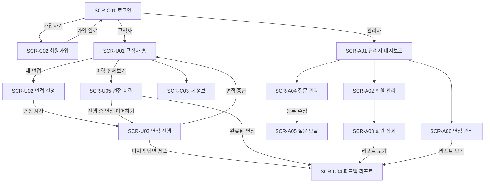

# AI 모의면접 플랫폼 MVP 화면정의서

| 항목 | 내용 |
|---|---|
| 문서 버전 | v1.0 |
| 작성일 | 2026-10-25 |
| 작성자 | 성준 |
| 관련 문서 | [기능정의서](./기능정의서.md) (기능 ID는 기능정의서 3장 참고) |

---

## 1. 화면 목록

| 화면 ID | 화면명 | 경로 | 사용자 | 관련 기능 |
|---|---|---|---|---|
| SCR-C01 | 로그인 | `/login` | 비회원 | AUTH-02 |
| SCR-C02 | 회원가입 | `/signup` | 비회원 | AUTH-01 |
| SCR-C03 | 내 정보 | `/me` | 로그인 | AUTH-03~06 |
| SCR-U01 | 구직자 홈 | `/` | 구직자 | INT-09, INT-10, RPT-02 |
| SCR-U02 | 면접 설정 | `/interviews/new` | 구직자 | INT-01, INT-02 |
| SCR-U03 | 면접 진행 | `/interviews/:id` | 구직자 | INT-03~08 |
| SCR-U04 | 피드백 리포트 | `/interviews/:id/report` | 구직자, 관리자 | RPT-01~03 |
| SCR-U05 | 면접 이력 | `/interviews` | 구직자 | INT-09 |
| SCR-A01 | 관리자 대시보드 | `/admin` | 관리자 | ADM-01 |
| SCR-A02 | 회원 관리 | `/admin/users` | 관리자 | ADM-02, ADM-03 |
| SCR-A03 | 회원 상세 | `/admin/users/:id` | 관리자 | ADM-02, ADM-03 |
| SCR-A04 | 질문 관리 | `/admin/questions` | 관리자 | QST-03~05 |
| SCR-A05 | 질문 등록·수정 (모달) | SCR-A04 위 모달 | 관리자 | QST-04 |
| SCR-A06 | 면접 관리 | `/admin/interviews` | 관리자 | ADM-04 |

> 관리자의 리포트 열람은 SCR-U04를 같이 쓴다. 관리자가 열면 상단에 응시자 이름과 [목록으로] 버튼이 추가된다.

---

## 2. 화면 흐름도



---

## 3. 공통 UI 규칙

| 구분 | 규칙 |
|---|---|
| 해상도 | 데스크톱 우선 (최소 1280px). 모바일은 MVP 범위에서 제외 |
| 레이아웃 | 상단 헤더 + 본문. 관리자 화면은 좌측 사이드바 추가 |
| 헤더 (구직자) | 로고(홈 이동), [새 면접], [면접 이력], 이름 드롭다운([내 정보], [로그아웃]) |
| 사이드바 (관리자) | 대시보드, 회원 관리, 질문 관리, 면접 관리. 하단 [로그아웃] |
| 권한 처리 | 비로그인 상태로 보호 화면 접근 → SCR-C01. 구직자가 `/admin` 접근 → SCR-U01. 토큰 만료 → "다시 로그인해주세요." 후 SCR-C01 |
| 로딩 | 1초 이상 걸리는 요청은 버튼을 비활성화하고 스피너 표시. LLM 대기는 안내 문구 표시 (SCR-U03 참고) |
| 오류 | 입력 오류는 입력창 아래 빨간 문구, 서버 오류는 화면 상단 토스트 ("잠시 후 다시 시도해주세요.") |
| 확인 창 | 되돌릴 수 없는 동작(면접 중단, 회원 탈퇴, 질문 삭제)은 확인 모달을 거친다 |
| 빈 상태 | 목록이 비면 안내 문구와 다음 행동 버튼을 보여준다 (예: "아직 본 면접이 없어요" + [첫 면접 시작하기]) |
| 디자인 참고 | 외부 서비스 디자인을 참고해 색상·폰트를 정한다. 폰트 기본값은 Pretendard |

---

## 4. 화면 상세

와이어프레임의 `[n]` 번호는 아래 구성 요소 표의 번호와 같다.

### SCR-C01 로그인

```
┌──────────────────────────────────────────────
│                 AI 모의면접
│
│     [1] 이메일      ┌──────────────────┐
│     [2] 비밀번호    ┌──────────────────┐
│     [3] ( 로그인 )
│     [4] 아직 회원이 아니신가요? 회원가입
└──────────────────────────────────────────────
```

| No | 요소 | 타입 | 설명·규칙 |
|---|---|---|---|
| 1 | 이메일 | 입력 | 이메일 형식 검사 |
| 2 | 비밀번호 | 입력(password) | Enter 키로 로그인 |
| 3 | 로그인 | 버튼 | 둘 다 입력해야 활성화. 성공 시 역할별 홈으로 이동 |
| 4 | 회원가입 | 링크 | SCR-C02로 이동 |

| 이벤트 | 결과 |
|---|---|
| 로그인 실패 | [2] 아래 "이메일 또는 비밀번호가 올바르지 않습니다." |
| 비활성 계정 | "이용이 제한된 계정입니다." |

### SCR-C02 회원가입

```
┌──────────────────────────────────────────────
│                 회원가입
│     [1] 이메일          ┌──────────────────┐
│     [2] 비밀번호        ┌──────────────────┐   8자 이상, 영문+숫자
│     [3] 비밀번호 확인   ┌──────────────────┐
│     [4] 이름            ┌──────────────────┐
│     [5] ( 가입하기 )
│     [6] 이미 계정이 있으신가요? 로그인
└──────────────────────────────────────────────
```

| No | 요소 | 타입 | 설명·규칙 |
|---|---|---|---|
| 1 | 이메일 | 입력 | 포커스가 빠질 때 형식 검사. 중복은 제출 시 서버 응답으로 표시 |
| 2 | 비밀번호 | 입력(password) | 8자 이상, 영문+숫자. 조건 미충족 시 안내 문구 |
| 3 | 비밀번호 확인 | 입력(password) | [2]와 다르면 "비밀번호가 일치하지 않습니다." |
| 4 | 이름 | 입력 | 1~20자 |
| 5 | 가입하기 | 버튼 | 모든 검사 통과 시 활성화. 성공 시 토스트 "가입이 완료되었습니다." 후 SCR-C01 |
| 6 | 로그인 | 링크 | SCR-C01로 이동 |

### SCR-C03 내 정보

```
┌──────────────────────────────────────────────
│ 헤더
├──────────────────────────────────────────────
│  내 정보
│   [1] 이메일   user@example.com (수정 불가)
│   [2] 이름     ┌──────────┐  [3] ( 저장 )
│
│  비밀번호 변경
│   [4] 현재 비밀번호 / 새 비밀번호 / 새 비밀번호 확인
│   [5] ( 비밀번호 변경 )
│
│  [6] 회원 탈퇴 (구직자만 표시)
└──────────────────────────────────────────────
```

| No | 요소 | 타입 | 설명·규칙 |
|---|---|---|---|
| 1 | 이메일 | 텍스트 | 읽기 전용 |
| 2~3 | 이름, 저장 | 입력, 버튼 | 값이 바뀌면 [3] 활성화 |
| 4~5 | 비밀번호 변경 | 입력, 버튼 | 규칙은 SCR-C02와 같음. 현재 비밀번호가 틀리면 오류 문구 |
| 6 | 회원 탈퇴 | 텍스트 버튼 | 확인 모달: "면접 기록과 녹음 파일이 모두 삭제되며 되돌릴 수 없습니다." + 비밀번호 입력 + [탈퇴하기]. 완료 후 SCR-C01 |

### SCR-U01 구직자 홈

```
┌──────────────────────────────────────────────
│ 헤더
├──────────────────────────────────────────────
│  [1] 안녕하세요, 성준님
│  [2] ( + 새 모의면접 시작하기 )
│
│  [3] 진행 중인 면접 (있을 때만)
│      백엔드 개발 · 보통 · 2/5 진행      ( 이어하기 )
│
│  [4] 최근 면접                         [5] 전체보기 >
│   ┌ 10/24 백엔드 개발 · 보통 · 78점 ┐ ┌ 10/22 … ┐ ┌ … ┐
│
│  [6] 내 점수 추이 (완료된 면접 2개 이상일 때)
│      개념 이해도 / 문제 해결력 / 커뮤니케이션 선 그래프
└──────────────────────────────────────────────
```

| No | 요소 | 타입 | 설명·규칙 |
|---|---|---|---|
| 1 | 인사말 | 텍스트 | 로그인 사용자 이름 |
| 2 | 새 면접 | 버튼 | SCR-U02로 이동 |
| 3 | 진행 중인 면접 | 카드 | `in_progress` 면접이 있을 때만 표시. [이어하기] → SCR-U03 |
| 4 | 최근 면접 | 카드 목록 | 최근 3개. 날짜, 직무, 난이도, 종합 점수(생성 중이면 "리포트 생성 중"). 클릭 → SCR-U04 |
| 5 | 전체보기 | 링크 | SCR-U05로 이동 |
| 6 | 점수 추이 | 선 그래프 | 최근 10개 완료 면접의 항목별 점수 (INT-10, 선택 기능) |

### SCR-U02 면접 설정

```
┌──────────────────────────────────────────────
│ 헤더
├──────────────────────────────────────────────
│  모의면접 설정
│   [1] 직무        ▼ 백엔드 개발
│   [2] 질문 유형   ( 기술 ) ( 인성 ) (● 혼합 )
│   [3] 난이도      ( 쉬움 ) (● 보통 ) ( 어려움 )
│   [4] 본질문 수   ◀ 5 ▶   (3~10개, 꼬리질문은 별도)
│
│   [5] 안내
│     · 답변은 텍스트로 입력하거나 음성으로 녹음할 수 있어요.
│     · 음성 답변은 최대 3분이며, 변환된 텍스트를 고친 뒤 제출해요.
│     · 면접관이 답변을 검토하는 데 최대 10초쯤 걸릴 수 있어요.
│
│   [6] ( 면접 시작 )
└──────────────────────────────────────────────
```

| No | 요소 | 타입 | 설명·규칙 |
|---|---|---|---|
| 1 | 직무 | 드롭다운 | `GET /interviews/options`의 직무 목록 |
| 2 | 질문 유형 | 라디오 | 기본 '혼합' |
| 3 | 난이도 | 라디오 | 기본 '보통' |
| 4 | 본질문 수 | 숫자 스테퍼 | 3~10, 기본 5 |
| 5 | 안내 | 텍스트 | 고정 문구 |
| 6 | 면접 시작 | 버튼 | 클릭 시 마이크 권한을 미리 요청(거부해도 진행 가능) → `POST /interviews` → SCR-U03 |

| 이벤트 | 결과 |
|---|---|
| 질문 부족 | [6] 아래 "선택한 조건의 질문이 부족합니다. 조건을 바꿔주세요." |
| 진행 중 면접 있음 | 확인 모달: "진행 중인 면접이 있어요. 새로 시작하면 이전 면접은 중단됩니다." |

### SCR-U03 면접 진행

```
┌──────────────────────────────────────────────
│ [1] 백엔드 개발 · 보통      본질문 2 / 5  ■■□□□      [2] ( 면접 중단 )
├──────────────────────────────────────────────
│  [3] 대화 영역
│   🤖 면접관  Q1. 자기소개와 지원 동기를 말씀해주세요.
│   🙂 나      저는 3년간 …
│   🤖 면접관  Q2. MSA를 도입한 경험이 있나요?
│   🙂 나      네, 주문 서비스를 …
│   🤖 면접관  ↳ 꼬리질문  그때 트랜잭션은 어떻게 관리하셨나요?
│
│  [4] (대기 중일 때) ⏳ 면접관이 답변을 검토하고 있어요…
├──────────────────────────────────────────────
│  [5] 답변 입력
│   ┌────────────────────────────────────────
│   │ 답변을 입력하거나 녹음 버튼을 눌러주세요.            0 / 2000
│   └────────────────────────────────────────
│   [6] ( 🎤 녹음 시작 )  02:41 남음      [7] ( 답변 제출 )
└──────────────────────────────────────────────
```

| No | 요소 | 타입 | 설명·규칙 |
|---|---|---|---|
| 1 | 진행 정보 | 텍스트, 진행 바 | 직무, 난이도, 본질문 진행률. 꼬리질문은 진행률에 포함하지 않음 |
| 2 | 면접 중단 | 버튼 | 확인 모달 "중단하면 리포트가 만들어지지 않아요." → `POST /abort` → SCR-U01 |
| 3 | 대화 영역 | 채팅 목록 | 질문(왼쪽)과 답변(오른쪽)을 순서대로 표시. 꼬리질문은 `↳ 꼬리질문` 라벨. 새 메시지가 오면 아래로 자동 스크롤 |
| 4 | 대기 표시 | 로딩 말풍선 | 답변 제출 후 다음 질문을 받을 때까지 표시. 이 동안 [5]~[7] 비활성 |
| 5 | 답변 입력창 | 여러 줄 입력 | 1~2,000자. 글자 수 표시. STT 결과가 여기에 채워짐 |
| 6 | 녹음 | 토글 버튼 | 아래 '녹음 상태' 표 참고 |
| 7 | 답변 제출 | 버튼 | 입력창이 비어 있지 않을 때 활성화. Ctrl+Enter로도 제출 |

녹음 상태:

| 상태 | [6] 표시 | 동작 |
|---|---|---|
| 대기 | 🎤 녹음 시작 | 클릭 → 녹음 시작 |
| 녹음 중 | ⏹ 녹음 종료 · 남은 시간 | 빨간 점 깜빡임. 3분이 되면 자동 종료 |
| 변환 중 | ⏳ 음성을 텍스트로 바꾸는 중 | 업로드와 STT 진행. [5], [7] 비활성 |
| 변환 완료 | 🎤 다시 녹음 | 결과를 [5]에 채우고 "변환된 내용을 확인하고 고친 뒤 제출해주세요." 안내 |

| 이벤트 | 결과 |
|---|---|
| 마이크 권한 거부 | 토스트 "마이크 권한이 필요합니다. 텍스트로 답변할 수도 있어요." [6] 비활성 |
| 인식 결과 없음 | "음성을 인식하지 못했습니다. 다시 녹음해주세요." |
| 마지막 답변 제출 | "면접이 끝났어요. 리포트를 만들고 있어요." 후 SCR-U04로 이동 |
| 새로고침·재접속 | `GET /interviews/{id}`로 대화를 다시 불러와 마지막 미답변 질문부터 이어서 진행 |

### SCR-U04 피드백 리포트

생성 중 상태:
```
┌──────────────────────────────────────────────
│ 헤더
├──────────────────────────────────────────────
│        ⏳ 리포트를 만들고 있어요 (보통 1~3분)
│        문항별 평가 2 / 5 완료
│        [8] (실패 시) 리포트 생성에 실패했어요. ( 다시 만들기 )
└──────────────────────────────────────────────
```

완료 상태:
```
┌──────────────────────────────────────────────
│ 헤더                                (관리자: 응시자 성준 · ( 목록으로 ))
├──────────────────────────────────────────────
│  [1] 2026-10-24 · 백엔드 개발 · 보통 · 본질문 5개 · 소요 18분
│
│  [2] 종합 점수  78 / 100        [3] 항목별 점수 (레이더 차트)
│                                     개념 이해도 4.2 / 문제 해결력 3.6 / 커뮤니케이션 3.9
│  [4] 종합 평가
│      기술 개념은 정확하지만 경험을 구조화해 설명하는 연습이 필요합니다.
│  [5] 강점 ✓ … ✓ … ✓ …          개선점 △ … △ … △ …
│
│  [6] 문항별 피드백
│   ▼ Q1. 자기소개와 지원 동기를 말씀해주세요.       4 · 3 · 4
│      내 답변: 저는 …     [▶ 녹음 듣기]
│      ↳ 꼬리질문: …   내 답변: …
│      피드백: …
│      [7] 모범 답변 예시 보기 ▸
│   ▶ Q2. MSA를 도입한 경험이 있나요?               3 · 3 · 4
│   ▶ …
│
│  ( 새 면접 시작하기 )   ( 면접 이력 )
└──────────────────────────────────────────────
```

| No | 요소 | 타입 | 설명·규칙 |
|---|---|---|---|
| 1 | 면접 정보 | 텍스트 | 날짜, 직무, 난이도, 본질문 수, 소요 시간 |
| 2 | 종합 점수 | 숫자 강조 | 100점 환산 |
| 3 | 항목별 점수 | 레이더 차트 + 숫자 | 5점 척도 세 항목 |
| 4 | 종합 평가 | 텍스트 | LLM 요약 |
| 5 | 강점·개선점 | 목록 | 각 3개 |
| 6 | 문항별 피드백 | 아코디언 | 첫 문항만 펼침. 헤더에 세 항목 점수. 음성 답변이면 [녹음 듣기] |
| 7 | 모범 답변 | 접기·펼치기 | 기본 접힘 |
| 8 | 다시 만들기 | 버튼 | `failed`일 때만 표시. `POST /report/retry` 후 생성 중 상태로 전환 |

| 이벤트 | 결과 |
|---|---|
| 생성 중 | 3초마다 상태 조회. `done`이 되면 완료 화면으로 전환 |
| 중단된 면접 | "중단된 면접은 리포트가 없어요." + [면접 이력] |
| 다른 사람의 리포트 접근 | 403 → "접근 권한이 없습니다." 후 SCR-U01 |

### SCR-U05 면접 이력

```
┌──────────────────────────────────────────────
│ 헤더
├──────────────────────────────────────────────
│  면접 이력        [1] 상태 ▼ 전체   직무 ▼ 전체
│  ┌──────┬──────────┬──────┬──────┬──────────┬───────
│  │ 날짜 │ 직무     │ 난이도│ 점수 │ 상태     │
│  ├──────┼──────────┼──────┼──────┼──────────┼───────
│  │10/24 │ 백엔드   │ 보통 │ 78   │ 완료     │ (리포트)
│  │10/23 │ 백엔드   │ 쉬움 │ -    │ 진행 중  │ (이어하기)
│  │10/22 │ 프론트   │ 보통 │ -    │ 중단     │
│  └──────┴──────────┴──────┴──────┴──────────┴───────
│  [2] < 1 2 3 >
└──────────────────────────────────────────────
```

| No | 요소 | 타입 | 설명·규칙 |
|---|---|---|---|
| 1 | 필터 | 드롭다운 | 상태(전체/완료/진행 중/중단), 직무 |
| 표 | 면접 목록 | 표 | 최신순. 완료 → [리포트] (SCR-U04), 진행 중 → [이어하기] (SCR-U03), 리포트 생성 중이면 점수 칸에 "생성 중" |
| 2 | 페이지 | 페이지네이션 | 10개씩 |

### SCR-A01 관리자 대시보드

```
┌────────────┬─────────────────────────────────
│ [사이드바] │  대시보드
│ 대시보드   │  [1] ┌ 전체 회원 ┐ ┌ 전체 면접 ┐ ┌ 오늘 면접 ┐ ┌ 평균 점수 ┐
│ 회원 관리  │      │   42      │ │   130     │ │    5      │ │   71.4    │
│ 질문 관리  │
│ 면접 관리  │  [2] 최근 7일 면접 수 (막대 그래프)
│            │  [3] 직무별 평균 점수 (가로 막대 그래프)
│ 로그아웃   │  [4] 최근 면접 10건   (이름 · 직무 · 점수 · 상태 · 리포트)
└────────────┴─────────────────────────────────
```

| No | 요소 | 타입 | 설명·규칙 |
|---|---|---|---|
| 1 | 요약 카드 | 숫자 카드 | 전체 회원(구직자), 전체 면접, 오늘 면접, 완료 면접 평균 점수 |
| 2 | 면접 수 추이 | 막대 그래프 | 최근 7일 일별 |
| 3 | 직무별 평균 | 가로 막대 그래프 | 완료 면접 기준 |
| 4 | 최근 면접 | 표 | 클릭 → SCR-U04 |

### SCR-A02 회원 관리

```
┌────────────┬─────────────────────────────────
│ [사이드바] │  회원 관리   [1] 🔍 이름·이메일 검색      [2] 상태 ▼ 전체
│            │  ┌──────┬────────────────┬────────┬────────┬──────┬──────
│            │  │ 이름 │ 이메일         │ 가입일 │ 면접 수│ 상태 │
│            │  │ 성준 │ a@example.com  │ 10/20  │ 4      │ 활성 │ (상세)
│            │  └──────┴────────────────┴────────┴────────┴──────┴──────
│            │  [3] < 1 2 3 >
└────────────┴─────────────────────────────────
```

| No | 요소 | 타입 | 설명·규칙 |
|---|---|---|---|
| 1 | 검색 | 입력 | 이름 또는 이메일 부분 일치. Enter로 검색 |
| 2 | 상태 필터 | 드롭다운 | 전체/활성/비활성 |
| 표 | 회원 목록 | 표 | 구직자만 표시. 행 클릭 또는 [상세] → SCR-A03 |
| 3 | 페이지 | 페이지네이션 | 20개씩 |

### SCR-A03 회원 상세

```
┌────────────┬─────────────────────────────────
│ [사이드바] │  < 회원 관리
│            │  [1] 성준 · a@example.com · 가입 2026-10-20     [2] 상태 (● 활성)
│            │  [3] 면접 4회 · 평균 74점 · 최근 면접 10/24
│            │  [4] 면접 이력 (SCR-U05와 같은 표, [리포트] → SCR-U04)
└────────────┴─────────────────────────────────
```

| No | 요소 | 타입 | 설명·규칙 |
|---|---|---|---|
| 1 | 회원 정보 | 텍스트 | 이름, 이메일, 가입일 |
| 2 | 활성 상태 | 토글 | 비활성으로 바꿀 때 확인 모달 "이 회원은 로그인할 수 없게 됩니다." |
| 3 | 요약 | 텍스트 | 면접 수, 평균 점수, 최근 면접일 |
| 4 | 면접 이력 | 표 | 해당 회원의 면접 목록 |

### SCR-A04 질문 관리

```
┌────────────┬─────────────────────────────────
│ [사이드바] │  질문 관리                                 [1] ( + 질문 등록 )
│            │  [2] 직무 ▼  유형 ▼  난이도 ▼  🔍 키워드
│            │  [3] 🧭 유사 질문 검색: ┌ 문장을 입력하세요 ┐ ( 검색 )
│            │  ┌────┬──────────────────────────┬────────┬────┬──────┬──────
│            │  │ ID │ 질문                     │ 직무   │유형│난이도│
│            │  │ 12 │ MSA를 도입한 경험이 …    │ 백엔드 │기술│ 보통 │ (수정)(삭제)
│            │  └────┴──────────────────────────┴────────┴────┴──────┴──────
│            │  [4] < 1 2 3 … >      총 3,214개
└────────────┴─────────────────────────────────
```

| No | 요소 | 타입 | 설명·규칙 |
|---|---|---|---|
| 1 | 질문 등록 | 버튼 | SCR-A05 모달(등록 모드) |
| 2 | 필터·키워드 | 드롭다운, 입력 | 조건을 바꾸면 1페이지부터 다시 조회 |
| 3 | 유사 질문 검색 | 입력, 버튼 | 벡터 검색 결과를 표에 유사도 열(예: 0.87)과 함께 표시. [초기화]로 일반 목록 복귀 |
| 표 | 질문 목록 | 표 | 질문은 한 줄로 줄이고 마우스를 올리면 전체 표시. [수정] → SCR-A05(수정 모드). [삭제] → 확인 모달 후 비활성화 |
| 4 | 페이지 | 페이지네이션 | 20개씩, 총 개수 표시 |

### SCR-A05 질문 등록·수정 (모달)

```
┌ 질문 등록 ─────────────────────────────
│ [1] 질문 ┌────────────────────────────
│          │
│          └────────────────────────────
│ [2] 직무 ▼   [3] 유형 ( 기술 ) ( 인성 )   [4] 난이도 ( 쉬움 ) ( 보통 ) ( 어려움 )
│ [5] 비슷한 질문 (입력 후 자동 표시)
│     · 0.91  MSA 도입 시 어려웠던 점은?  (ID 12)
│ [6] ( 취소 )  ( 저장 )
└────────────────────────────────────────
```

| No | 요소 | 타입 | 설명·규칙 |
|---|---|---|---|
| 1 | 질문 | 여러 줄 입력 | 5~500자 |
| 2~4 | 직무, 유형, 난이도 | 드롭다운, 라디오 | 필수 |
| 5 | 비슷한 질문 | 목록 | 입력을 멈추고 1초 뒤 유사 질문 상위 3개 표시. 유사도 0.9 이상이면 "중복일 수 있어요" 경고 (저장은 가능) |
| 6 | 취소, 저장 | 버튼 | 저장 시 임베딩을 다시 만들고 목록 새로고침, 토스트 "저장되었습니다." |

### SCR-A06 면접 관리

```
┌────────────┬─────────────────────────────────
│ [사이드바] │  면접 관리   [1] 상태 ▼  직무 ▼  기간 ┌10/01┐~┌10/25┐  🔍 응시자
│            │  ┌──────┬──────┬────────┬──────┬──────┬──────────┬──────
│            │  │ 날짜 │ 응시자│ 직무   │난이도│ 점수 │ 리포트   │
│            │  │10/24 │ 성준 │ 백엔드 │ 보통 │ 78   │ 완료     │ (보기)
│            │  │10/24 │ 민지 │ 데이터 │ 쉬움 │ -    │ 실패     │ (다시 만들기)
│            │  └──────┴──────┴────────┴──────┴──────┴──────────┴──────
│            │  [2] < 1 2 3 >
└────────────┴─────────────────────────────────
```

| No | 요소 | 타입 | 설명·규칙 |
|---|---|---|---|
| 1 | 필터 | 드롭다운, 날짜, 입력 | 면접 상태, 직무, 기간, 응시자 이름 |
| 표 | 면접 목록 | 표 | [보기] → SCR-U04. 리포트가 `failed`이면 [다시 만들기] |
| 2 | 페이지 | 페이지네이션 | 20개씩 |
